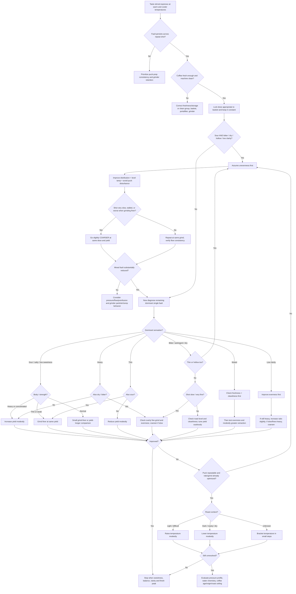

# Causal Foundation of Espresso Extraction for Sensory Diagnosis

## Executive summary

A useful espresso-diagnosis model should **not** map a taste directly to a machine setting. The more reliable causal chain is:

**control variable → puck/extraction state → chemical/physical cup state → sensory descriptor.**

For practical dialing-in, the most important intermediate states are **beverage strength/concentration**, **overall extraction**, and especially **extraction evenness**. Barista Hustle's Espresso Compass captures the first two dimensions: increasing beverage yield normally raises extraction while lowering strength, whereas decreasing yield raises strength while lowering extraction. Moving to a genuinely better region of the Compass usually requires changing grind and, critically, improving extraction evenness rather than simply lengthening the shot. citeturn46view0turn46view2

That leads to six high-level conclusions.

**First, dose should normally be treated as a constraint, not a taste-control knob.** Barista Hustle's recipe hierarchy—**dose first, yield second, time/grind third**—is causally clean because changing dose changes puck depth, resistance, saturation behavior, strength, extraction yield, and evenness simultaneously. Dose should usually remain fixed near the basket's intended capacity while flavor is dialed with yield and grind. citeturn46view1turn49view2

**Second, yield/brew ratio is the safest macro adjustment.** At fixed dose, more beverage yield generally means more complete extraction but lower concentration; less yield means greater concentration/body but less complete extraction. Thus a **strong, heavy, sour espresso** often benefits from a modestly longer ratio, while a **thin but otherwise clean espresso** may benefit from a shorter ratio. Yield changes cannot, however, simultaneously increase both strength and extraction. citeturn46view2turn50view0

**Third, grind is the principal micro-adjustment because it can improve both extraction and strength—until it cannot.** Finer grinding normally increases surface area, slows flow, and raises strength/extraction; this is why a thin+sour shot at an appropriate yield is often best corrected by grinding finer. But beyond a critical fineness, nonuniform flow can increase and extraction can fall. Both Barista Hustle and fluid-dynamics research describe this reversal: pushing finer can produce low-permeability regions and preferential pathways, making the cup simultaneously sour, bitter/astringent, hollow, and unclear. citeturn50view1turn50view2turn49view3

**Fourth, mixed faults are usually more informative than single faults.** Simultaneous **sourness + bitterness**, particularly with low sweetness, hollowness, or low clarity, is much stronger evidence for **uneven extraction/channeling or grinding beyond the useful fineness limit** than for a simple global state of "underextracted" or "overextracted." The Espresso Compass explicitly identifies simultaneous bitter+sour+low-strength espresso with lower, less-even extraction regions. citeturn46view0turn50view0

**Fifth, time is predominantly a diagnostic consequence of grind and hydraulics, not an independent target.** Barista Hustle explicitly ranks time below dose and yield and cautions that extraction is not linear with shot time. Fast shots tend to be lighter-bodied and more acidic, and very slow shots often become harsh, but a particular second count is not itself proof of good or bad extraction. citeturn49view2turn50view1

**Sixth, sensory terms have unequal causal specificity.** Sour, bitter, salty, and basic mouthfeel terms can be anchored to standardized sensory vocabulary; World Coffee Research's Sensory Lexicon provides explicit references for Sour, Bitter, and Salty among its 110 sensory attributes. By contrast, terms such as **hollow, muted, low clarity, dry finish, and finish duration** are useful professional descriptors but are not single chemical variables. They are best treated as compound diagnostic signals. citeturn49view1

The resulting priority order for an unknown espresso is therefore:

**sanitation/freshness → fixed appropriate dose → puck evenness → yield/brew ratio → grind → temperature → pressure/flow profile → coffee/water reassessment.**

That order is intentionally different from the common habit of "make it sour → grind finer; make it bitter → grind coarser." The latter works only when the puck is already extracting reasonably evenly. Once channeling dominates, either direction can make the flavor worse. Extraction models and recent espresso-flow research reinforce why: permeability, porosity, puck deformation, particle aggregation, and the development of preferential pathways make espresso a nonlinear porous-flow system rather than a simple timer-controlled dissolution process. citeturn49view3turn49view5turn52academia5

### Evidence notation used below

**Causal strength** describes how strongly a factor can normally move the stated sensory result under café conditions: **3 = strong/first-order**, **2 = moderate/context-dependent**, **1 = weak/secondary or mainly diagnostic**.

**Confidence** describes the evidence behind the link: **H = high**, supported by direct espresso evidence or strong convergence between espresso practice and physical research; **M = moderate**, supported by adjacent controlled sensory work, extraction physics, or convergent expert practice; **L = low**, mainly empirical/professional inference with little controlled descriptor-specific research.

Thus **3/H** means "strong causal lever, high confidence"; **1/L** means "possible secondary link, weak evidence." Absence of a descriptor from a factor row should be read as **no dependable first-order link**, not proof of zero effect.

## Causal model and extraction-variable map

### The latent variables that actually govern diagnosis

The Barista Hustle framework becomes considerably more powerful when its Compass is expanded from two axes into five latent states.

| Latent state | What it means | Strong sensory signals | Main controls |
|---|---|---|---|
| **Extraction completeness** | How much of the readily and progressively soluble material has been removed overall | Sour/salty/low sweetness at low end; increasing roast/bitter/dry components toward higher extraction, depending on coffee | Yield, useful grind fineness, temperature |
| **Strength / concentration** | Amount of dissolved coffee per beverage mass | Thin/weak at low concentration; heavy/intense/viscous at high concentration | Brew ratio, grind, evenness |
| **Extraction evenness** | Uniformity of water access and local extraction throughout puck | Mixed sour+bitter, hollow, low clarity, drying, inconsistency | Distribution, level tamp, grind regime, channeling control, basket/puck hydraulics |
| **Coffee baseline** | Chemistry already established by origin, processing, roast and age | Bright acidity, roastiness, bitterness, aromatics, sweetness potential | Coffee selection, roast level, age/storage |
| **Extraneous sensory load** | Material not representative of intended extraction | Rancid bitterness, muted/dirty flavor, excess foam effects | Cleaning, water, crema handling |

This distinction matters because **the same measured extraction yield can conceal very different spatial distributions of extraction**. Barista Hustle notes that improving evenness can raise both extraction and beverage strength at unchanged dose and yield; conversely, uneven extraction leaves some particles contributing disproportionately little. Physics models likewise show that below a critical grind size, small initial differences in permeability can amplify into highly unequal flow paths and reduced total extraction. citeturn50view0turn49view3

Recent microtomography and flow simulations provide the physical foundation for that barista observation. Coffee-bed microstructure determines permeability and tortuosity, while espresso-scale pressure gradients can produce important inertial and erosion effects; post-extraction pucks develop nonuniform porosity profiles. Newer controlled café-machine work further shows a nonlinear pressure-flow relationship caused by the interaction of puck elasticity, porosity, dissolution, and flow. These studies do **not** prove a direct "pressure X tastes bitter" rule, but they strongly support treating pressure and puck structure as mediators of extraction uniformity rather than isolated flavor knobs. citeturn52academia5turn49view5

### Factor-by-factor causal map

| Factor | Principal causal mechanism | Sensory states it tends to produce | What the opposite/better-controlled state tends to mitigate | Strength / confidence |
|---|---|---|---|---|
| **Dose** | Alters puck depth, resistance, saturation and recipe ratio if yield is not scaled. Excessive dose relative to basket can impair evenness. | Excess dose/headspace error: sour, hollow, mixed sour+bitter, low clarity; changing dose ad hoc makes all diagnosis noisy. | Keep dose fixed and appropriate to basket; scale yield if dose intentionally changes. | **2/H** for extraction behavior; **1/M** for individual flavors. Barista Hustle explicitly warns that dose changes alter flow, saturation, temperature, extraction, strength and evenness. citeturn46view1 |
| **Beverage yield** | At fixed dose, more water raises extraction while diluting concentration. | Too short: sour, salty-like, low sweetness, heavy, sometimes hollow. Too long: thin, weak/fast finish; in some coffees greater exposure to slower-extracting bitter/roast compounds. | Increase yield for strong/heavy/underdeveloped shots; reduce it for clean-but-thin shots or where later fractions degrade flavor. | **3/H.** This is the core Espresso Compass macro lever. citeturn46view0turn46view2 |
| **Brew ratio** | Normalizes yield to dose; operationally expresses the same extraction-versus-strength compromise. | Short ratio: heavy/high intensity with greater risk of sour/low sweetness. Long ratio: lighter body and potentially greater extraction/clarity, eventually dilution. | Move ratio incrementally toward the missing dimension: more yield for completeness; less for strength. | **3/H.** citeturn50view0 |
| **Grind size** | Changes surface area, permeability, flow time and particle-scale extraction. Relationship becomes nonlinear when very fine. | Coarse/fast: thin, sour, salty-like, low sweetness, fast finish. Progressively finer: sweeter/full-bodied until optimum. Too fine: astringent, dry, mixed sour+bitter, hollow, low clarity and sometimes weaker extraction through uneven flow. | Finer for evenly flowing thin+sour shots; **coarser** when the puck is beyond the diminishing-return/channeling threshold. | **3/H.** BH and published flow modeling converge. citeturn50view1turn50view2turn49view3 |
| **Extraction time** | Proxy for contact time and puck resistance; mostly governed by grind, dose, pressure/flow and basket. | Very fast commonly accompanies thin, sour, weak shots. Very slow commonly accompanies heavy, bitter/harsh/dry shots—but either can be delicious under nontraditional profiles. | Diagnose *why* time changed rather than forcing a prescribed number. | **2/H** diagnostically; **1/M** as an independent cause. BH explicitly calls time least important of dose/yield/time and notes time–extraction nonlinearity. citeturn49view2 |
| **Water temperature** | Alters dissolution kinetics and therefore achievable extraction at a given hydraulic recipe; temperature can also change which compounds reach the cup. | Too low for a difficult/light coffee: sour, low sweetness, muted. High temperature in a highly soluble/dark coffee may accentuate bitter, roasty, acrid or dry qualities. | Increase modestly after evenness/recipe are sound when sourness persists; lower modestly for persistent roast/dry harshness. | **2/M.** Temperature effects are real, but part of their sensory effect is mediated through extraction rather than temperature itself; therefore it should normally follow ratio/grind in the adjustment hierarchy. |
| **Pressure profile** | Alters flow, puck compaction/deformation and evolution of permeability. | Aggressive hydraulics in a vulnerable puck can accentuate nonuniformity; pressure alone has no universal "bitter" or "sour" sign. | Gentler pre-wetting/preinfusion or lower-pressure profiles can improve robustness in some grind regimes, but effects are machine- and puck-specific. | Hydraulic mechanism **2/H**; specific sensory link **1–2/M-L**. Recent espresso physics confirms nonlinear pressure-flow coupling. citeturn49view5turn49view2 |
| **Puck preparation / tamping** | Establishes puck geometry and local resistance before flow begins. Levelness is especially important. | Tilt, cracks or disturbed puck: channeling → mixed sour/bitter, hollow, low sweetness, dry/astringent, low clarity. | Flat, repeatable tamp after good distribution; avoid disturbing the puck after tamping. | **3/M-H.** BH explicitly places level tamping in its evenness protocol. citeturn50view0 |
| **Distribution** | Determines initial density uniformity and therefore local permeability. | Poor distribution: all major mixed-extraction faults—sour+bitter, astringent, hollow, thin/weak despite slow shot, low sweetness and low clarity. | Homogeneous distribution before tamping. | **3/H** as an evenness lever; descriptor-specific evidence **M**. citeturn50view0turn49view3 |
| **Channeling** | Preferential flow extracts some regions rapidly while bypassing or under-wetting others. | **Mixed sourness+bitterness is the signature combination**; also hollow, astringent/dry, low sweetness, low clarity, variable body and shot-to-shot inconsistency. | Correct distribution/puck integrity; avoid unnecessarily fine grind; stabilize flow. | **3/H.** The Espresso Compass and porous-flow research strongly converge here. citeturn46view0turn49view3 |
| **Roast level** | Changes intrinsic flavor chemistry, fragility and solubility before brewing. | Lighter profiles more readily present acidity and can require more extraction work; darker profiles tend to carry stronger roast-derived sensory load and often extract more readily, increasing risk of roasty/bitter/dry intensity. | Adapt ratio, grind and temperature rather than forcing one universal recipe. | **3/H** for baseline flavor; **2/M** for exact espresso adjustment magnitude. Modern specialty practice spans light through dark espresso rather than a single "espresso roast." citeturn48view6 |
| **Bean age** | Degassing and subsequent aroma loss change puck behavior and sensory intensity over time. | Extremely fresh coffee can be harder to wet reproducibly and highly foamy; older coffee generally loses aromatic intensity and can present muted, hollow/shorter finishes. | Use roast-date/age consistently during dialing; interpret age jointly with storage. | **2/M-L** for descriptor-specific causality. Roast date is therefore useful contextual information rather than a direct extraction variable. citeturn48view6 |
| **Freshness / storage** | Oxidation and volatile loss alter the coffee independent of extraction. | Muted, low sweetness, hollow, lower aromatic clarity, fast/abrupt finish; stale roast character can be mistaken for extraction bitterness. | Compare with a known-fresh, well-stored sample before making extreme machine changes. | **2/M** overall; **1–2/L-M** by descriptor. |
| **Crema stability** | Primarily a foam/degassing/hydraulic indicator, not a direct extraction-quality score. | Large or stable crema can alter perceived texture and concentrate bitter/dry foam sensations; weak crema can accompany older beans but does not prove poor extraction. | Stir espresso before comparative tasting so foam stratification does not become a confounder. | **1/L-M.** Treat crema mostly as a diagnostic proxy, not a flavor-setting variable. |
| **Machine cleanliness** | Old coffee oils and residues introduce compounds unrelated to the current puck; scale can destabilize temperature/flow. | Persistent bitter, rancid, roasty, dry or muted/dirty flavors across different coffees and recipes. | Clean group, screen, basket, portafilter and grinder as appropriate; resolve scale according to machine/water requirements. | **2/M** operationally. Experienced coffee technicians specifically identify rancid group/portafilter oils as a source of persistent bitterness. citeturn48view5 |
| **Grinder static/clumping** | Alters particle aggregation and density distribution before brewing. | Can indirectly increase channeling, weak extraction, low clarity and mixed faults. | Static control plus deliberate distribution where necessary. | **2/H** for extraction mechanism, **1–2/M** sensory. Controlled espresso work found that static mitigation changed particle behavior and materially changed espresso concentration. citeturn49view6 |
| **Water chemistry** | Changes extraction chemistry and taste baseline independently of nominal recipe. | Can shift apparent acidity, salinity, bitterness and clarity; therefore persistent faults across coffees may be water-driven. | Hold water constant while dialing; investigate water only after repeatable recipe/puck behavior unless the water itself tastes abnormal. | **2/H** as a confounder, but magnitude is composition-specific. Because chemistry was unspecified here, no single mineral target is assumed. |

A critical implication of this table is that **"bitter = overextracted" is too crude**. Bitter intensity can come from roast chemistry, concentration, late-extracted material, dirty equipment, or highly uneven localized extraction. Likewise, **"sour = grind finer" is conditional**: it works extremely well for a thin, fast, *evenly extracted* shot, and can fail badly when an already very fine puck is channeling. Barista Hustle's own example uses finer grind to correct a thin+sour fixed-yield espresso, but the same series warns that grinding finer past the limiting point decreases both strength and extraction. citeturn50view1turn50view2

## Descriptor adjustment matrix

### How to taste before adjusting

The highest-value diagnostic practice is to judge **multiple dimensions simultaneously**, not merely name the strongest unpleasant flavor. A useful tasting pass asks:

**Is it concentrated or thin? Is acidity ripe or sharp? Is bitterness gustatory or is the sensation actually tactile dryness? Is sweetness present through the center of the sip? Is the finish clean or does it leave roughness? Are sour and bitter occurring together?**

Stir the espresso before formal comparison. Taste at more than one temperature. Repeating two shots before a major recipe conclusion is particularly useful when channeling is suspected, because uneven pucks often show large shot-to-shot sensory variance even when dose, output mass and nominal time look similar. The WCR lexicon provides standardized references for basic tastes such as sour, bitter and salty, whereas descriptors such as hollow and clarity require a more relational interpretation. citeturn49view1

### Machine-readable diagnostic table

The following CSV is designed to be directly copied into a spreadsheet, database, rules engine, or espresso-dialing application. `3/H`, `2/M`, etc. use the strength/confidence notation defined above. Source keys are decoded directly after the table.

```csv
descriptor,ranked_likely_causes,prioritized_adjustments_low_risk_to_high_impact,expected_outcome_and_tradeoffs,diagnostic_tasting_cues,causal_strength_confidence,source_keys
"Sour","1 uneven/insufficient extraction or channeling; 2 ratio too short for coffee; 3 grind too coarse/fast if flow is even; 4 temperature too low for difficult/light coffee; 5 intrinsic bright/light-roast acidity","1 stir and repeat shot; 2 verify fixed dose and even puck; 3 if heavy/strong increase yield 5-10%; 4 if thin/fast grind finer at same yield; 5 if still sour increase temperature modestly; 6 reassess roast/water","More yield raises extraction but reduces body; finer grind can raise both extraction and strength until channeling threshold; hotter water can increase extraction but may expose roast/bitter character","Fault sourness is sharp/unripe, often with low sweetness, salinity or hollow center; desirable brightness is fruit-like/ripe, sweet-supported, clear and coherent into finish","channeling 3/H; ratio 3/H; grind 3/H; temperature 2/M; roast baseline 2/H","BH-C;BH-Y;BH-T;FLOW"
"Salty","1 very low/uneven extraction or early-fraction-dominant cup; 2 unusual water chemistry; 3 confusion with high-acid sourness","1 repeat and confirm true salty basic taste; 2 improve puck evenness; 3 if thin/fast grind finer; 4 if heavy/short extend yield; 5 if salinity persists across coffees test source water","Increasing extraction should reduce an early-fraction/underdeveloped impression; changing water may radically change balance and invalidates prior recipe comparisons","True salinity resembles mineral/saline/basic salty taste; underextracted espresso usually adds sharp acidity, low sweetness and hollowness","low extraction 2/M-L; water 2/M; sensory identification H","WCR;BH-Y;BH-T"
"Bitter","1 roast-derived bitterness; 2 high concentration/high extraction combination; 3 too-fine or uneven extraction producing harsh local zones; 4 excessive temperature for soluble/dark coffee; 5 dirty coffee oils","1 stir and distinguish bitterness from astringency; 2 clean equipment if fault persists across shots/coffees; 3 inspect evenness; 4 if slow/dry and very fine go slightly coarser; 5 tune yield according to body; 6 lower temperature modestly for roast-driven harshness","Coarsening can reduce harshness but may restore sourness if overdone; changing yield trades concentration against extraction; lower temperature may soften roast bitterness but reduce sweetness/extraction in light coffees","Bitterness is a basic taste strongest on tongue/back palate; dry gums/cheeks indicate astringency; smoke/ash aroma indicates roast rather than extraction alone","roast 3/H; fine/channeling 3/H; ratio/concentration 2-3/H; temperature 2/M; cleanliness 2/M","BH-C;BH-T;WCR;CLEAN"
"Astringent","1 uneven flow/channeling; 2 grind beyond useful fineness with fines-rich low-permeability regions; 3 very high concentration/harsh extraction; 4 high temperature or dark roast as amplifiers","1 identify tactile drying rather than bitter taste; 2 improve distribution/tamp; 3 if shot is slow or unstable go slightly coarser; 4 reduce aggressive pressure/flow if profiling is available; 5 lower temperature slightly if extraction is otherwise correct","Better evenness should remove drying while increasing sweetness/clarity; coarsening too far can cause sour/thin espresso; lowering temperature can reduce extraction","Astringency is tactile: puckering, rough gums, drying cheeks or tongue after swallowing; bitterness is a taste and can occur without dryness","channeling/fineness 3/M-H; concentration 2/M; temperature/roast 2/M","BH-C;BH-T;FLOW;PRESS"
"Hollow","1 uneven extraction/channeling; 2 low extraction with missing sweetness; 3 ratio mismatch creating either underdeveloped concentration or over-dilution; 4 stale/low-aroma coffee","1 repeat and inspect consistency; 2 correct puck prep; 3 use body cue: heavy+hollow -> extend yield; thin+hollow+sour -> finer at same yield; 4 if slow+mixed fault coarsen before changing ratio; 5 check freshness","Fixing evenness normally fills in sweetness and continuity without needing major ratio change; more yield reduces body; finer grind raises body/extraction only before limiting point","Hollow means strong attack but a missing mid-palate: acidity or bitterness appears at edges with little sweetness or flavor continuity in between","channeling 3/H; extraction 3/M-H; ratio 2/H; freshness 2/M-L","BH-C;BH-Y;BH-T;FLOW"
"Thin","1 low beverage concentration from long ratio; 2 coarse/fast low extraction; 3 channeling causing inefficient extraction; 4 coffee with intrinsically low body","1 determine whether shot is sour; 2 thin+sour -> grind finer at same yield; 3 thin+sweet/clean -> shorten yield 5-10%; 4 thin+bitter/hollow -> fix channeling and consider coarser if already very fine","Shorter yield increases concentration/body but lowers extraction; finer grind can increase both strength and extraction until the limiting point","Thin+sharp acidity indicates weak underextraction; thin but sweet/clear indicates mainly low concentration; thin+bitter is a warning against simply grinding finer","yield 3/H; coarse grind 3/H; channeling 3/H","BH-Y;BH-T;BH-C"
"Heavy","1 short brew ratio/high concentration; 2 fine/slow extraction before limiting point; 3 roast/coffee with high inherent body; 4 crema contribution","1 stir shot; 2 if sweet and clean but too dense increase yield 5-10%; 3 if heavy+dry/bitter and slow consider slightly coarser; 4 lower temperature only after ratio/grind are correct","Longer ratio reduces concentration and can improve openness/clarity while raising extraction; excessive extension becomes thin","Heavy is viscosity/intensity, not necessarily bitterness; desirable syrupy body remains sweet/clear, whereas pathological heaviness often carries dryness or roast saturation","ratio 3/H; grind 2/H; roast 2/M; crema 1/L-M","BH-Y;BH-T"
"Muted","1 stale/oxidized or low-aroma coffee; 2 uneven extraction lowering clarity; 3 roast-dominant coffee masking origin character; 4 extraction too low; 5 dirty machine; 6 inappropriate strength masking nuance","1 clean and verify coffee age/storage; 2 improve puck evenness; 3 taste diluted sample to test whether high concentration is masking detail; 4 adjust grind/yield toward greater extraction; 5 adjust temperature after recipe is stable","Improving extraction can reveal sweetness/aroma but may increase bitterness if roast-limited; dilution/longer ratio improves openness but reduces intensity","Muted lacks aromatic lift and flavor differentiation; unlike hollow, it may be uniformly dull rather than having a conspicuous missing mid-palate","freshness 2/M; evenness 2-3/H; roast 2/H; cleanliness 2/M","BH-C;BH-Y;CLEAN"
"Roasty","1 intrinsic dark/developed roast character; 2 high concentration emphasizing roast compounds; 3 extraction/temperature exposing more roast-derived harshness; 4 old coffee oils in machine","1 establish whether aroma itself is smoky/ashy; 2 clean machine; 3 increase yield slightly if overwhelmingly concentrated but otherwise clean; 4 coarsen or shorten harsh late extraction where appropriate; 5 lower temperature modestly","Longer ratio may reduce intensity but increase extraction; shorter yield can avoid later material but raises concentration; lower temperature may reduce harshness while sacrificing extraction on less soluble coffees","Roasty is primarily aromatic/flavor character such as toast, smoke, char or ash; bitterness is basic taste; astringency is drying touch","roast 3/H; concentration/extraction 2/M-H; temperature 2/M; cleanliness 2/M","BH-Y;CLEAN"
"Dry finish","1 astringency from uneven extraction/channeling; 2 excessively fine grind; 3 high roast load/high extraction; 4 temperature as amplifier; 5 crema/foam contribution","1 distinguish tactile drying; 2 stir; 3 fix distribution and puck integrity; 4 if slow/very fine coarsen one step; 5 reduce temperature modestly; 6 alter ratio only after evenness is stable","Coarser grind can greatly clean finish but may reduce body/extraction; lower temperature can soften drying but risks sourness; crema stirring reduces sampling bias rather than extraction itself","Dry finish persists on gums/cheeks after liquid is gone; a merely bitter finish has taste persistence without the same tactile roughness","channeling/fine grind 3/M-H; roast/temp 2/M; crema 1/L","BH-T;FLOW;PRESS"
"Low sweetness","1 low extraction; 2 uneven extraction/channeling; 3 very high concentration masking sweetness; 4 roast/green-coffee ceiling; 5 stale coffee","1 improve puck evenness; 2 heavy+sour -> extend yield; 3 thin+sour -> grind finer; 4 if concentrated but balanced test slightly longer yield; 5 increase temperature modestly for difficult light roast; 6 reassess coffee freshness/roast","Higher useful extraction generally increases perceived ripeness/sweetness until roast/harshness limits are reached; longer ratio sacrifices strength; finer grind risks channeling beyond optimum","Underextracted low sweetness usually comes with sharp acidity/salinity; roast-limited low sweetness may already have adequate body/extraction but persistent roast bitterness","extraction/evenness 3/H; strength masking 2/M; roast/freshness 2/M","BH-Y;BH-C;BH-T"
"Low clarity","1 uneven extraction/channeling; 2 grind too fine/fines-rich; 3 excessive concentration/heavy short ratio; 4 roast-dominant coffee; 5 staleness/dirty equipment","1 correct distribution and tamp; 2 if flow is slow/unstable go slightly coarser; 3 test slightly longer ratio to lower concentration; 4 clean; 5 reassess roast/freshness","Improved evenness usually increases both clarity and sweetness; coarsening can improve separation but may lower extraction; longer ratio improves openness while reducing body","Low clarity means flavors blur together; hollow means the center is missing; muted means overall aromatic intensity is low","evenness 3/H; fine grind 3/H; concentration 2/H; roast/freshness 2/M","BH-C;BH-Y;BH-T;FLOW"
"Mixed sourness and bitterness","1 channeling/uneven extraction; 2 grind past useful fineness causing preferential pathways; 3 disturbed/poorly distributed puck; 4 less commonly an intrinsically bright coffee combined with roast bitterness","1 do not chase sourness and bitterness separately; 2 lock dose/yield; 3 rebuild distribution and tamp; 4 if shot is slow/stalling or gets worse finer, coarsen; 5 only after flow becomes repeatable tune yield to remaining dominant fault; 6 then temperature","Evenness should reduce both extremes simultaneously and enlarge the sweet center; coarsening from the over-fine regime can paradoxically raise total extraction; extreme ratio changes before fixing channels often make one side worse","Most diagnostic when sour and bitter alternate spatially/temporally, sweetness is low, cup is hollow/dry, or repeated shots vary substantially","channeling 3/H; over-fine regime 3/H; roast alternative 1-2/M","BH-C;BH-T;FLOW"
"Fast versus slow finish","Fast: 1 low extraction/low concentration; 2 stale/low-aroma coffee; 3 deliberately clean light profile. Slow: 1 high concentration; 2 roast/bitter/astringent persistence; 3 intentionally syrupy sweet profile","For fast+thin+sour use finer grind; fast+clean but weak shorten yield; fast+muted check freshness. For slow+dry fix evenness/coarsen; slow+roasty lower roast load/temperature; leave a long sweet finish alone","Increasing concentration generally prolongs sensory intensity but can reduce clarity; reducing harsh extraction can shorten an unpleasant finish while improving sweetness","Judge finish quality before duration: long caramel/fruity sweetness is positive; long ash/dryness is a fault; a clean fast finish is not automatically underextracted","duration as extraction diagnostic 1-2/L-M; associated body/harshness links 2/M-H","BH-Y;BH-T"
```

**Source-key legend:** `BH-C` = Barista Hustle Espresso Compass, particularly its extraction/strength/evenness logic. citeturn46view0 `BH-Y` = Barista Hustle Yield and extraction-evenness framework. citeturn46view2turn50view0 `BH-T` = Barista Hustle Time/grind framework, including the fine-grind diminishing-return regime. citeturn49view2turn50view1turn50view2 `FLOW` = published modeling of nonuniform extraction and coffee-bed flow. citeturn49view3turn52academia5 `PRESS` = pressure/poroelastic espresso-flow evidence. citeturn49view5 `WCR` = World Coffee Research Sensory Lexicon. citeturn49view1 `CLEAN` = experienced-machine-maintenance guidance on rancid oils, scale and persistent flavor contamination. citeturn48view5

### Descriptor-specific interpretation

**Sour versus underextracted versus bright acidity.** "Sour" is the sensory observation; "underextracted" is a proposed causal state. They are not synonyms. An intentionally bright, light-roasted espresso can have substantial acidity while remaining highly sweet, aromatic and coherent. Underextraction is more likely when acidity feels **sharp, unripe, saline, hollow or unsupported by sweetness**, especially with a fast/thin shot. At the opposite extreme, a concentrated short-ratio espresso can be sour despite substantial body because yield has produced the BH combination of high strength and relatively low extraction. The correct response is then usually *more yield*, not necessarily finer grind. citeturn46view2turn50view1

**Bitter versus astringent.** Bitter is gustatory; astringency is tactile. A shot that tastes quinine/cocoa-like but leaves the mouth physically normal is bitter. A shot that makes gums, cheeks or tongue feel rough and contracted is astringent/drying. This distinction is essential because drying combined with sourness strongly raises the probability of uneven extraction, whereas pure roast bitterness can remain quite uniform and full-bodied. WCR's formal lexicon treats Bitter as a defined basic sensory attribute; "dry" faults require a texture-oriented interpretation. citeturn49view1

**Thin versus weakly extracted.** Thinness principally tells you **concentration/body**, not extraction completeness. A high-ratio shot can be thin yet well extracted and sweet; a coarse, fast shot can be both thin *and* underextracted. Barista Hustle therefore makes the useful distinction: when a fixed-yield espresso is **thin+sour**, finer grinding is preferable to simply adding more water, because finer grinding—before the limiting regime—can raise both strength and extraction. citeturn50view1

**Heavy versus overextracted.** Heavy principally reports concentration/viscosity. A short-ratio espresso can be extremely heavy yet underextracted and sour. Conversely, a sufficiently even, highly extracted espresso can be both strong and sweet. Heavy should therefore trigger a **ratio diagnosis**, not an automatic "overextracted" label. citeturn46view2turn50view0

**Hollow versus muted.** Hollow is best interpreted as **missing continuity**: there is an acidic or bitter attack, but little mid-palate sweetness or aromatic integration. That pattern is highly compatible with uneven extraction. Muted means overall information content is low—the flavors may be balanced but dim—which gives coffee age, roast, contamination and concentration masking more weight. These are professional diagnostic constructs rather than single WCR chemical attributes, so their confidence is necessarily lower than for sour/bitter. The evenness explanation is nevertheless strongly supported by BH's observation that less-even extractions have a smaller sweet region and stronger under/over-extraction taints. citeturn46view0

**Roasty versus bitter.** "Roasty" should be identified through aroma/flavor associations—toast, smoke, char, ash, dark crust—rather than only tongue bitterness. Roast level establishes a baseline that extraction cannot remove. A recipe can *reduce the prominence* of that baseline by lowering concentration, reducing harsh late extraction, or lowering temperature, but an espresso cannot be dialed into origin clarity that the roast itself has destroyed. Contemporary espresso practice uses a wide spectrum of roast styles, and more-developed coffee is generally easier to solubilize during short espresso contact times. citeturn48view6

**Fast versus slow finish.** Finish duration is diagnostically weaker than the *quality* of the finish. A long caramel/fruit finish may be a marker of excellent concentration and aromatic persistence; a long dry/ashy finish suggests an entirely different problem. Likewise, a clean, transparent espresso can intentionally finish quickly. Treat duration as supporting evidence only after determining sweetness, body, drying and roast character.

## Decision flowchart

The following flow is deliberately constructed around **causal isolation**: establish that the material and equipment are sane, stabilize dose and puck geometry, then use yield for macro balance and grind for micro balance. Pressure and temperature come later because altering them too early adds dimensions to an already underdetermined problem. This follows Barista Hustle's dose → yield → time/grind ordering while adding channeling as a first-class diagnostic branch. citeturn46view1turn49view2turn46view0



Several branches merit emphasis.

The **"thin+sour → finer"** branch comes directly from Barista Hustle's worked example: at fixed dose and yield, finer grinding can increase both strength and extraction and thereby reduce acidity while improving body. citeturn50view1

The **"sour+bitter → evenness before recipe"** branch comes from the Espresso Compass and is reinforced by the fine-grind physics literature. Less-even extraction compresses the sensory distance between under- and overextracted regions; beyond a critical fineness, finer particles can make flow *less* uniform and total extraction can decline. citeturn46view0turn49view3

The **"very slow and bad → possibly coarser"** branch is therefore not a contradiction. It is one of the most important non-intuitive espresso rules. Barista Hustle describes a point at which further fining reduces both strength and extraction and recommends locating that limiting point, then moving slightly coarser. citeturn50view2

Pressure profiling appears late because pressure alters puck mechanics in a nonlinear and equipment-specific manner. Café-machine research shows that puck elasticity and porosity interact with pressure to control long-time flow and beverage concentration, but the evidence does not justify a universal prescription such as "6 bar = sweeter." citeturn49view5

## Mixed-fault dialing sequences

### Sour plus bitter, hollow, or low clarity

This is the **highest-priority channeling pattern**.

Suppose a shot has an acidic attack, a bitter/dry tail, poor sweetness, and an empty center. The common mistake is to interpret sourness first and grind finer. But if the puck is already near the fine-grind limit, this can strengthen preferential paths: some regions receive excessive flow while dense/fine areas contribute very little. Barista Hustle explicitly associates simultaneously bitter+sour+low-strength espresso with the low/uneven part of its Compass, and fluid-dynamic modeling demonstrates how a fine bed can amplify small permeability differences into strongly unequal pathways. citeturn46view0turn49view3

**Adjustment sequence:** hold dose and yield constant. Rebuild distribution and tamping technique first; do not make a recipe change while changing puck prep. Pull a repeat shot. If the shot is unusually slow, stalls, sprays, behaves erratically, or became *more* sour/hollow as previous grind changes went finer, move **one meaningful step coarser**. Taste again at the identical yield. Only after the sour+bitter split collapses into a more coherent flavor should yield be adjusted. If the remaining shot is strong/heavy/sour, extend yield modestly; if it becomes thin+sour, move somewhat finer again while remaining on the stable side of the channeling threshold. This sequence follows BH's "grind finer until gains stop, then step back" logic. citeturn50view2

**Expected result:** sweetness should appear in the center of the sip, sourness and bitterness should stop behaving like separate poles, the finish should become less drying, and repeated shots should become more similar. The trade-off is that moving coarser may shorten shot time substantially; that is acceptable if flavor and repeatability improve because time is not the primary target. citeturn49view2

### Thin plus hollow

Thin+hollow has two major causal branches, and body determines which one to choose.

When the shot is **thin + hollow + sour**, but flow appears even and not abnormally slow, use **finer grind at the same dose and yield**. This is almost exactly Barista Hustle's canonical case: changing yield cannot solve both low strength and low extraction simultaneously—more yield raises extraction but makes it even thinner, while less yield raises strength but makes it even less extracted. Finer grind can improve both dimensions at once. citeturn50view1

When the shot is **thin + hollow + bitter/dry**, do **not** automatically grind finer. That combination suggests poor extraction efficiency: some puck regions are contributing too little even though other regions are producing harsh compounds. Correct distribution first. If the extraction is already slow or pressure-sensitive, try coarser. A more permeable and homogeneous bed can paradoxically produce a stronger, sweeter cup by allowing more coffee to participate. BH's evenness model predicts exactly this: at fixed dose and yield, more even extraction can raise both extraction and strength. citeturn50view0

If the shot is **thin but sweet, transparent and non-sour**, the extraction may actually be good and the issue may be concentration. Reduce yield modestly. The trade-off is lower extraction, so stop shortening once sourness or loss of sweetness appears. citeturn46view2

### Low sweetness plus dry finish

This pair is frequently misdiagnosed as straightforward overextraction. In fact, **low sweetness + dryness** often deserves an evenness check before a global reduction in extraction.

Hold the ratio initially. Improve puck preparation and determine whether grind is extremely fine. If the shot is slow and drying, move slightly coarser. The goal is not merely to make the shot faster; it is to restore a flow regime in which a larger portion of the puck contributes productively. The scientific basis is that excessively fine grind can decrease extraction when nonuniform flow becomes dominant. citeturn49view3turn50view2

Once the cup becomes coherent, treat the remaining deficiency normally. If it is now sour/underdeveloped but not thin, extend yield. If it is thin+sour, recover a little fineness without crossing back into the unstable regime. If it is sweet but retains roast-driven drying, test a modest temperature reduction and/or a shorter extraction window appropriate to the roast. Pressure profiling is a subsequent option, particularly where preinfusion or lower-pressure extraction materially changes puck stability, but the pressure–sensory mapping remains equipment-specific. citeturn49view5

### Heavy plus muted plus roasty

This combination often occurs when **coffee baseline and concentration are being mistaken for extraction failure**.

First stir the espresso and verify equipment cleanliness. A dirty group or portafilter can contribute persistent bitter/rancid character that no grind adjustment will remove. citeturn48view5

If the shot is coherent and repeatable but simply dense and roast-saturated, extend yield slightly. The expected movement on the BH Compass is **lower concentration but greater extraction**. The cup should open and individual flavor notes may become easier to distinguish, though body will decrease. citeturn46view2

If extending yield creates more ash/dryness without revealing fruit or sweetness, the limiting factor is increasingly likely to be the roast rather than recipe. A lower brewing temperature may reduce extraction aggressiveness in an already soluble roast; a different coffee is ultimately the higher-impact intervention if origin clarity is not present in the roasted material. Modern espresso can be made from widely different roast styles, and more-developed coffees are generally easier to extract during espresso's short contact time. citeturn48view6

### Sour but heavy

This is the classic **short-ratio underdevelopment** case. It is extremely useful because it distinguishes ratio from grind.

If the espresso is sour **and heavy**, strength is already high. The most efficient first experiment is usually to **increase yield**, not grind finer. Higher yield raises extraction while lowering concentration, which is exactly the needed directional movement. Stop when sweetness peaks; extending beyond that point produces an increasingly dilute beverage with diminishing gains in extraction. citeturn46view2turn50view0

If a longer yield reduces intensity but the acidity remains raw and the shot is now too thin, restore some concentration through finer grinding at the chosen ratio. This two-stage method—**ratio first for macro balance, grind second for strength/extraction optimization**—is the central BH dialing philosophy. citeturn49view2turn50view1

### Bitter but thin

Bitter+thin is another warning against one-dimensional diagnosis. A uniformly "overextracted" espresso is not the first hypothesis because the cup is simultaneously weak. Check cleanliness, roast level and—most importantly—extraction evenness. A highly uneven puck can deliver harsh local material while leaving much of the dose poorly utilized, producing exactly the weak-but-bitter contradiction that the Espresso Compass treats as characteristic of a poor extraction slice. citeturn46view0turn50view0

If the shot is very slow, go coarser after improving distribution. If it is extremely fast, distribution defects or gross channeling should still be corrected before choosing a new grind. Only after repeatability returns should the remaining body problem be solved through ratio or useful fineness. The general rule is **repair contradictory sensory states before optimizing a single taste attribute**.

## Boundary conditions, confidence limits, and source foundation

### What the unspecified variables change

Because **origin is unspecified**, this model does not assign an absolute target acidity or sweetness. High-elevation washed coffees, naturally processed coffees, low-acid origins, robusta-containing blends, and fermented coffees can occupy very different sensory baselines. Consequently, an acid-forward but ripe, sweet, transparent espresso should not be "corrected" merely because Sour scores higher than a traditional chocolate-profile espresso. The WCR lexicon is useful precisely because it separates the *presence/intensity* of attributes from judgments about whether those attributes are desirable. citeturn49view1

Because **roast profile is unspecified**, all temperature, ratio and grind advice is directional rather than absolute. A relatively light, dense, less-soluble roast often tolerates or benefits from more extraction effort; a substantially developed roast can produce intense roast character at a recipe that would be appropriate for a lighter coffee. Modern espresso is not tied to one roast level, so fixed rules such as "espresso must be 1:2 at 93°C" are not causally defensible across all coffees. citeturn48view6

Because **equipment model is unspecified**, no universal shot-time, pressure or preinfusion prescription is appropriate. Barista Hustle notes that pump pressure, flow rate and baskets all change time; newer physics shows that espresso pressure and flow are coupled through puck poroelasticity rather than by a simple fixed-resistance relation. A lever machine, flow-controlled saturated-group machine and small thermoblock machine can therefore reach similar sensory outcomes through very different pressure/time trajectories. citeturn49view2turn49view5

Because **water chemistry is unspecified**, water should be held constant during the initial dialing process and treated as a latent confounder. If several coffees show the same persistent sharp acidity, salinity, flatness or extraction ceiling despite repeatable puck behavior, water becomes a much stronger suspect. The relevant primary chemical literature includes Hendon et al., *The Role of Dissolved Cations in Coffee Extraction*, which established that dissolved mineral composition is not sensory-neutral in coffee extraction ([DOI: 10.1021/jf501687c](https://doi.org/10.1021/jf501687c)). The model above intentionally does not prescribe a mineral recipe because the user's water composition and machine compatibility are unknown.

### Where the evidence is strongest—and weakest

The **highest-confidence causal relationships** are the extraction-versus-strength trade-off of beverage yield, the use of grind as an extraction/strength lever, and the importance of extraction evenness. Barista Hustle states these relationships explicitly, and the nonmonotonic fine-grind behavior has independent support from physical modeling published in *Physics of Fluids*. citeturn46view2turn50view1turn49view3

The relationship between **puck preparation and channeling** is also strong mechanistically. BH recommends deliberate distribution, flat/level tamping and avoidance of post-tamp disturbances specifically to improve extraction evenness. Particle-scale and puck-scale research independently shows that the bed's pore structure, permeability and evolving porosity control espresso flow. citeturn50view0turn52academia5

The **pressure-profile → specific flavor** links are weaker. Pressure clearly affects flow mechanics, and recent café-machine experiments directly demonstrate a nonlinear relationship among pressure, puck elasticity, porosity and beverage concentration. That does not mean a specific pressure trajectory universally maps to "sweet," "clear" or "less bitter." Such claims remain contingent on grinder, basket, puck depth, machine flow characteristics and coffee. citeturn49view5

The **crema → quality** relationship is weaker still. Crema is influenced by gas, coffee age, roast, pressure and colloidal behavior and can itself alter the immediate sensory sample, but its visual persistence should not be treated as a reliable scalar measure of extraction quality. For rigorous dialing, it is better used as contextual evidence and the shot should be stirred before side-by-side sensory judgment.

The descriptor **Salty** has good sensory standardization but comparatively weak espresso-specific causal literature. WCR explicitly standardizes Salty as an attribute, but the common barista interpretation of salinity as a low-extraction/early-fraction clue is more empirical than the BH evidence for yield, grind or evenness. Therefore a salty espresso should first be tested for accompanying sourness/hollowness and then checked against the source water if it persists. citeturn49view1

Likewise, **fast/slow finish, hollow and muted** are useful professional descriptors but have less direct controlled causal evidence than strength, acidity, bitterness or basic tactile measures. Their strongest value is combinatorial: *hollow + sour + bitter*, for example, is much more informative than "hollow" alone.

### Primary and priority references

The conceptual spine of this report is **Barista Hustle's Espresso Compass and recipe series**. The Espresso Compass formalizes movement between extraction and strength and emphasizes that more-even extraction enlarges the sweet zone. citeturn46view0 *Understanding Yield* explains why beverage yield is a compromise between strength and extraction and why better evenness can improve both at a fixed recipe. citeturn46view2turn50view0 *Analyzing Dose* argues for fixing dose during flavor dialing and documents the multiple confounds introduced when dose is changed. citeturn46view1 *Time* establishes the yield-before-time hierarchy, finer/coarser flow relationship, thin+sour grind example, and the fine-grind diminishing-return threshold. citeturn49view2turn50view1turn50view2

The principal scientific complement is Lee, Smith & Arshad, **"Uneven Extraction in Coffee Brewing,"** subsequently associated with *Physics of Fluids*. Their model reproduces the experimentally observed result that below a critical grind size, making coffee finer can lower extraction because dissolution-flow coupling amplifies differences between pathways. This is an unusually important scientific foundation for sensory diagnoses involving mixed sourness, bitterness, hollowness and low clarity. citeturn49view3

Mo et al., **"Exploring the link between coffee matrix microstructure and flow properties using combined X-ray microtomography and smoothed particle hydrodynamics simulations,"** directly examines coffee-bed pore structure and espresso-relevant flow behavior. The work finds significant pressure-gradient/inertial effects and evolving porosity through extracted coffee beds, providing a microstructural basis for why puck preparation and channel formation matter. citeturn52academia5

Waszkiewicz et al., **"Under pressure: poroelastic regulation of flow in espresso brewing,"** accepted in *Physics of Fluids* and revised in 2026, uses a café-grade machine and shows that puck elasticity and porosity govern long-time flow and beverage concentration, with a nonlinear pressure-flow relationship and important dissolution dynamics. It is particularly relevant to why pressure profiling should be regarded as a hydraulic/evenness control rather than assigned simplistic sensory labels. citeturn49view5

Méndez Harper & Hendon's work on **electrostatic charging during grinding** demonstrates experimentally that particle charging changes clumping and liquid-solid accessibility and that water-mediated static reduction changed espresso concentration under controlled conditions. It supports treating grinder clumping and distribution as real extraction variables, not merely workflow aesthetics. citeturn49view6

The landmark espresso optimization study by Cameron et al./Hendon and collaborators, **"Systematically Improving Espresso: Insights from Mathematical Modeling and Experiment"**, *Matter* (2020), is also foundational to the modern recognition that finer is not always better and that fast, coarser, more repeatable espresso can occupy a high-extraction regime ([DOI: 10.1016/j.matt.2019.12.019](https://doi.org/10.1016/j.matt.2019.12.019)). The present model is deliberately broader than "turbo shot" prescriptions: the scientifically durable lesson is the **nonmonotonic relationship between fineness and extraction**, not that one universal coarse/fast recipe should replace traditional espresso.

For sensory terminology, **World Coffee Research's Sensory Lexicon** remains the highest-priority reference. It was created through the Kansas State University Sensory Analysis Center, provides references and intensities for 110 coffee attributes, and underpins the revised SCA Coffee Taster's Flavor Wheel; Lexicon 2.0 explicitly includes Sour, Bitter and Salty. citeturn49view1

The **Specialty Coffee Association standards framework** is relevant as the broader measurement context. SCA currently publishes Coffee Value Assessment standards for tasting and descriptive assessment and maintains a dedicated semi-automatic/automatic espresso-machine testing standard, SCA-350. These are useful for standardization, but they should not be interpreted as prescribing one sensory-optimal dose, ratio, time or temperature for all espresso. citeturn50view3

### Operational model in one sentence

The most defensible espresso-dialing rule is:

**Hold dose constant; remove contamination and obvious freshness problems; make the puck extract evenly; use yield to choose the extraction-versus-strength balance; use grind to raise both extraction and strength until just before the fine-grind/channeling limit; use temperature and pressure only after those variables are stable; and treat contradictory sensory faults—especially sour + bitter + hollow/dry—as evidence of unevenness before labeling the whole shot under- or overextracted.** This synthesis follows directly from the Barista Hustle Compass and recipe hierarchy and is supported by modern porous-flow models showing why extreme fineness and unstable puck structure can reduce, rather than improve, extraction. citeturn46view0turn50view0turn50view2turn49view3