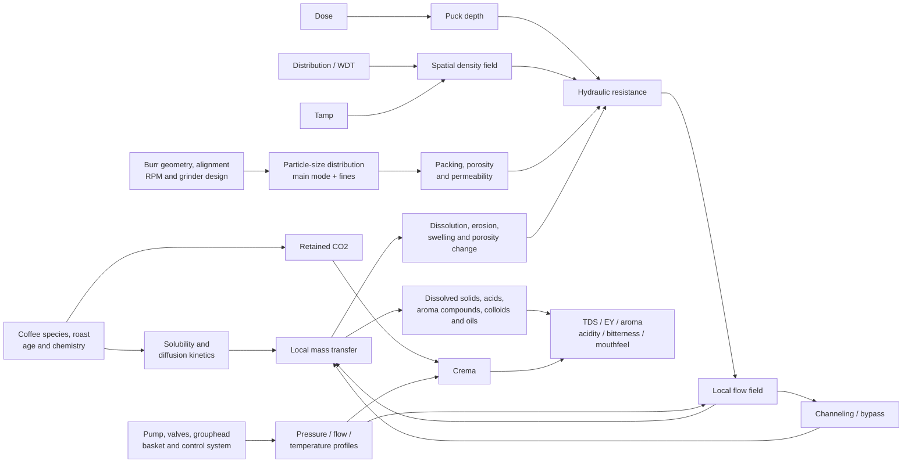

# Causal Foundation of Espresso Extraction: Physics, Chemistry, Equipment, and Community Validation

## Executive summary

Espresso is best understood not as a fixed recipe but as a **reactive, deformable porous-bed extraction process**. Hot water moves through a compressed granular bed whose permeability is set by particle-size distribution, fines, packing density, dose, distribution, tamping, basket geometry, and the evolving structure of the puck. Simultaneously, soluble material leaves the particles, the puck changes porosity, gas is released, oils and colloids enter the beverage, and local differences in flow can amplify into channels. Recent microtomography, extraction-kinetics, and porous-flow studies therefore support a model substantially more complicated than the traditional heuristic “finer grind + 9 bar + 25–30 seconds = more extraction.” citeturn47academia2turn58view0turn37academia2

The most important causal result is the **competition between mass transfer and hydraulics**. Smaller particles provide more surface area and shorter diffusion paths, which by themselves accelerate dissolution. Yet smaller particles—and especially a larger fraction of fines—also reduce puck permeability, slow transport through the bed, change compaction behavior, and increase susceptibility to nonuniform flow. That competition explains why extraction does not necessarily increase monotonically as grind becomes finer. Both modeling and experiments show that sufficiently fine grinding can produce a turnover in extraction yield rather than continued improvement. citeturn34view0turn58view0

Pressure is similarly misunderstood. In a fixed, rigid porous bed, Darcy's law predicts approximately proportional flow with pressure difference. A coffee puck is neither fixed nor rigid: it compresses, erodes, dissolves, redistributes fines, and develops spatial porosity gradients. Micro-CT work finds significant inertial effects at espresso-like pressure gradients, while newer poroelastic experiments find a nonlinear pressure–flow relationship. Earlier experimental literature summarized by Schmieder et al. even found a **decreasing trend in extracted component mass when pressure was raised from 7 to 11 bar**, although those experiments did not report the corresponding flow rates. Nine bar is therefore a historically important operating point, not a universal chemical optimum. citeturn47academia2turn37academia2turn62view0

Temperature has two distinct causal effects: it generally raises molecular mobility/solubility and reduces water viscosity, but its effect on the **final cup composition and sensory quality is compound- and coffee-dependent**. In a 2023 controlled study spanning 80–98°C, grind and flow conditions, flow rate had the largest effect among the manipulated process variables on measured caffeine, trigonelline, 5-CQA and TDS mass, while changes caused simply by the amount of espresso collected were larger still. An older controlled sensory/chemical study of three coffees found 92°C optimal under its test conditions, not because 92°C is universally optimal but because volatile and sensory responses depended on the coffee. citeturn56view0turn62view0turn56view2

Particle-size distribution matters more than a single “grind size” number. Smrke, Eiermann and Yeretzian experimentally varied the fraction of particles below 100 µm and found that more fines reduced permeability, lowered flow and lengthened shots. Their 20 g / 40 g, 9-bar experiments also found that shots below roughly 10–15 seconds could already reach about **17–18% extraction yield**, more than 80% of the maximum extraction observed in that experimental system. This is unusually strong scientific support for the community's “turbo shot” exception to the traditional 25–30-second rule. citeturn58view0

The best current causal hierarchy is therefore:

**coffee and roast chemistry → grinder-generated PSD → puck density/permeability field → machine pressure/flow/temperature boundary conditions → local residence time and mass transfer → evolving permeability/channeling → beverage composition → sensory response.**

TDS and extraction yield belong late in this chain. They are useful measurements but are **averages**, and an average extraction yield can conceal a puck containing simultaneously under-extracted low-flow regions and intensely extracted channels. Aroma compounds also do not vary monotonically with extraction yield: the 2024 fines study found several distinct VOC-versus-yield patterns and proposed extraction, degassing, and post-extraction evaporation as competing processes. citeturn34view0turn58view0

The focused community validation broadly agrees with this scientific picture. The strongest recurring themes in large r/espresso discussions are that WDT primarily improves **consistency/density uniformity rather than magically increasing extraction**, its benefit depends strongly on grinder/workflow, light roasts often require different ratios or faster/lower-pressure profiles, and 6-bar or 10–15-second shots can work extremely well. The weakest community claims are equipment-brand causal claims such as “98 mm flat burrs fixed sourness” or exact extraction improvements attributed to one puck-prep tool: those observations are plausible through PSD changes but are uncontrolled and cannot establish burr geometry or brand as the cause. citeturn61view0turn61view1turn61view2turn61view3turn61view6

## Research sequencing and causal map

The sequencing matters because community rules are often observations of **downstream symptoms**. “Grind finer,” for example, describes an intervention; it does not identify whether the underlying cause was inadequate surface area, excessive flow, poor distribution, low temperature, a low-solubility roast, or a particular PSD. The foundation should therefore be established before treating repeated forum experience as confirmation or contradiction.

```mermaid
flowchart TD
    A[Define physical observables<br/>P(t), Q(t), T(t), beverage mass] --> B[Establish porous-bed physics]
    B --> C[Establish dissolution and chemical kinetics]
    C --> D[Map grinder and puck-prep variables<br/>to PSD, density and permeability]
    D --> E[Map machine architecture<br/>to pressure, flow and temperature boundary conditions]
    E --> F[Measure TDS, extraction yield<br/>flow, pressure, temperature and time]
    F --> G[Connect composition to sensory outcomes]
    G --> H[Validate against Reddit and community observations]
    H --> I{Agreement?}
    I -->|Yes| J[Increase practical confidence]
    I -->|Exception| K[Identify conditional regime<br/>coffee, grinder, machine or recipe]
    I -->|Contradiction| L[Design controlled experiment<br/>holding confounders constant]
```

That sequence also prevents a common category error: treating a target such as “9 bar” as a cause independent of flow. Pressure and flow are coupled through puck resistance. A pressure-controlled machine imposes one boundary condition; a flow-controlled machine imposes another and changes pressure as necessary. Decent's technical documentation explicitly illustrates the distinction by offering pressure profiling as well as a flow mode in which the controller adjusts pressure to maintain the desired puck flow. citeturn42view2

The causal system itself can be represented as follows:



The feedback loop in the center is crucial. Models of uneven coffee extraction show how an initially slightly more permeable region can receive more flow, dissolve faster, become still more porous/permeable, and therefore receive still more flow. Fines migration/clogging provides an additional, potentially competing mechanism. This is why an espresso puck cannot safely be treated as a homogeneous filter whose resistance stays constant during the shot. citeturn34view0turn47academia2turn37academia2

## Foundational physics and chemistry

### Fluid dynamics, permeability and channeling

For a first approximation, flow through a homogeneous porous puck can be written in Darcy form:

\[
Q \approx \frac{k A}{\mu L}\Delta P
\]

where \(Q\) is volumetric flow, \(k\) permeability, \(A\) puck cross-sectional area, \(\mu\) viscosity, \(L\) puck depth and \(\Delta P\) the pressure drop. Espresso extraction models commonly couple this with a Kozeny–Carman-type dependence:

\[
k \propto d_p^2\frac{\varepsilon^3}{(1-\varepsilon)^2}
\]

where \(d_p\) is a characteristic particle size and \(\varepsilon\) is porosity. The exact prefactor and even the validity of Darcy flow become uncertain for real espresso because the particles are irregular and polydisperse, the bed deforms, fines migrate, and inertial terms can matter. citeturn34view0turn47academia2

Those equations nevertheless give useful **directional quantitative intuition**. If all else truly remained constant, halving characteristic particle diameter would reduce permeability and flow to roughly \(0.5^2=0.25\) of the original value. Increasing puck depth by 20% would reduce flow to roughly \(1/1.2=0.833\), or about 17%. More dramatically, in the idealized Kozeny–Carman expression, reducing porosity from 0.30 to 0.25 reduces the porosity factor to about **50%** of its previous value. These are not espresso predictions; they show why seemingly small differences in packing or fines can produce disproportionately large hydraulic changes. The actual puck may respond less, more, or non-monotonically because its structure changes under load. citeturn34view0turn47academia2

The 2023 micro-CT/SPH study by Mo and colleagues directly strengthens that caution. It reconstructed coffee-bed microstructure and found that inertial effects could be significant under pressure gradients typical of espresso, and that extraction generated a systematic post-shot porosity gradient. The more recent poroelastic study by Waszkiewicz and colleagues, accepted after experiments on a café-grade platform, likewise reports a nonlinear pressure–flow relationship governed by porosity, elasticity and dissolution. citeturn47academia2turn37academia2

Consequently, **more pressure does not imply proportionally more extraction**. At fixed puck resistance it tends to increase flow; but increasing flow shortens residence time, pressure can compact or mechanically alter the bed, and localized weak regions can preferentially conduct the additional flow. Schmieder et al.'s review of controlled espresso literature notes that experiments raising pressure from 7 to 11 bar showed a decreasing trend in extracted component mass, with the important limitation that those studies did not report the corresponding flow rates. citeturn62view0

This is also the causal basis of channeling. “Channeling” is not simply visible spraying from a bottomless portafilter. The deeper phenomenon is spatially nonuniform hydraulic conductivity. A low-resistance path carries a disproportionate share of the total water, so bulk extraction yield can look respectable even while substantial regions of the puck see little water. Lee, Smith and Arshad's model explicitly generates a positive feedback between local extraction, porosity, permeability and flow and reproduces the experimentally observed possibility that making the grind too fine eventually reduces average extraction. Their own model has simplifying assumptions, however, so the exact balance between dissolution-driven instability and fines clogging remains an active research question rather than a settled single-mechanism explanation. citeturn34view0

### Solubility, diffusion and extraction kinetics

At particle scale, dissolution can be conceptualized as a driving force proportional to the difference between the local saturation concentration and the concentration already present in the pore water:

\[
\dot m \sim k_m\,a\,(C^*-C)
\]

with \(k_m\) representing mass-transfer effects and \(a\) accessible surface area. Finer grinding increases accessible surface area per unit mass and decreases intraparticle diffusion distance. Those are the chemical reasons that “grind finer” often works. But the same change reduces permeability, so espresso contains an intrinsic **surface-area versus hydraulic-transport tradeoff**. citeturn34view0turn58view0

Schmieder and colleagues directly fractionated espresso shots and quantified caffeine, trigonelline, 5-caffeoylquinic acid and TDS. They found that concentrations change strongly over the course of a shot and that most material is extracted disproportionately early. Prior work summarized in the same paper found caffeine and trigonelline extracting faster from smaller particles. In their controlled design, water flow rate was the strongest of the three studied process factors—flow, grind setting and temperature—although its effect and those of grind and temperature were smaller than changes attributable to collecting different total masses of espresso. citeturn56view0turn62view0

This point undermines another common oversimplification: “longer shot = more of everything in the same proportion.” Later fractions are much more dilute, and compounds possess different transfer and volatility behavior. Smrke et al. found multiple qualitatively different VOC relationships with overall extraction yield: some measured headspace signals declined with increasing yield, some were non-monotonic, some showed little trend and at least one class increased. They argue that extraction is competing with CO₂-assisted stripping and evaporation during and after the shot. citeturn58view0

### Temperature, acids and pH

Temperature operates through at least three routes: higher temperature generally increases diffusion/molecular mobility, can increase apparent solubility of extracted compounds, and lowers water viscosity, which by itself tends to raise flow for the same pressure and puck permeability. These mechanisms do **not** guarantee a simple monotonic sensory response because changing flow simultaneously changes residence time, and individual compounds respond differently. citeturn62view0

Schmieder et al. tested 80–98°C and found the temperature effects smaller than the effect of collected beverage mass and dependent on the other operating conditions. Their literature review found mixed results in earlier espresso work. Andueza et al., testing 88, 92, 96 and 98°C on an Arabica coffee and two Robusta-containing coffees, found volatile and sensory changes more useful for distinguishing temperatures than basic taste/mouthfeel chemistry; 92°C was the preferred condition for the coffees under that particular experimental protocol. That is evidence for **coffee-specific temperature optimization**, not evidence for a universal 92°C setpoint. citeturn62view0turn56view2

Coffee acidity also needs two separate concepts. **pH** measures hydrogen-ion activity, whereas perceived sourness/acidity depends on the mixture and concentrations of organic acids, buffer capacity, aroma and other taste interactions. Chlorogenic acids, including the 5-CQA measured directly in espresso kinetic studies, change strongly with roasting; published brewed-coffee work has found correlations between lower chlorogenic-acid concentrations and higher pH as roasting becomes darker. Therefore “higher pH” and “less perceived acidity” are related possibilities, not interchangeable measurements. citeturn62view0turn43search2

### Oils, carbohydrates, sugars and melanoidins

Espresso is not merely an aqueous molecular solution. It contains dissolved material, suspended particles and dispersed oil droplets. The pressurized metal-filter process retains a substantially different colloidal phase from paper-filtered coffee; oil droplets contribute creaminess/body and provide a hydrophobic phase in which aroma compounds can partition. The espresso literature on interfacial properties and foam treats this multiphase character as central to the beverage. citeturn54view0turn55view2

Roasting converts a large portion of green-coffee precursors through Maillard chemistry and thermal degradation, creating aroma compounds and high-molecular-weight brown material commonly grouped as melanoidins. Espresso-specific quantitative kinetic literature is much stronger for caffeine, trigonelline, chlorogenic acids and bulk TDS than for assigning individual perceived sweetness/body changes to extracted sugars or melanoidin fractions. Accordingly, claims such as “a higher extraction simply extracts more sugar and therefore tastes sweeter” have weaker causal support than the hydraulic and TDS relationships documented above. Schmieder et al. explicitly note that roasting changes coffee composition through degradation and formation of new compounds, including Maillard products. citeturn62view0

## Mechanical and machine causality

### Grinder particle-size distribution and burrs

The scientifically useful grinder output is a **particle-size distribution**, not a burr marketing category. Espresso grounds are characteristically multimodal, and two grinding technologies producing the same median particle size can produce different fractions of fines. Smrke et al. define fines as particles below 100 µm for their analysis and show directly that an increasing share of those fines decreases puck permeability, lowers flow and increases extraction time. Their statistical model found contributions from the full PSD that could not be represented adequately by median size alone. citeturn58view0

That finding changes how “flat versus conical” should be interpreted. Burr geometry can matter because it changes PSD, particle shape, fines production, regrinding and possibly packing behavior; but **“flat” or “conical” is not itself a sufficient causal variable**. Diameter, geometry, alignment, RPM, feed rate and coffee brittleness can all change the resulting distribution. The scientific consensus supported by the fines study is therefore “compare PSD characteristics,” not “flat burrs inherently create clarity and conical burrs inherently create body.” citeturn58view0

Electrostatics add another grinder-mediated pathway. Méndez Harper and Hendon measured substantial electrostatic charging during grinding and found that adding less than 0.05 mL water per gram of beans before grinding altered the recovered PSD by preventing charged fines from remaining attached to other grounds or grinder surfaces. Under their controlled espresso conditions, darker-roast shots prepared after this treatment showed at least a 15% increase in beverage concentration. That is a striking result but should not be universalized: it was grinder-, roast- and protocol-specific. citeturn51academia0

### Dose, puck depth, distribution and tamping

Dose has two physical effects that are often conflated. Increasing mass provides more soluble material, but at fixed basket area it generally also increases puck depth \(L\), raising hydraulic resistance. The Darcy scaling predicts \(Q\propto1/L\) if permeability and pressure are otherwise held constant. In reality, dose also changes headspace, compaction, basket-wall effects and the vertical pressure field, so changing dose cannot be assumed equivalent to simply changing coffee-to-water ratio. Schmieder et al. identify coffee mass, PSD and tamping as jointly defining the puck's mechanical structure and hydraulic resistance. citeturn62view0

Distribution acts primarily on **spatial density variance**. If one region begins less dense than another, tamping both regions from above does not guarantee that their local porosities become identical: granular particles support force through contact networks and experience friction against one another and the basket. The causal goal of distribution is therefore to reduce the variance of the pre-tamp density field, not merely to make the top look level. This mechanism is consistent with the permeability sensitivity in porous-bed models and with the community's strongest explanations of WDT. citeturn34view0turn61view0turn61view1

Tamping performs the different task of mechanically consolidating and leveling the bed. There is strong evidence that puck mechanical structure matters, but comparatively weak evidence for a universal “correct tamp force” once a stable, reproducible bed has been formed. Consequently, exact prescriptions such as a particular number of kilograms should be regarded as workflow specifications unless supported by a controlled test on the relevant basket, coffee, dose and grinder. The direct espresso literature supports the causal variables—packing, resistance, PSD and density—more strongly than any universal tamp-force number. citeturn62view0turn58view0

### Pump type, pressure and flow profiling

Machine architecture determines the boundary conditions presented to the puck. A nominal “9-bar machine” does not guarantee the same puck pressure or flow history as another 9-bar machine because pump behavior, valves, flow restrictors, reservoir versus line pressure, feedback control and the resistance of the puck all interact. Decent's technical documentation makes the control distinction explicit: its pressure mode follows a programmed pressure trajectory, whereas flow profiling adjusts pressure dynamically to maintain the programmed flow; it also measures pressure near the puck rather than treating pump pressure as the sole relevant variable. citeturn42view2

For causal analysis, therefore, recording **\(P(t)\) and \(Q(t)\)** is more informative than merely naming the pump “vibratory,” “rotary” or “lever.” Pump type matters insofar as it constrains attainable pressure/flow ramp rates, compliance, noise/pulsation, and control strategy. A spring lever, a rotary-pump machine with a fixed restrictor, and a digitally controlled variable-flow machine may all reach the same peak pressure while exposing the puck to materially different saturation and late-shot conditions. The newer nonlinear poroelastic results make the full trajectory especially important. citeturn37academia2turn42view2

### Pre-infusion, thermal stability and grouphead design

Pre-infusion supplies water at a lower initial hydraulic stress or lower flow before the main extraction. The intended physical effect is to fill pore space and wet particles before the full pressure gradient is imposed, potentially reducing large dry/weak regions. But pre-infusion is not universally beneficial: prolonged wetting begins dissolution, swelling, fines movement and structural evolution before the nominal main extraction. Decent's machine, for example, includes saturation detection and also documents a very slow low-pressure “slow infusion” mode, illustrating how broad the design space is. citeturn42view2turn37academia2

Thermal stability matters because puck temperature affects both chemistry and hydraulics. A grouphead, boiler/heater and portafilter with insufficient thermal equilibration can expose the puck to a different temperature from the machine setpoint; conversely, a high-thermal-mass group can reduce short-term fluctuations but may warm slowly. Given the experimentally mixed compound-specific response to temperature, the strongest engineering objective is **known and reproducible puck temperature**, rather than simply maximizing temperature. citeturn56view2turn62view0

Grouphead and basket design also set the spatial inlet and outlet boundary conditions. Shower-screen dispersion influences how evenly water is delivered across the puck, while basket hole number, size and distribution contribute downstream hydraulic resistance. A bottomless portafilter is especially useful diagnostically because jets and asymmetric flow become visible; changing from spouted to bottomless hardware while retaining exactly the same basket does not by itself fix an internal density defect. Decent explicitly presents its bottomless portafilter as a way to observe puck-preparation problems. citeturn42view2

A pressurized or double-wall basket is causally different because it adds substantial restriction **after** the coffee bed. This can make beverage flow less sensitive to puck resistance and can generate foam even when the puck itself could not sustain traditional espresso resistance. This is an engineering inference from the placement of the restriction; results from pressurized-basket machines therefore should not be transferred uncritically to nonpressurized precision baskets.

### Key causal factors and quantitative expectations

| Causal factor | Primary mechanism | Quantitative relationship or observed effect | Main downstream effects | Evidence strength |
|---|---|---|---|---|
| Pressure difference | Drives flow through porous bed | Ideal rigid-bed \(Q\propto\Delta P\); real espresso is nonlinear. Literature summarized by Schmieder found extracted component mass trending downward from 7→11 bar in some experiments, with flow unreported. citeturn62view0turn37academia2 | Flow, residence time, compaction, channel initiation | **Strong physics; moderate espresso-specific optimum evidence** |
| Particle diameter | Changes permeability, area and diffusion length | Ideal \(k\propto d_p^2\): halving \(d_p\) would give ~¼ permeability if porosity were unchanged; experiments show sufficiently fine grinding can cease improving or reduce EY. citeturn34view0turn58view0 | Flow, extraction kinetics, channeling | **Strong** |
| Fines fraction | Fills pore throats and changes packing | Increasing particles <100 µm reduced permeability, slowed flow and lengthened extraction in controlled 20 g/40 g, 9-bar tests. citeturn58view0 | Shot time, pressure/flow curve | **Strong direct experiment** |
| Porosity | Strong nonlinear control of permeability | Ideal \(k\propto\varepsilon^3/(1-\varepsilon)^2\); 0.30→0.25 porosity gives ~0.50× permeability factor under that idealization. Espresso micro-CT shows porosity evolves spatially. citeturn34view0turn47academia2 | Flow heterogeneity, channeling | **Strong mechanism, approximate scaling** |
| Puck depth / dose | Longer transport path, more resistance | Ideal \(Q\propto1/L\); +20% depth → ~17% less flow if all else were unchanged. citeturn62view0 | Flow, contact time, solute inventory | **Strong mechanism, approximate scaling** |
| Distribution | Reduces spatial density/permeability variance | No universal percentage established; expected effect is reduced shot-to-shot variance and fewer extreme local flow paths. citeturn34view0turn61view0 | Channeling, repeatability | **Strong mechanism; limited direct WDT trials** |
| Pre-grind water / static control | Alters electrostatic aggregation and recovered PSD | <0.05 mL/g water; ≥15% higher concentration reported for darker-roast espresso under the study's fixed conditions. citeturn51academia0 | PSD, clumping, TDS | **Strong direct experiment, limited generalizability** |
| Flow rate | Sets residence time and advective removal | In 1–3 mL/s experiments, flow was the strongest tested process factor for component mass; effect interacted with grind and temperature. citeturn56view0turn62view0 | Component kinetics, shot duration | **Strong** |
| Temperature | Solubility/diffusion ↑; viscosity ↓ | 80–98°C experiment found compound-specific and comparatively modest effects; a separate 88–98°C sensory study favored 92°C for its tested coffees. citeturn62view0turn56view2 | EY, aroma, acids, flow | **Strong, but coffee-specific** |
| Extraction duration / output ratio | Changes total water and late-shot fraction | In one 20 g→40 g study, <10–15 s shots reached 17–18% EY, >80% of the study's observed maximum. citeturn58view0 | EY, TDS, aroma profile | **Strong for tested system** |
| Pressure/flow profiling | Changes puck hydraulic stress throughout shot | Flow-control hardware explicitly changes pressure to hold target flow; no universal optimal profile. citeturn42view2turn37academia2 | Channel growth, flow acceleration, extraction | **Strong mechanism; recipe-specific sensory evidence** |
| Temperature stability | Reduces uncontrolled variation in kinetics/viscosity | Exact sensory sensitivity is coffee-specific; controlled temperature is more defensible than a universal setpoint. citeturn56view2turn62view0 | Reproducibility, aroma | **Strong** |

The idealized percentages in this table are **sensitivity calculations from the porous-bed equations**, not promises about what a real espresso machine will do. The experiments showing evolving porosity, inertial flow and poroelastic behavior are precisely why the simple equations should be used as causal intuition rather than recipe calculators. citeturn47academia2turn37academia2

## Sensory outcomes and quantitative synthesis

### TDS and extraction yield

TDS answers “how concentrated is the beverage?” Extraction yield answers “what fraction of the dry coffee mass ended up as measured dissolved material?” To first order,

\[
EY=\frac{m_{\text{beverage}}\times TDS}{m_{\text{dry coffee}}}
\]

with TDS entered as a mass fraction. Thus an 18 g dose producing 36 g of beverage at 10.0% TDS corresponds to:

\[
EY=\frac{36(0.10)}{18}=0.20=20\%
\]

This mass balance is why TDS and EY must not be used interchangeably. A long shot may have higher EY but lower TDS; a ristretto may have high TDS with a lower total extracted mass. Espresso studies use refractometric TDS and beverage mass in exactly this way to calculate extraction percentage. citeturn58view0turn34view0

More importantly, EY is an **average over the entire dose**. If half a puck receives little water and the other half carries most of the flow, the average may lie in a conventionally desirable range while neither region experienced the same extraction history. This is the fundamental reason a refractometer cannot diagnose channeling on its own. citeturn34view0

### Acidity and bitterness

The familiar rule “underextracted = sour; overextracted = bitter” has value as a troubleshooting shorthand but is not a complete chemical model. Different acids, caffeine-related bitterness, roast-derived compounds, aromatics and tactile components have different extraction and volatility kinetics. Smrke et al.'s VOC data demonstrate directly that aroma concentration need not increase monotonically with total EY. Likewise, temperature experiments show that sensory differences may be driven more by volatiles than by gross physicochemical measures. citeturn58view0turn56view2

Channeling makes the shorthand still less reliable because the same cup can contain highly extracted liquid from a preferential channel mixed with weak liquid associated with poorly wetted regions. A shot can therefore present both sharp acidity and drying/bitter character without having a single meaningful state called “underextracted” or “overextracted.” citeturn34view0

Light-roast coffees often expose these interactions more clearly because their chemistry and physical structure differ from darker roasts; however, the scientific literature does not support one universal light-roast recipe. The controlled fines study explicitly concludes that the green coffee and roast profile affect where peak sensory quality occurs: despite showing the extraction efficiency of fast shots, its single taster preferred the tested coffee around 30 seconds and 19–20% EY rather than at the fastest “turbo” condition. citeturn58view0

### Crema and mouthfeel

Crema is fundamentally a gas/liquid/solid-interface phenomenon. Roasting leaves CO₂ in the coffee; high-pressure water permits more gas to be carried in the liquid/pore system, and decompression during exit promotes bubble formation. Surface-active coffee compounds, colloidal material and dispersed lipids influence foam formation and stability. Espresso literature specifically treats foamability and interfacial behavior as chemical-physical properties rather than simply as a visual marker of correct extraction. citeturn54view0turn56view2turn55view2

Therefore crema quantity is **not a direct proxy for extraction quality**. Freshness/degassing, roast level, Robusta content, pressure history and foam-stabilizing composition can all change crema independently of whether the soluble flavor balance is desirable. The community example of seeking Robusta specifically for additional crema illustrates how readily foam quantity can vary with coffee composition. citeturn61view5turn54view0

Mouthfeel arises partly from the high concentration of dissolved material but also from suspended particles, oil droplets, foam and macromolecular/colloidal material. Espresso's dispersed oils have been associated with creaminess/body and aroma retention, so two shots with similar refractometer TDS can still differ materially in tactile character if their suspended and emulsified phases differ. citeturn54view0turn55view2

The resulting sensory causal hierarchy is:

**TDS → strength**, but not necessarily quality.  
**EY → average mass removed**, but not necessarily uniformity.  
**pH → chemical acidity state**, but not perceived sourness by itself.  
**crema → gas/interfacial behavior**, but not proof of a good extraction.  
**shot time → consequence of flow and resistance**, not a fundamental quality variable.

Those distinctions are supported by the extraction-kinetics, fines, temperature and porous-flow studies rather than by a single preferred espresso recipe. citeturn56view0turn58view0turn34view0

## Community validation

The community phase was deliberately performed **after** establishing the physics and chemistry. Reddit was the richest accessible corpus, particularly r/espresso; Home-Barista is historically important because WDT originated in that community, but the accessible long-form search results were substantially more complete for Reddit in this research pass. The frequency labels below are qualitative: **high** means a claim recurred across many independent comments or multiple prominent threads; **moderate** means repeatedly observed but coffee/equipment-specific; **low** means essentially anecdotal or dependent on a particular setup. They are not population-prevalence estimates.

### Agreement with established causal rules

The strongest agreement concerns distribution. In a long r/espresso debate explicitly questioning whether WDT is pointless, multiple independent participants describe its effect as reducing density variation or improving consistency rather than merely removing visible clumps. Commenters repeatedly distinguish “distribution” from “tamping,” and several report less spraying/channeling when WDT is used. That mechanism aligns closely with the scientific picture in which spatial density determines local permeability and uneven permeability can amplify into channels. **Frequency: high. Credibility: moderate-to-high for the qualitative mechanism; low for exact percentage improvements.** citeturn61view0turn61view1turn34view0

The same thread also contains the important exception: some experienced users report little practical benefit when their grinder and dosing workflow already produce an even bed, and one describes WDT as a small effect not worth the additional step. Others explicitly say grinder quality changes whether WDT is useful. That is not a contradiction of the science; it is exactly what the causal model predicts. A tool that reduces initial density variance should provide little benefit when initial variance is already small. citeturn61view1

Community enthusiasm for lower-pressure and fast shots also agrees surprisingly well with the controlled literature. A representative r/espresso post documents a 16 g in / 35 g out medium-roast shot with a 10-second pre-infusion and 6-bar extraction, while commenters discuss extended pre-infusion. More broadly, fast “turbo” approaches recur in discussions of difficult light roasts. The 2024 fines study provides independent experimental support for the underlying exception: sub-10–15-second extractions still achieved roughly 17–18% EY in that system. **Frequency: moderate-to-high. Credibility: high for the general proposition that 25–30 seconds and 9 bar are not mandatory; moderate for any specific 6-bar recipe.** citeturn61view6turn61view2turn58view0

### Recurring exceptions and coffee-specific behavior

Light-roast espresso generates one of the clearest recurring exception clusters. In a very long r/espresso discussion, multiple users call light roasts harder to extract or describe a narrower “good” dial-in window; several report persistent sourness under conventional recipes. Other commenters directly counter that experience by reporting excellent fruit-forward light-roast espresso and suggesting ~15-second fast shots. **Frequency: high. Credibility: moderate**, because the recurrence is strong but roast definitions, coffees, machines and sensory preferences are uncontrolled. citeturn61view2

That disagreement actually matches the scientific findings better than a simple rule would. The fines study shows that fast shots can be extraction-efficient but also found that its particular Costa Rican coffee was sensorially preferred by its taster closer to a conventional 30-second, 19–20% EY point. The proper conclusion is therefore not “light roast requires turbo shots,” but **the optimum shifts with coffee chemistry, roast structure and grinder-generated PSD**. citeturn58view0

An especially revealing community exchange concerns grinder dependence. One user says sour light-roast shots on a Niche grinder largely disappeared after moving to a 98 mm Lagom P100/Mizen setup; another reports continued light-roast difficulty with the Niche, and the first recommends 1:2–1:3 turbo-style ratios in approximately 10–15 seconds. **Frequency: moderate as a general grinder-dependence theme; credibility: low for the claim that 98 mm flat burrs themselves caused the improvement.** The scientific literature supports a grinder→PSD→permeability mechanism, but does not establish “98 mm” or “flat burr” as the isolated causal variable. citeturn61view3turn58view0

### Equipment-specific behavior

Community reports around thermally limited or modification-oriented machines illustrate why machine identity can matter even when the recipe numbers look identical. In a recent Bambino Plus troubleshooting thread centered on persistent sourness, commenters repeatedly recommend additional warming/blank-shot routines and separately question grinder limitations. Those reports are physically plausible because temperature affects extraction kinetics and viscosity, but they are **low-to-moderate credibility as evidence about the specific machine** because no puck-temperature measurements accompany the anecdotes. citeturn61view5turn62view0

The long Gaggia Classic Pro discussion similarly shows recurring user concern with OPV/PID modifications, thermal behavior and workflow. Some users argue extensive modification is needed for repeatability; others report that experience and puck preparation matter more and dispute the size of the machine's temperature problem. This is useful community evidence that machine behavior interacts strongly with skill and modification state, but it cannot determine the magnitude of a temperature swing or isolate its sensory effect without instrumented measurements. **Frequency: high within Gaggia-specific discussion; credibility: low-to-moderate for quantitative claims.** citeturn61view4

This is where programmable machines offer unusually useful research capability. Decent's official platform records pressure, flow and temperature trajectories and can control pressure or flow directly, allowing profiles that community members discuss qualitatively to be turned into measured experiments. Manufacturer claims about superiority should still be treated as claims, but the instrumented control capability itself directly addresses the main experimental confounder: not knowing what the puck actually experienced. citeturn42view2

### Community claims versus scientific consensus

| Community claim | Frequency indicator | Scientific comparison | Assessment |
|---|---:|---|---|
| “WDT reduces channeling and makes shots more consistent.” | **High** | Mechanistically consistent with density/permeability uniformity and channel-instability models. Direct controlled WDT evidence is thinner than general porous-bed evidence. citeturn61view0turn34view0 | **Agreement; credible qualitative claim** |
| “WDT is unnecessary with some good grinders/workflows.” | **Moderate–high** | Expected if starting density variance/clumping is already small. citeturn61view1 | **Valid conditional exception** |
| “More pressure is better; espresso should be 9 bar.” | **Common traditional rule, but repeatedly challenged** | Science does not show monotonic benefit. 7→11-bar studies summarized by Schmieder trended toward less extracted component mass; real pressure-flow coupling is nonlinear. citeturn62view0turn37academia2 | **Contradicted as universal rule** |
| “A proper shot must take ~25–30 s.” | **Still common, but turbo exception is prominent** | Direct experiments produced 17–18% EY in <10–15 s and >80% of their observed maximum. citeturn58view0 | **Contradicted as universal rule** |
| “6-bar shots can taste excellent.” | **Moderate** | Entirely plausible; no physical reason 9 bar uniquely optimizes extraction. Lower pressure can change flow/channel development. citeturn61view6turn62view0 | **Scientifically compatible; coffee-specific** |
| “Light roast requires long/hot extraction.” | **High but contested** | Higher temperature can help kinetics, but fast shots can also extract efficiently. Sensory optimum is coffee-specific. citeturn61view2turn58view0turn56view2 | **Overgeneralization** |
| “Light roast works best as a 10–15 s turbo.” | **Moderate** | Strong evidence turbo extraction can be efficient; no evidence it is universally sensory-optimal. citeturn61view2turn58view0 | **Supported exception, not universal rule** |
| “98 mm flat burrs remove sourness / produce better light espresso.” | **Isolated to moderate anecdotal pattern** | PSD/fines matter strongly, but diameter and flat geometry are confounded with burr geometry, grinder alignment, RPM and recipe. citeturn61view3turn58view0 | **Unproven causal attribution** |
| “Tamping should eliminate clumps, so distribution does not matter.” | **Recurring minority position** | Granular-bed permeability depends on spatial packing; uniform vertical tamp force does not prove uniform local density. citeturn61view0turn34view0 | **Mechanistically weak** |
| “Higher EY always means a better / more bitter shot.” | **Recurring simplification** | VOC behavior versus EY is nonlinear; average EY can hide spatial nonuniformity. citeturn58view0turn34view0 | **Contradicted as universal rule** |
| “A visibly good crema proves good extraction.” | **Common visual heuristic** | Crema is governed by CO₂, pressure and interfacial chemistry and can vary independently of soluble flavor balance. citeturn54view0 | **Weak diagnostic** |

The community evidence is most valuable when it identifies **conditional regimes** that formal studies might otherwise miss: grinder-specific WDT benefit, a particular light roast responding to turbo extraction, or a thermally sensitive machine needing a different warm-up workflow. It is least reliable when a user changes several things at once and assigns causality to the most visible equipment upgrade. The 98-mm-versus-Niche anecdote is a textbook example: the observation may be genuine, but grinder, burr geometry, PSD, retention, static, distribution and recipe all changed together. citeturn61view3turn58view0

## Evidence limits and source map

The strongest conclusions in this report are the ones supported simultaneously by porous-flow theory and controlled espresso experiments: PSD/fines govern permeability; pressure and flow must be treated jointly; grind has competing hydraulic and mass-transfer effects; extraction is spatially nonuniform; temperature effects are compound- and coffee-specific; and TDS/EY do not uniquely determine sensory quality. citeturn34view0turn47academia2turn58view0turn62view0

Several areas remain materially underdetermined. The exact physical cause of the “too fine → lower extraction” turnover is still being refined; dissolution-driven permeability instability and fines redistribution/clogging are both credible contributors. Burr **type** has much weaker causal evidence than the PSD it produces. Exact tamp-force recommendations are less scientifically grounded than puck-density/repeatability principles. Pressure-profile sensory optima are strongly coffee-dependent. And espresso-specific quantitative work on individual sugars, melanoidins and tactile colloidal fractions remains less mature than the work on caffeine, chlorogenic acids, TDS and porous flow. citeturn34view0turn58view0turn37academia2

Most importantly, the findings imply a more rigorous dialing and research order:

**First control coffee and water; then characterize grinder/PSD and puck preparation; then establish machine temperature, pressure and flow behavior; then vary one hydraulic parameter at a time; then measure beverage mass, TDS and EY; only after that compare sensory outcomes.** Community recipes are most useful after these measurements, as hypotheses about where a particular coffee/equipment combination may depart from the traditional regime.

### Core primary and technical sources

| Source | Why it matters | Link |
|---|---|---|
| Schmieder et al., *Influence of Flow Rate, Particle Size, and Temperature on Espresso Extraction Kinetics*, Foods, 2023 | Controlled component-by-component kinetics; 80–98°C; flow, grind and temperature interaction. citeturn56view0turn62view0 | [DOI](https://doi.org/10.3390/foods12152871) |
| Smrke, Eiermann & Yeretzian, *The role of fines in espresso extraction dynamics*, Scientific Reports, 2024 | Direct fines manipulation; PSD/permeability; fast-shot EY; VOC and sensory data. citeturn58view0 | [DOI](https://doi.org/10.1038/s41598-024-55831-x) |
| Mo et al., *Exploring the link between coffee matrix microstructure and flow properties…*, Scientific Reports, 2023 | Micro-CT reconstruction; permeability, tortuosity, inertial effects and evolving porosity. citeturn47academia2 | [DOI](https://doi.org/10.1038/s41598-023-42380-y) |
| Lee, Smith & Arshad, *Uneven Extraction in Coffee Brewing* / dissolution-flow-instability work | Mechanistic explanation of channel amplification and non-monotonic grind response. citeturn34view0 | [Preprint](https://arxiv.org/abs/2206.12373) |
| Waszkiewicz et al., *Under pressure: poroelastic regulation of flow in espresso brewing* | Controlled modern evidence for nonlinear pressure-flow behavior, elasticity and dissolution coupling. citeturn37academia2 | [Preprint](https://arxiv.org/abs/2512.21528) |
| Méndez Harper & Hendon, *Chemical strategies to mitigate electrostatic charging during coffee grinding* | Direct measurement of grinding static, clumping and pre-grind-water effects on PSD/extraction. citeturn51academia0 | [Preprint](https://arxiv.org/abs/2312.03103) |
| Andueza et al., *Influence of extraction temperature on the final quality of espresso coffee*, 2003 | Controlled 88–98°C chemical, volatile and sensory comparison across multiple coffees. citeturn56view2 | [DOI](https://doi.org/10.1002/jsfa.1304) |
| Ferrari et al., *Interfacial properties of coffee-based beverages*, Food Hydrocolloids, 2007 | Interfacial/colloidal basis relevant to espresso oil, foam and mouthfeel. citeturn55view2 | [DOI](https://doi.org/10.1016/j.foodhyd.2006.10.016) |
| Decent Espresso technical overview | Official documentation illustrating measured puck pressure, pressure profiling, flow profiling, temperature profiling and saturation detection. Manufacturer claims should be distinguished from independent experiments. citeturn42view2 | [Technical overview](https://decentespresso.com/overview) |

### Community validation sources

The principal WDT discussion is the r/espresso thread [“Convince me WDT isn't pointless”](https://www.reddit.com/r/espresso/comments/1j5un06/convince_me_wdt_isnt_pointless/), where both the density-uniformity rationale and grinder-dependent exceptions recur. citeturn61view0turn61view1

The principal light-roast corpus is the long r/espresso discussion [“Unpopular opinion: light roasted espresso is overrated”](https://www.reddit.com/r/espresso/comments/1l9exvr/unpopular_opinion_light_roasted_espresso_is/), which contains repeated narrow-window/sourness reports, fast-shot exceptions and the Niche-versus-98-mm grinder anecdote. citeturn61view2turn61view3

The lower-pressure example is [“Tanzania beans, medium roast, 16g in 35g out, pre infusion 10s, 6 bar”](https://www.reddit.com/r/espresso/comments/ov1nvu/tanzania_beans_medium_roast_16g_in_35g_out_pre/), useful not as proof of an optimum but as primary community evidence that successful non-9-bar practice predates the current wave of pressure-profiling discussion. citeturn61view6

Equipment-specific evidence comes from the long [Gaggia Classic Pro beginner discussion](https://www.reddit.com/r/espresso/comments/ru0a6e/please_stop_recommending_the_gaggia_classic_pro/) and the recent [Bambino Plus persistent-sourness troubleshooting thread](https://www.reddit.com/r/espresso/comments/1v9odqg/im_completely_lost_every_espresso_i_make_is_sour/). Both are valuable for generating machine-specific hypotheses but are substantially weaker than instrumented temperature/pressure/flow measurements for establishing causality. citeturn61view4turn61view5

The resulting scientific/community synthesis is unusually coherent: **there is no single espresso “rule set.” There is a causal system.** Grind size, fines, distribution, dose, pressure, flow, temperature and time cannot be optimized independently because each changes the hydraulic or chemical state in which the others operate. The most durable practical rules are therefore mechanistic rather than numerical: control the density field, understand the PSD, measure the actual flow/pressure/temperature trajectory, avoid assuming finer or higher pressure is always better, and judge TDS/EY as measurements of concentration and average extraction rather than substitutes for uniformity or taste. citeturn58view0turn62view0turn34view0turn37academia2