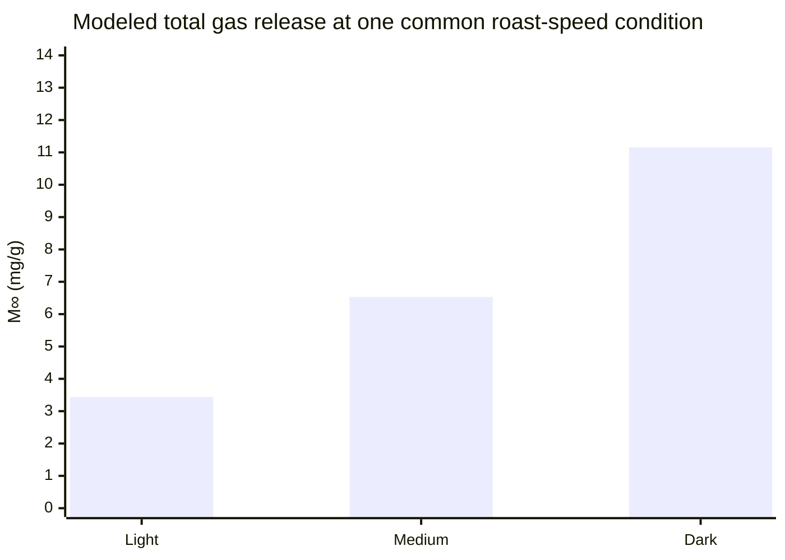
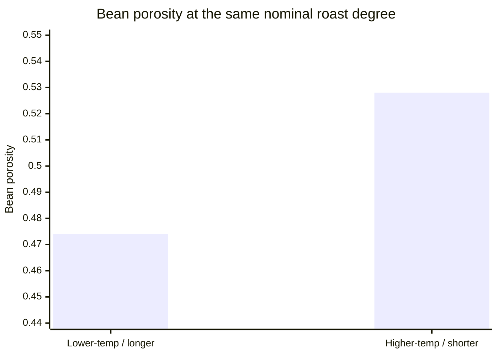
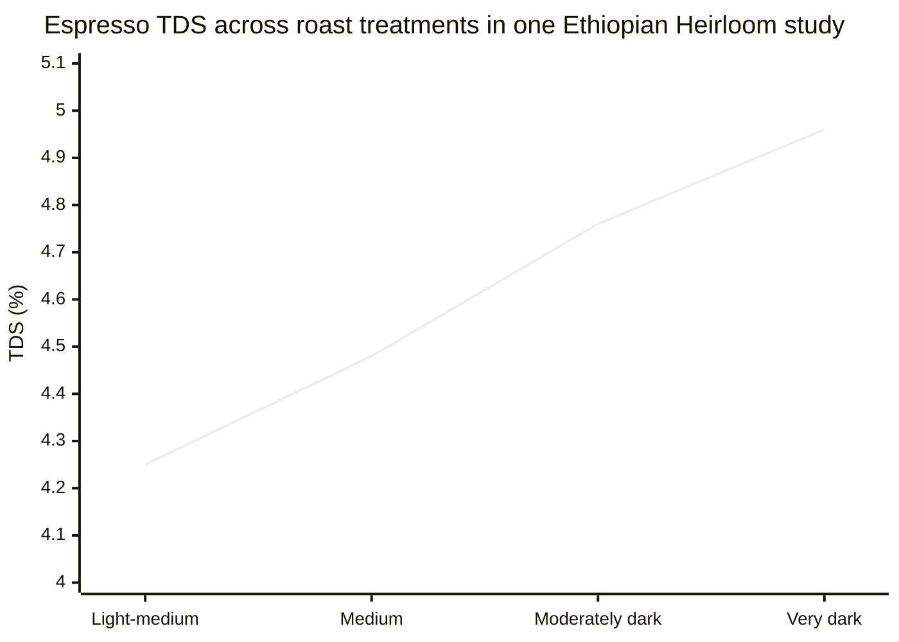
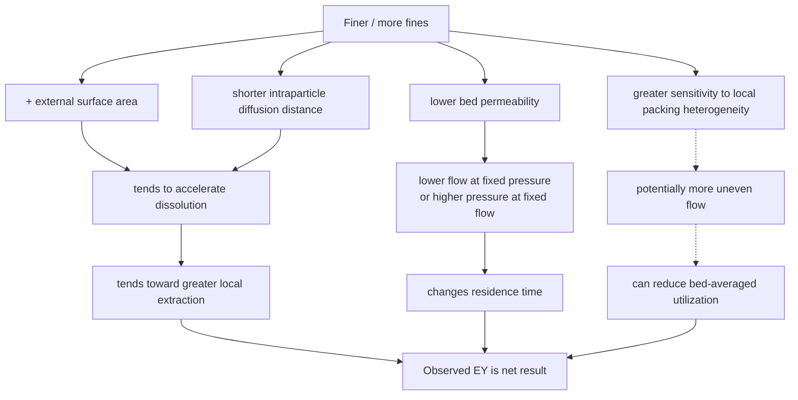

# Causal Foundations of Espresso Extraction and the Effects of Coffee Characteristics

## Executive Summary

Espresso is best understood as a **coupled porous-media flow and multicomponent mass-transfer problem**. Water must first move through a compressible, heterogeneous granular bed; soluble material must then dissolve and diffuse out of particles into that moving water. The same changes that make compounds more accessible—especially smaller particles and greater surface area—can simultaneously reduce puck permeability, alter pressure and residence time, and amplify non-uniform flow. This coupling explains why simple rules such as “finer always extracts more” or “more soluble coffee always runs faster” are not causally sound. Controlled espresso experiments have directly demonstrated a non-monotonic extraction-yield response to grind size, while fines-spiking experiments have shown that the fines fraction causally reduces puck permeability and flow. A 2026 X-ray microtomography study further tied puck permeability principally to connected pore volume and particle surface area. citeturn17search5turn21view1turn17search7

The strongest causal evidence concerning **coffee characteristics themselves** is upstream of the espresso machine. Roasting causally changes bean porosity, density, moisture, composition and gas content. Importantly, two coffees roasted to the *same apparent degree* can possess substantially different physical structures: Schenker et al. reported porosities of 0.528 versus 0.474 and densities of 622 versus 747 kg/m³ for high-temperature/short-time versus lower-temperature/long-time roasts taken to the same roast degree. Thus, roast color is an incomplete state variable for espresso behavior. citeturn18search5 More recent Micro-CT work independently measured substantial development of internal porosity during roasting—up to roughly 60% in the studied Kenyan Arabica system. citeturn18search6

**Roast age is causally important for gas content, but its direct effect on espresso hydraulics is surprisingly under-measured.** Time-resolved gravimetry demonstrates continued gas loss for weeks and strong dependence on roast degree and roast speed. The experimental literature therefore firmly establishes age → retained gas, but much of the familiar next step—retained CO₂ → altered wetting, resistance, channeling and extraction yield—is still a mechanistic inference rather than a well-isolated age-controlled espresso result. citeturn21view0

For **density, hardness, bean size and brittleness**, evidence supports an indirect pathway through fracture mechanics and resulting particle-size distribution rather than a simple direct effect on a mass-dosed puck. Controlled cooling of roasted beans changed the resulting particle-size distribution substantially, with the particle-number mode falling by about 31% from room temperature to approximately −200°C and the distribution becoming narrower. That establishes that mechanical state can causally alter grinding. It does **not** establish that whole-bean density or hardness independently determines espresso flow after particle-size distribution, packing and roast are controlled. citeturn20view0

For **origin, elevation, variety, processing method and decaffeination**, the causal evidence becomes progressively less direct with respect to espresso hydraulics. Genetics, environment and post-harvest processing clearly alter green-bean morphology and chemistry; a 232-accession Arabica study found substantial genetic variation in bean dimensions, bulk density and composition, while a controlled 2026 split-lot processing experiment found large metabolomic differences among wet, dry, anaerobic-wet and anaerobic-dry treatments. Yet these studies did not measure espresso permeability, pressure-flow behavior or extraction yield. citeturn22search11turn16search0turn16search4 Elevation studies likewise establish associations with chemistry and sensory properties, not an independent elevation → espresso-flow effect. citeturn16search3

**Decaffeination is method-specific and poorly studied from an espresso-physics perspective.** In a controlled supercritical-CO₂ study, decaffeination changed composition and caused decaffeinated beans to reach a given L* darkness with less thermal history than non-decaffeinated beans. Thus, even color-matched caffeinated and decaffeinated coffees need not represent equivalent roast states. Direct controlled data on decaffeination → particle-size distribution → puck permeability → espresso extraction remain scarce. citeturn21view2

**Tasting-note families are not causal extraction variables.** “Floral,” “fruit,” “chocolate,” “nut,” and similar terms are sensory descriptions downstream of chemistry and extraction. They may correlate with roast, processing, origin or volatile composition, but a descriptor cannot physically change puck permeability or solubility. Moreover, espresso VOC measurements show that individual aroma-related signals can rise, fall, remain flat, or behave non-monotonically as bulk extraction yield increases, demonstrating why neither tasting notes nor total extraction yield uniquely specifies the chemical trajectory of a coffee. citeturn21view1turn17search4

The evidence ranking reached in this review is:

| Characteristic | Evidence that characteristic changes an upstream physical/chemical mediator | Direct evidence for espresso EY/TDS/flow/permeability effects | Overall causal confidence |
|---|---:|---:|---|
| Roast degree/development | **High** | **Moderate** | **High for material state; moderate for espresso hydraulics** |
| Roast age/degassing | **High for gas content** | **Low–moderate** | **High age→gas; low–moderate gas→espresso behavior** |
| Density/hardness | **Moderate–high** | **Low** | **Moderate as proxy/mediator, low as independent cause** |
| Origin/elevation | **Moderate for chemistry/morphology** | **Very low** | **Low for direct espresso effect** |
| Variety | **High for morphology/composition** | **Low** | **Low–moderate, mediated** |
| Processing | **High for chemistry; some structural evidence** | **Very low** | **Moderate upstream, low espresso-specific** |
| Decaffeination | **Moderate, method-specific** | **Very low** | **Low–moderate** |
| Bean size/brittleness | **Moderate–high for fracture state** | **Low** | **Moderate for grinding pathway; low direct** |
| Tasting-note families | Descriptive outcome, not a physical input | None | **No direct causal status** |

A major methodological conclusion follows: **the coffee label is generally several causal steps removed from the puck**. The variables with the strongest direct control over espresso flow are the properties of the *ground and packed bed*—particle-size distribution, fines, particle geometry, connected porosity, packing and evolving saturation—not origin names, tasting descriptors, or green-bean screen size. citeturn21view1turn17search7

## Scope, Causal Language, and Measurement

This report uses “causal” narrowly. A factor receives causal status when investigators deliberately altered that factor while holding important alternatives reasonably constant and measured the resulting change. A manipulation that only measures an intermediate state—for example, roasting conditions → bean porosity—is distinguished from a manipulation that measures the final espresso endpoint. Natural comparisons between coffees from different origins or elevations are treated as **associations**, because genotype, climate, soil, processing, roast and storage generally vary together. Mathematical models are classified as **mechanistic hypotheses** unless the proposed internal mechanism is directly observed.

Four evidence classes are used throughout:

| Classification | Meaning |
|---|---|
| **Measured causal effect** | Controlled manipulation of the stated variable produced a measured downstream change. It may be limited to a mediator rather than the complete espresso chain. |
| **Correlation/association** | Variables covaried, but relevant alternative causes were not independently controlled. |
| **Mechanistic hypothesis/model** | Physics or chemistry provides a plausible pathway, sometimes quantitatively modeled, but the critical intermediate step has not been directly isolated. |
| **Common assumption** | Frequently repeated proposition for which robust direct measurements are absent or substantially weaker than the confidence with which the claim is usually expressed. |

“Evidence strength” additionally considers directness, replication, sample diversity, measurement quality and confounding. A controlled one-coffee experiment can establish a causal effect **within that coffee and apparatus** while still having limited external validity.

Several measurement distinctions are essential.

**Extraction yield (EY)** is normally operationalized approximately as beverage mass × measured TDS / dry coffee dose. It is a bulk mass-balance quantity. **TDS** is beverage concentration, commonly inferred refractometrically; it is not itself solubility and does not identify which molecules comprise the dissolved mass. Smrke et al., for example, filtered espresso, measured refractometric TDS and calculated extraction percentage from beverage mass and TDS. citeturn21view1

**Solubility** describes an equilibrium limit for a particular compound or material fraction under specified conditions. **Extractability** incorporates kinetics: accessibility of material, diffusion distance, pore connectivity, dissolution rate and convective removal. Therefore a coffee can have a more open roasted structure yet still show compound-specific extraction behavior that is not predicted by a single “solubility” number. Time-resolved espresso work measuring caffeine, trigonelline, 5-CQA and TDS found distinguishable kinetic responses and showed that total beverage mass had a larger practical effect than several machine variables within the tested domain. citeturn19search2turn19search6

A particularly important terminology problem is **porosity**. Roast papers typically measure **intraparticle porosity inside the roasted bean**. Puck-flow papers concern **interparticle connected pore volume through the packed bed**. The former can affect fracture, liquid access and intraparticle diffusion, but it is not numerically equivalent to puck porosity or permeability. Wadsworth et al.'s 2026 model specifically describes permeability in terms of the connected pore volume fraction between packed coffee grains and their specific surface area. citeturn17search7

Roast level is also not yet governed by one universally adopted public SCA numerical scale. As of August 2026, the SCA lists **SCA-131 Coffee Roast Level: Test Method as “in development,”** while SCA-350 for semi-automatic and automatic espresso machines is a published certification standard. Consequently, study labels such as “light,” “medium,” or “dark” should not be assumed equivalent unless color instrumentation or another numerical definition is provided. citeturn17search0

## Causal Foundations of Espresso Extraction

At the hydraulic level, an espresso puck is a porous medium. Wadsworth et al.'s 2026 X-ray microtomography study used two roasted coffees—Tumba from Rwanda and Guayacán from Colombia—at 11 grind settings each, reconstructed real packed beds, simulated flow with lattice-Boltzmann methods, and obtained strong agreement with a percolation-based description of permeability. Their theoretical treatment starts from the more general Forchheimer equation and identifies ordinary Darcy flow as the low-inertia limit relevant to typical espresso preparation. citeturn17search3turn17search7

Ignoring the sign convention, Darcy behavior can be written:

\[
q \approx \frac{k}{\mu}\frac{\Delta P}{L}
\]

where \(q\) is superficial flow velocity, \(k\) puck permeability, \(\mu\) liquid viscosity, \(\Delta P\) pressure drop and \(L\) puck thickness. Thus:

- under approximately **constant pressure**, reducing permeability causes flow to fall;
- under approximately **constant flow**, reducing permeability forces pressure upward.

This distinction is important because a statement such as “coffee X produces more pressure” is machine-control dependent: the same lower-permeability puck manifests as lower flow on a pressure-controlled machine and higher pressure on a flow-controlled machine. The 2023 espresso-kinetics study illustrates this coupling experimentally: under controlled flow, increasingly fine grinding corresponded to substantially higher operating pressure, while flow rate itself was the strongest tested contributor to the extracted masses of several compounds. citeturn19search6turn19search2

Grinding introduces the central tradeoff. Smaller particles generally produce more external surface area and shorter internal transport distances, which favors faster mass transfer. At the same time, fine particles occupy voids, increase hydraulic resistance and can make the flow field more heterogeneous. Cameron et al.'s controlled experiments therefore found a **peak** rather than a monotonic increase in extraction yield with progressively finer grinding: below a critical grind region, additional fineness reduced measured EY despite its higher nominal surface area. Their homogeneous extraction model did not predict that downturn, leading the authors to attribute the discrepancy to incomplete or uneven utilization of the bed. citeturn17search5

That explanation should be called a hypothesis rather than an observed fact. Lee, Smith and Arshad subsequently constructed a two-pathway flow model in which a small initial difference in porosity/permeability is amplified: the higher-flow pathway extracts faster, extraction modifies the local structure, and the imbalance grows until one pathway is much more completely extracted than the other. The model reproduces a declining-EY regime at very fine grind, but it is a **mechanistic model of channeling/uneven extraction, not direct imaging of the process in an espresso puck**. citeturn19search3turn19search7

Fines are on firmer experimental ground. Smrke, Eiermann and Yeretzian deliberately added sieved fines to otherwise coarser ground coffee. They used one Costa Rican pulped-natural Arabica roasted to 143 Colorette Pt, six baseline grinder settings, and 1, 2 or 4 g fines additions at three settings; every espresso condition was prepared in triplicate. That design corresponds to 15 PSD conditions and 45 espresso extractions. PSD was measured independently by image analysis and fines defined as particles below 100 μm by volume share. citeturn21view1

The result was clear: a larger fines fraction increased extraction time at fixed 9-bar brewing pressure, and both fines fraction and median particle size contributed significantly to statistical models of extraction time. The authors concluded that, over the tested domain, the principal role of the added fines was hydraulic—reducing bed permeability—while their added surface area made only a marginal contribution to extraction efficiency. citeturn21view1 This is among the strongest direct causal results in espresso science because fines were independently manipulated rather than merely correlated with a grinder setting.

The causal architecture can therefore be represented as follows:

```mermaid
flowchart LR
    A["Genotype + environment<br/>+ post-harvest processing"]
    B["Green-bean composition<br/>and cellular architecture"]
    C["Roast time-temperature<br/>history"]
    D["Roasted-bean state:<br/>porosity, density, moisture,<br/>gas load, mechanical strength"]
    E["Grinding/fracture"]
    F["PSD, fines, particle shape,<br/>intraparticle pore structure"]
    G["Packing and connected<br/>puck porosity"]
    H["Puck permeability"]
    I["Pressure-flow field<br/>and residence-time distribution"]
    J["Dissolution + intraparticle<br/>diffusion + convective removal"]
    K["TDS, extraction yield,<br/>compound-specific kinetics"]
    L["Volatile partitioning<br/>and sensory perception"]
    M["CO2 release / bubbles"]

    A --> B
    B --> C
    C --> D
    D --> E
    E --> F
    F --> G
    G --> H
    H --> I
    F --> J
    D --> J
    I --> J
    D --> M
    M -. "hydraulic effect plausible,<br/>direct evidence limited" .-> I
    J --> K
    K --> L
```

The solid portions of this chain are supported to differing degrees by controlled material, grinding and espresso experiments. The dashed CO₂ → hydraulic pathway is deliberately shown differently: roast age and degassing are well measured, but the magnitude and direction of their independent effect on puck permeability, channel formation and bulk EY are not nearly as well established. citeturn21view0turn21view1

## Comparative Evidence Base

The table below emphasizes study design because apparent contradictions often disappear once the measured endpoint is identified.

| Study | Design and sample | Manipulated/exposure variables | Measurements | Key result | Causal status and limitations |
|---|---|---|---|---|---|
| **Cameron et al., Matter (2020)** citeturn17search5 | Espresso experiments plus coupled mathematical model; total experimental shot N not clearly stated in the accessible manuscript excerpt | Grind setting, dry coffee mass, pressure and related extraction parameters | EY, shot time; modeled dissolution/transport | EY was non-monotonic with grind fineness; sufficiently fine grinding decreased EY rather than increasing it | **Direct causal for grind→EY.** Uneven-flow explanation is a **hypothesis/model**, not direct visualization |
| **Smrke et al., Scientific Reports (2024)** citeturn21view1 | 1 Costa Rican pulped-natural coffee; 15 PSD conditions × 3 espresso replicates ≈ **45 shots**; PSD also measured in triplicate | Grinder spacing and deliberate 1/2/4-g fines additions | PSD, <100-μm fines share, extraction time, dynamic beverage mass, TDS/EY, PTR-MS VOCs | Added fines increased hydraulic resistance/extraction time; surface-area contribution to EY was comparatively small in tested range | **Strong direct causal evidence** for fines→permeability/flow; external validity limited to one coffee/grinder |
| **Wadsworth et al., Royal Society Open Science (2026)** citeturn17search7turn17search3 | 2 coffees × 11 grind settings = **22 packed-ground conditions** with XCT and flow simulation | Grind size/packing state | 3-D connected pore space, specific surface, simulated permeability | Percolation-based framework closely reproduced permeability; connected pore fraction and specific surface are core state variables | **High mechanistic evidence** for puck structure→permeability; simulations rather than brewing chemistry |
| **Espresso extraction kinetics, Foods (2023)** citeturn19search2turn19search6 | Central-composite experimental design; dynamic brew fractions; exact overall run N not clear in accessible excerpt | Flow, grinder level, water temperature | Dynamic TDS; HPLC caffeine, trigonelline, 5-CQA; pressure and mass | Flow rate was the strongest of tested machine variables; grind effects were non-simple; 80–98°C kinetic curves overlapped in a central comparison | **Controlled causal evidence** within tested machine/coffee domain; not a bean-characteristic experiment |
| **Schenker et al., Journal of Food Science (2000)** citeturn18search5 | Same coffee roasted by two distinct time-temperature trajectories to equal nominal roast degree; replicate N not exposed in abstract | Roast trajectory while matching final degree | Volumetry, mercury porosimetry, microscopy, density | HTST: density 622 kg/m³, porosity 0.528; LTLT: 747 kg/m³, 0.474 | **Strong causal mediator evidence:** development profile changes structure independently of apparent roast degree; no espresso endpoint |
| **Al-Shemmeri et al., Journal of Food Engineering (2024)** citeturn18search6 | Kenyan Arabica, pilot spouted-bed roasting under multiple controlled process conditions; N not stated in accessible abstract | Roasting thermal/process conditions | Micro-CT porosity, density, moisture, mass, volume, color, thermophysical properties | Bean porosity increased substantially—up to about 60% during roasting | **Strong causal roast→structure evidence**; one regional Arabica system; no espresso |
| **Smrke et al., JAFC (2018)** citeturn21view0 | Arabica whole beans across 3 roast degrees × 3 roast speeds; additional ground Arabica/Robusta experiments; time-resolved gravimetry | Roast degree, roast speed, grinding and storage time | Gas mass-loss kinetics | Darker and differently paced roasts retained/released substantially different gas quantities; gas release persisted for weeks | **Strong causal roast/age→gas evidence; weak direct evidence gas→espresso hydraulics** |
| **Uman et al., Scientific Reports (2016)** citeturn20view0 | 4 Arabicas from Guatemala, El Salvador, Tanzania, Ethiopia; data triplicate; 4 temperature conditions with duplicates, yielding 6 datasets/temperature | Coffee identity and controlled bean temperature | Laser-diffraction PSD | Four light-medium coffees produced very similar PSDs; cooling changed PSD and reduced mode ~31% | Temperature experiment is **causal fracture evidence**. Origin comparison is **confounded association**, since variety/process/roast covary |
| **Ethiopian Heirloom roast study (2021)** citeturn16search1 | One coffee across four stated roast conditions; replicate total not clear in accessible excerpt | Roast category | Espresso TDS and composition | Espresso TDS rose from 4.25% to 4.96% from light-medium to very dark condition | **Direct roast→TDS evidence**, but TDS ≠ EY; labels are categorical and not a universal standard; one coffee |
| **Tran et al., Tree Genetics & Genomes (2017)** citeturn22search11 | **232 Arabica accessions** from 27-country germplasm collection; 35 used for targeted volatile analysis | Genetic/accession variation | Bean size, dimensions, bulk density, caffeine, trigonelline, volatiles | Large genetic variation in morphology and composition; morphology did not strongly predict chemical composition | **Association/genetic diversity evidence**, not espresso causality |
| **Processing metabolomics study (2026)** citeturn16search0turn16search4 | One harvested lot split into **4 × 10-kg** portions: wet, dry, anaerobic-wet, anaerobic-dry; **3 biological replicates** | Post-harvest process | UPLC-ESI-MS/MS metabolomics and sensory assessment after matched roasting | 843 differential metabolites identified among 1,682; anaerobic treatments produced distinct profiles | **Relatively strong causal processing→chemistry evidence** because the lot was split; no espresso hydraulics/EY |
| **Honda et al., Journal of Oleo Science (2022)** citeturn21view2 | Decaffeinated versus non-decaffeinated coffee over controlled roast-temperature/time histories; N not supplied in accessible abstract | Supercritical-CO₂ decaffeination and roast trajectory | Caffeine, trigonelline, CGAs, L* color | Decaf materially changed composition and darkened to a given L* with less thermal history | **Causal decaf→composition/color-response evidence**; no PSD, permeability or espresso extraction |
| **Shen et al., Food Science & Nutrition (2026)** citeturn16search3 | Wet-processed Arabica sampled at 1000, 1200, 1400 and 1600 m | Elevation as field exposure | Microbiome, metabolomics, roasted volatiles, cupping | Chemistry, microbiota, volatiles and sensory scores differed systematically across elevation | **Association, not isolated elevation causality**; no espresso measurements |
| **Genovese et al., Food Chemistry (2021)** citeturn22search8 | Arabica and Robusta espresso from separated particle-size fractions; N absent from accessible abstract | Species/“variety” class and size fraction | Espresso furan and 2-methylfuran | Compound concentrations depended on species × particle-size fraction | **Direct evidence for selective chemical extraction**, not bulk EY or hydraulics |

Two limitations recur across nearly the entire literature. First, most studies use **one or a few coffees**, making causal internal validity substantially better than population-level generalizability. Second, many studies do not measure the complete chain from whole-bean material properties through **PSD → packed-puck structure → pressure/flow → time-resolved EY/TDS**. Consequently, apparently strong industry rules often splice together two or three separately plausible results without experimentally testing the full mediation pathway.

## Characteristic-by-Characteristic Analysis

| Characteristic | Proposed causal pathway to espresso | What has actually been measured | Major confounding | Evidence strength |
|---|---|---|---|---|
| Roast degree/development | Thermal history → porosity/density/moisture/composition/CO₂/mechanical properties → grinding & intraparticle transport → puck flow and extraction | Micro-CT/porosimetry, density, TDS, composition; limited direct espresso TDS | “Roast degree” scale, roast time vs temperature, green coffee, grinder, age | **High upstream; moderate direct** |
| Roast age/degassing | Time → lower trapped CO₂/volatiles → altered wetting/bubble formation and possibly permeability | Time-resolved gas mass loss | Roast degree, packaging, temperature, grinding delay, oxidation | **High for gas; low–moderate for espresso hydraulics** |
| Density/hardness | Structure/moisture → fracture behavior → PSD/fines; internal pores → mass-transfer distance/accessibility | Bean density, porosity, breaking-related behavior, PSD under changed mechanical state | Roast is dominant common cause; “density” measurements differ | **Moderate indirect; low independent** |
| Origin/elevation | Genotype/environment → chemistry, morphology, maturation → roast response → extraction | Morphology, chemistry, microbiome, sensory; one multi-origin PSD comparison | Almost every upstream variable | **Low direct** |
| Variety | Genetics → bean geometry, cell structure, chemistry → roast/fracture/extraction | Large accession studies; Arabica/Robusta compound extraction | Environment, processing, roast | **Moderate upstream, low hydraulic** |
| Processing | Fermentation/drying → precursors, cell/matrix chemistry → roast chemistry/possibly mechanics | Metabolomics; some microstructural studies | Variety, drying, fermentation parameters, roast | **Moderate–high chemistry; very low hydraulics** |
| Decaf | Extraction treatment → composition and possibly structure/moisture → altered roasting response/fracture/solubles | Composition and roast-color response | Decaf method, subsequent roast, moisture | **Low–moderate** |
| Bean size/brittleness | Size → roast heat/mass-transfer history; brittleness → fracture/PSD → permeability | Genetic size variation; controlled mechanical-state/temperature PSD | Variety, moisture, roast/density | **Moderate for fracture; low direct bean-size effect** |
| Tasting-note family | No forward physical mechanism; notes are downstream sensory labels | Sensory descriptors and volatile profiles | Essentially all coffee-production variables | **No direct causal role** |

**Roast degree and roast development.** This is the characteristic with the most defensible causal foundation. Roasting physically expands and restructures coffee, reduces density and moisture, produces gas, and changes chemical composition. Controlled Micro-CT and porosimetry studies directly demonstrate these changes. citeturn18search5turn18search6turn22search6

The important distinction is between **degree** and **development trajectory**. Schenker et al. intentionally reached the same roast degree through two thermal histories and still produced markedly different microstructures: approximately 0.528 versus 0.474 bean porosity and 622 versus 747 kg/m³ density. citeturn18search5 This is strong evidence against the common assumption that two equally colored beans are physically equivalent for grinding or extraction.

A causal chain from greater internal porosity to faster intraparticle wetting/diffusion is physically plausible, but it should not be confused with a measured increase in **puck** permeability. In fact, a more brittle, porous bean could generate a different PSD and potentially more fines, which could move puck permeability in the opposite direction. The ultimate flow response is therefore a product of competing pathways, and direct roast-profile → matched-PSD → XCT puck permeability experiments are still missing.

There is some direct espresso evidence for bulk concentration. In the Ethiopian Heirloom study, espresso TDS increased across the stated four roast levels from approximately 4.25% to 4.96%. citeturn16search1 This is a measured roast-treatment effect for that protocol, but it should **not** be generalized to “dark roast always extracts more”: TDS is not EY, one coffee was used, the roast labels “light-medium,” “medium,” “moderately dark,” and “very dark” are not a universal SCA numerical scale, and darker roasting simultaneously changes both available material and structure. The SCA's dedicated roast-level test method remains under development in 2026. citeturn17search0

**Bottom line:** roast time-temperature history is causally important; color is only a partial proxy. Evidence that roast changes intrinsic bean structure is strong. Evidence quantifying its independent impact on espresso permeability after matching PSD and puck packing is much weaker.

**Roast age and degassing.** The direct causal portion is clear: roasted coffee loses trapped gas over time. Smrke et al.'s gravimetric work quantitatively tracked this process for more than four weeks across roast degrees and speeds, and explicitly found that roast degree and roasting speed strongly altered both the total released gas and release kinetics. citeturn21view0 In one comparable roast-speed series, modeled asymptotic gas release rose from roughly 3.44 mg/g for light roast to 6.53 mg/g for medium and 11.16 mg/g for dark roast, illustrating the magnitude of roast-state dependence in that experiment. citeturn12view0

Grinding also changes the relevant timescale radically: the same study found that a large fraction of retained gas in fresh coffee can be liberated almost immediately after grinding. citeturn12view0 Consequently, “days after roast” is not sufficient to characterize gas state without also specifying roast degree, storage temperature/package and ground-to-brew interval.

The often-repeated hydraulic explanation is less secure. CO₂ evolution during extraction unquestionably contributes to crema and gaseous release; Smrke et al. also note that degassing can transport volatile material during espresso brewing. citeturn21view1 But there is much less controlled evidence in which *only coffee age or retained CO₂* is varied and simultaneous puck permeability, pressure distribution, flow, EY and PSD are measured.

Therefore:

- **Measured causal:** age → retained gas decreases.
- **Measured causal:** roast profile → amount/rate of degassing changes.
- **Plausible hypothesis:** greater gas release changes local saturation, bubble occupancy and wetting, altering hydraulic resistance or flow heterogeneity.
- **Common assumption not yet adequately quantified:** a specific age universally makes espresso “more stable” or “more extractable.”

No rest-period recommendation follows from these data.

**Density and hardness.** Whole-bean density is often treated as if it were an independent espresso variable, but much of its apparent effect is likely due to common causes. Roasting simultaneously removes moisture and dry mass, expands the bean and creates pores, so roast degree and thermal history strongly affect density. Controlled roasting studies find density falling as roasting proceeds and relate it to moisture and porosity. citeturn18search6turn22search6

After coffee is ground and a puck is dosed by **mass**, the hydraulic equation does not contain “whole-bean density” as a fundamental variable. It contains the properties of the *packed ground bed*: connected porosity, particle surface/size, geometry and packing. citeturn17search7 Therefore any independent whole-bean-density effect must be mediated through one or more of:

\[
\text{density/hardness}
\rightarrow
\text{fracture behavior}
\rightarrow
\text{PSD/fines/shape}
\rightarrow
\text{packing/permeability}
\]

or

\[
\text{density/porosity}
\rightarrow
\text{intraparticle access/diffusion}
\rightarrow
\text{extraction kinetics}.
\]

That is a much more defensible statement than “dense coffee runs faster/slower.”

The mechanical link has experimental support, although hardness itself is rarely manipulated cleanly. Uman et al. changed the physical state of otherwise identical roasted coffee by cooling it before grinding. Particle-size distributions changed markedly and reversibly; the particle-number mode declined by approximately 31% between room temperature and near −200°C, and the distribution generally narrowed. citeturn20view0 This proves that fracture mechanics can alter PSD. It does not prove that a naturally denser green coffee creates the same change.

**Bottom line:** density and hardness are useful upstream material descriptors and may predict grinder response, but evidence for an independent density→espresso-flow effect after controlling roast, moisture, PSD and puck packing is low.

**Origin and elevation.** “Origin” is not a unitary physical property. It bundles genotype, temperature history, rainfall, agronomy, ripeness, processing, storage and many other variables. Uman et al.'s four-coffee comparison is instructive: despite different countries, varieties, processing methods and roast profiles, the four light-medium Arabicas produced very similar PSDs when ground on the same grinder. The authors nevertheless explicitly noted that density had not been measured and that all tested coffees occupied a relatively narrow roast range. citeturn20view0 Because origin, variety, processing and roast changed together, the experiment cannot isolate the causal effect of any one of them.

Elevation has a more physically meaningful chain because it affects the growing environment, but existing studies remain mostly observational. A 2026 study comparing wet-processed Arabica from 1000, 1200, 1400 and 1600 m found substantial differences in microbial communities, nonvolatile compounds, roasted volatiles and cup sensory results across the altitude gradient. citeturn16search3 The result establishes **association across an environmental gradient**, not elevation as an isolated intervention; climate, maturation rate, microbial ecology and site characteristics can covary.

No strong primary study located in this review demonstrated:

\[
\text{elevation alone}
\rightarrow
\text{matched roast}
\rightarrow
\text{matched PSD}
\rightarrow
\text{espresso puck permeability/EY}.
\]

Thus claims such as “high-grown coffee is denser and therefore needs X espresso behavior” contain several untested mediation steps and should be treated as hypotheses unless density, roast state and ground-bed properties are actually measured.

**Variety.** Genetics clearly changes coffee material characteristics. Among 232 Arabica accessions representing germplasm originating from 27 countries, Tran et al. measured substantial variation in 100-bean weight, dimensions, bulk density and chemical composition. Importantly, physical bean morphology did **not** strongly predict the measured volatile/nonvolatile composition, showing why one physical trait cannot stand in for the whole genetic phenotype. citeturn22search11

Espresso-specific evidence exists for **compound-selective** effects. Genovese et al. compared Arabica and Robusta across controlled particle-size fractions and found significant variety/species × particle-size effects on furan and 2-methylfuran concentrations. For Arabica, furan rose from 68.27 to 91.48 ng/mL and 2-methylfuran from 404.31 to 634.64 ng/mL between the <200-μm and >425-μm fractions; Robusta showed a different size-response pattern. citeturn22search8 That is evidence that biological composition can interact with particle size to change what enters—or survives into—the espresso.

It is **not** evidence that one variety inherently creates more or less puck resistance. Direct variety-controlled measurements of PSD, fines, XCT puck structure, pressure-flow curves and bulk EY remain rare.

**Processing method: washed, natural, honey/pulped-natural, anaerobic and related treatments.** Processing can causally alter green-coffee chemistry. A particularly useful 2026 experiment took a single harvested Arabica lot, divided it into four 10-kg portions, and subjected them to wet processing, dry processing, anaerobic-fermentation wet processing, or anaerobic-fermentation dry processing; analyses used three biological replicates. The experiment detected 843 differential metabolites among 1,682 measured compounds, with especially distinct anaerobic-treatment profiles. citeturn16search0turn16search4 Because the same starting lot was split among treatments, this is considerably stronger causal evidence than comparing unrelated “washed” and “natural” commercial coffees.

Older X-ray microtomography work also indicates that cultivation/post-harvest treatments such as monsooning can leave measurable structural differences before and after roasting, while roasting itself produces a large porosity increase. citeturn22search17

The missing link is espresso. Neither result shows whether processing-induced chemical or structural changes persist through roasting and grinding strongly enough to change fines, connected puck porosity, permeability or EY independently of roast. The 2024 fines study happened to use a pulped-natural Costa Rican coffee, but processing was held constant and therefore was **not** tested as a causal variable. citeturn21view1

For “honey” processing specifically, high-quality direct comparative data connecting honey processing to espresso hydraulics are especially sparse in the literature located here. Honey/pulped-natural labels also span differing quantities of retained mucilage and drying/fermentation regimes, so the label alone is not a precise process variable.

**Bottom line:** processing → chemistry has good evidence, including controlled split-lot evidence. Processing → espresso hydraulic behavior remains largely unmeasured.

**Decaffeination.** Generalizing “decaf behaves differently” without specifying the decaffeination method is scientifically problematic. The strongest directly relevant controlled study found here concerns **supercritical CO₂** decaffeination. Honda et al. showed that this treatment markedly removed caffeine, slightly reduced trigonelline, left the studied chlorogenic acids comparatively less changed, and altered subsequent roast-color development. In particular, decaffeinated beans reached lower L* values with less thermal history than non-decaffeinated counterparts. citeturn21view2

This has an important causal implication: **matching decaf and regular coffee by color does not necessarily match thermal history or chemistry**. The same problem already seen in roast-development experiments is therefore amplified by decaffeination. citeturn18search5turn21view2

What is not established is equally important. The study did not measure espresso PSD, puck permeability, pressure profile or EY. Claims that “decaf is universally more porous,” “always produces more fines,” or possesses a fixed difference in espresso solubility remain inadequately supported unless the decaffeination process and subsequent roast are specified and the physical variables are directly measured.

Hence:

- decaffeination → composition: **measured causal**, method-specific;
- decaffeination → altered roast response: **measured causal** for supercritical CO₂ treatment;
- decaffeination → changed fracture/PSD: **plausible but insufficiently quantified**;
- decaffeination → specific espresso flow/EY shift: **weak direct evidence**.

**Bean size and brittleness.** Whole-bean size largely disappears as a geometric variable once the bean has been ground. Therefore a causal espresso effect of green-bean screen size must be *mediated*, principally through roasting or fracture:

\[
\text{whole-bean size}
\rightarrow
\text{heat/mass-transfer trajectory during roast}
\rightarrow
\text{local development, porosity, moisture}
\rightarrow
\text{fracture/chemistry}
\rightarrow
\text{espresso}.
\]

Genetic work confirms that bean dimensions vary substantially across Arabica germplasm, but these dimensions do not uniquely encode chemical composition. citeturn22search11 Controlled roasting research likewise shows that heat and mass transfer are closely coupled to changes in volume, density and internal matrix structure. citeturn22search6turn18search6

Brittleness is more directly relevant because grinding is fracture. Uman's controlled-temperature experiment provides causal evidence that changing the mechanical state of the same beans changes PSD. citeturn20view0 However, it used temperature as the intervention rather than an independent measured brittleness parameter, so the quantitative relationship

\[
\text{breaking force or fracture toughness}
\rightarrow
\text{fines fraction}
\rightarrow
k
\]

has not yet been mapped robustly across coffees.

The commonly assumed statement “larger beans require different espresso extraction” is therefore too direct. Bean size can plausibly alter roasting uniformity; brittleness can alter grinding; but once roast state and PSD are measured, whole-bean size itself may contribute little independent information to puck hydraulics.

**Tasting-note families.** These require the strongest conceptual correction. A tasting note is a **sensory classification downstream of extraction**, not a material property capable of exerting force on the system. “Floral coffee,” for example, cannot be inserted into Darcy's law. Any apparent relationship between floral notes and flow must come from a common upstream cause such as variety, processing, roast state, volatile chemistry or a correlated roaster choice.

The current SCA sensory framework explicitly separates descriptive sensory assessment from affective quality judgment rather than treating descriptors as physical compositional variables. citeturn17search4 Instrumental espresso data further show why tasting families cannot be reliably mapped onto bulk EY: in Smrke et al., PTR-MS signals partitioned into multiple behaviors as extraction yield increased—some decreased, some increased, some showed minima and reversals, and some had no clear relationship. citeturn21view1

Thus:

- **Measured causal effect of tasting-note family on extraction:** none; direction of causality is wrong.
- **Correlation:** possible, coffee- and dataset-specific.
- **Useful hypothesis:** a sensory family may act as a probabilistic proxy for chemistry or roast/process history.
- **Unsupported assumption:** tasting notes alone predict grind PSD, puck permeability or idealized “extractability.”

## Quantitative Patterns and Visualizations

The clearest quantitative example of why “roast age” cannot be separated from roast degree comes from the gravimetric degassing work. For one medium-speed roast comparison, fitted total releasable gas \(M_\infty\) increased sharply with roast darkness. citeturn12view0

These values should not be interpreted as universal light/medium/dark constants. They are measurements from specific coffees and roast conditions; their value is in demonstrating that **roast state changes the entire age/degassing trajectory**. Smrke et al.'s broader conclusion was that both roast degree and roast speed significantly altered release amount and kinetics. citeturn21view0

The Schenker experiment isolates a different issue: two thermal histories can produce the same nominal endpoint color while leaving distinct pore structures. citeturn18search5

The corresponding reported densities were 747 and 622 kg/m³, respectively. citeturn18search5 This is one of the most consequential quantitative findings for espresso interpretation because it establishes experimentally that **roast color does not uniquely determine microstructure**.

The Ethiopian Heirloom study provides an espresso-level trend, though with substantially weaker generalizability: TDS increased across its four roast treatments. citeturn16search1

This trend must remain labeled **TDS**, not extraction yield or “solubility.” The roast-category terms were study-specific rather than a current finalized SCA roast-level standard. citeturn17search0turn16search1

A more revealing conceptual comparison is the competing effect of grinding finer:

Controlled espresso studies support the surface-area/permeability tradeoff and the observed non-monotonic result; the flow-heterogeneity feedback remains a modeled explanation rather than a directly imaged causal mechanism. citeturn17search5turn21view1turn19search7

For future quantitative synthesis, the most informative visualizations would be:

| Proposed visualization | Axes / encoding | Why it would resolve uncertainty |
|---|---|---|
| **Roast structure map** | x = instrumented roast color; y = Micro-CT porosity; point size = density; facet = time-temperature trajectory | Separates roast “degree” from development history |
| **Degassing → hydraulics curve** | x = measured retained CO₂ immediately before brew; y = XCT/pressure-derived permeability or shot flow | Tests the presently weak CO₂→flow mediation step directly |
| **Fracture response surface** | x = hardness/fracture toughness; y = fines volume%; additional axis = median PSD | Replaces informal “dense/hard bean” claims with mechanical measurements |
| **Matched-PSD bean comparison** | x = coffee characteristic; y = permeability/EY; PSD and puck porosity held constant | Determines whether chemistry/intraparticle structure has an effect after grinding confounding is removed |
| **Elevation causal decomposition** | elevation → density/composition → matched roast → PSD → permeability/EY with standardized coefficients | Distinguishes altitude itself from mediating coffee properties |
| **Processing split-lot espresso study** | wet/natural/honey/anaerobic on x; multiple panels for PSD, permeability, flow, EY and compounds | Extends strong processing→chemistry designs into actual espresso physics |

The absence of those plots in the existing literature is itself informative: the industry has abundant sensory comparisons, but relatively little **causal mediation data joining green/roasted-bean properties to packed-bed hydraulics**.

## Conclusions and Research Gaps

The most defensible causal hierarchy is:

\[
\boxed{
\text{PSD + fines + packing}
\;\rightarrow\;
\text{connected puck porosity/permeability}
\;\rightarrow\;
\text{pressure-flow-residence time}
\;\rightarrow\;
\text{mass transfer}
}
\]

This section of the chain is supported directly by espresso experiments, X-ray microtomography, statistical PSD experiments and porous-media modeling. citeturn17search5turn21view1turn17search7

Upstream coffee characteristics matter primarily because they feed into that chain or into compound-specific chemistry:

\[
\boxed{
\text{green coffee}
\rightarrow
\text{roasting}
\rightarrow
\text{material state}
\rightarrow
\text{fracture/PSD}
}
\]

and

\[
\boxed{
\text{green chemistry}
\rightarrow
\text{roast chemistry}
\rightarrow
\text{compound accessibility}
\rightarrow
\text{extracted composition}.
}
\]

**Roast degree/development has the strongest overall evidence** because controlled studies demonstrate major structural changes, and espresso data independently show roast-dependent TDS. Crucially, roast development cannot be reduced to color: equal-color roasts can differ materially in porosity and density. citeturn18search5turn18search6turn16search1

**Roast age has strong causal evidence only through the retained-gas step.** The existence and magnitude of long-term degassing are well documented, but the independent causal transfer function from retained CO₂ to espresso permeability, channeling, flow and EY is a major research gap. citeturn21view0

**Density, hardness and brittleness are best treated as mediator/proxy variables rather than stand-alone espresso laws.** Roasting strongly changes density, mechanical state demonstrably changes grind PSD, and PSD controls puck flow. What remains poorly established is the independent effect of naturally occurring whole-bean density or measured fracture toughness after roast and PSD are controlled. citeturn18search6turn20view0turn21view1

**Origin and elevation have weak direct causal status.** They clearly associate with chemical and sensory variation, but they are highly compound exposures and almost never isolated through matched roast, matched PSD and matched puck experiments. citeturn16search3turn20view0

**Variety has strong evidence for changing morphology and chemistry, but weak evidence for directly changing espresso hydraulics.** The genetic variation is real; the specific mediation into flow resistance has scarcely been measured. Species/variety can, however, alter the extraction behavior of individual chemical compounds. citeturn22search11turn22search8

**Processing method has stronger causal evidence than origin because split-lot experiments are feasible.** Recent controlled work shows large chemistry changes among wet, dry and anaerobic processes, but comparable split-lot espresso studies measuring PSD, permeability, flow and EY are missing. Evidence specific to “honey” processing and espresso hydraulics is especially sparse. citeturn16search0turn16search4

**Decaffeination should never be analyzed as one universal physical treatment.** Supercritical-CO₂ decaffeination demonstrably changes composition and subsequent color-development behavior, but public primary evidence directly connecting decaffeination method to espresso PSD/permeability/EY is insufficient. citeturn21view2

**Bean size is an upstream variable; brittleness is a more immediate one.** Once coffee is ground, whole-bean dimensions can affect espresso only through what they caused during roasting, chemistry or fracture. Controlled mechanical-state experiments support the fracture→PSD link, not a universal size→espresso rule. citeturn20view0turn22search11

**Tasting-note families have no forward causal role in extraction.** They are downstream descriptions and, at most, proxies for upstream chemistry/process state. Individual aromatic compounds do not even vary monotonically with bulk EY, so a label such as “fruity” or “chocolate” cannot legitimately be converted into a hydraulic or solubility parameter. citeturn21view1turn17search4

The highest-priority research gap is therefore not another uncontrolled comparison of coffees. It is a **causal mediation experiment**: characterize green density/size/composition; apply controlled roast trajectories with instrumented color and Micro-CT; measure gas and mechanical properties; grind under standardized conditions; measure full PSD and particle shape; reconstruct packed pucks with XCT; quantify permeability; then brew under both pressure- and flow-controlled modes while measuring pressure fields, time-resolved beverage mass, TDS, compound-specific extraction and replicate-to-replicate variance. Current studies contain nearly all of these techniques separately, but rarely in the same experiment. citeturn18search6turn17search7turn21view1turn19search2

Until such work exists, the rigorous interpretation is that **roast history, gas state and mechanical properties influence espresso through identifiable physical mediators; origin, elevation, variety, processing, decaffeination and bean size are increasingly upstream proxies; and tasting notes are outcomes rather than causes.** The strongest predictions of espresso behavior should therefore be made from measured roasted-coffee and ground-puck properties—not from categorical coffee descriptors alone.