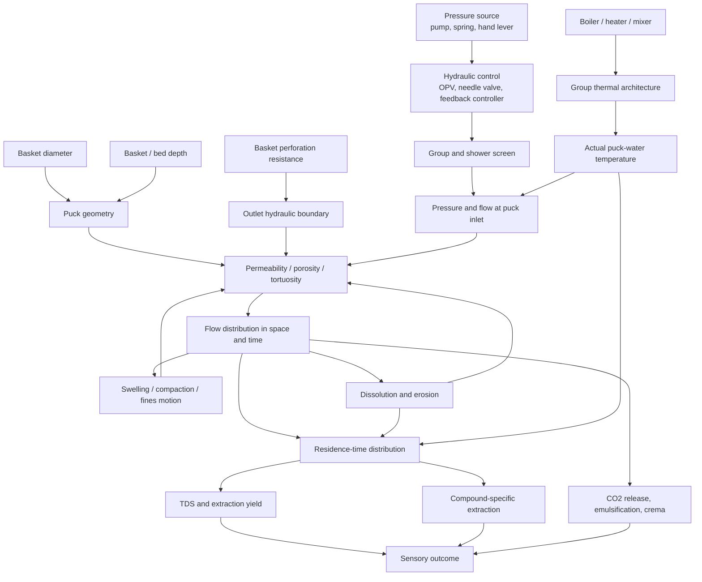

# Causal Foundations of Espresso Extraction: Machine–Basket Interactions

## Executive summary

The most useful way to understand espresso machines is **not** as seven mutually exclusive machine categories. The categories in this report occupy different causal layers. A “flat 9-bar” machine describes a **pressure-control regime**; E61 describes a **group-head and hydraulic architecture**; “saturated group” primarily describes a **thermal architecture**; spring and direct levers describe the **pressure actuator**; flow-control describes an **upstream hydraulic control mechanism**; and Decent-style profiling describes a **sensor-feedback control architecture**. Thus an E61 can also be a flow-control machine, and a saturated-group machine can also be a nominally flat-pressure machine or an actively profiling one. This distinction is fundamental because espresso outcomes are caused by the combination of actuator, hydraulic impedance, temperature boundary condition, control law, and basket/puck geometry—not by the machine label alone. Modern controlled experiments reinforce this view: espresso behaves as reactive flow through a deformable, dissolving porous medium whose permeability changes during the shot. citeturn49view0turn38view3turn38view4turn38view5

The conventional intuition that “more pressure means more flow and more extraction” is incomplete and, under espresso conditions, can be wrong. A 2026 controlled study using 18.50 ± 0.05 g in a 58-mm IMS basket, pressures from about 1 to 12 bar, simultaneous pressure and gravimetric measurements, and time-resolved TDS found that long-time flow was **non-monotonic with pressure**: flow increased at low pressures but eventually decreased as pressure rose, with the fastest flow around approximately 5 bar in that experimental system. The authors model this as **poroelastic compaction**: pressure compresses the wetted puck, reducing pore volume and permeability. The experiment also found a roughly 5–10 s wetting phase before full percolation and a 10–20 s characteristic early evolution of flow and dissolution. citeturn49view0turn50view0turn50view1

That result changes how pressure profiles should be interpreted. A flat 9-bar shot is not simply a constant “driving force.” Pressure simultaneously drives fluid and mechanically loads the coffee matrix. A spring lever's declining pressure, therefore, has a plausible self-moderating property: as dissolution and erosion tend to make the puck more permeable, spring pressure is declining. Conversely, a flat-pressure pump keeps applying essentially the same hydraulic load as the puck evolves. True flow control goes further by reducing or increasing pressure as required to maintain the selected aggregate flow. Decent explicitly implements this relationship in feedback: in flow-profile mode, pressure is automatically adjusted to maintain the desired puck outflow. These stabilizing interpretations are mechanically well founded, although direct head-to-head imaging trials of spring-lever versus flat-pressure channel formation remain a research gap. citeturn50view0turn52academia1turn38view3

**Preinfusion should be understood as control of a moving saturation, swelling, gas-displacement, and stress front**, not merely as “wetting the puck.” Contemporary experiments characterize initial espresso as unsaturated multiphase transport: water invades pores containing air and residual CO₂, the grounds swell, solubles begin dissolving, and the puck's mechanical properties change. Low-pressure or low-flow preinfusion can allow these events to progress before the puck sees peak compressive stress. But there is no universal best preinfusion time. Deeper/higher-resistance pucks generally need a slower or longer saturation phase than low-resistance shallow or high-flow systems; excessively long hot preinfusion can also permit substantial extraction and structural evolution before the main-pressure stage. Decent's saturation-detection approach is therefore conceptually superior to treating “five seconds” as an invariant physical quantity, even though the accuracy of any commercial saturation detector should be independently validated. citeturn49view0turn50view0turn38view3

Basket geometry strongly changes the operating point of the entire hydraulic system. In a first-order Darcy picture,

\[
Q \approx \frac{kA\Delta P}{\mu L},
\]

where \(Q\) is flow, \(k\) puck permeability, \(A\) cross-sectional area, \(\Delta P\) pressure across the puck, \(\mu\) viscosity, and \(L\) bed depth. For a fixed dose and approximately fixed packed density, \(L\propto1/A\), so the simplistic model implies \(Q\propto A^2\) at fixed permeability and pressure. Real espresso departs substantially from this ideal because the puck compacts, swells, dissolves, erodes and exhibits inertial/non-Darcy effects, but the equation correctly exposes why diameter and bed depth are not cosmetic variables. The 2026 poroelastic work uses this same Darcy-like starting relationship before adding pressure-dependent deformation; micro-CT and pore-scale simulations independently show that normal espresso pressure gradients produce significant inertial effects and evolving porosity. citeturn49view0turn44academia6

A nominally “high-flow” basket should consequently be viewed as **removing basket resistance from the series hydraulic circuit**. That shifts more of the total pressure drop onto the coffee puck. At unchanged coffee preparation and pump pressure, this normally raises flow; to recover the old flow one must generally grind finer, use more/deeper coffee, lower pressure, or actively constrain flow. This is why a high-flow basket is not intrinsically a higher-extraction device. Its main causal advantage is that it can make the coffee bed, rather than arbitrary metal-hole resistance, the dominant flow-limiting element. Its corresponding disadvantage is that, under fixed pressure, local puck defects can become more consequential. Decent's basket documentation explicitly varies hole size with intended dose because lower doses create less puck resistance, and it warns that nonuniform holes create preferential pathways. These particular statements are manufacturer claims, but they are consistent with porous-flow physics and controlled evidence that permeability imbalances can amplify into uneven extraction. citeturn38view7turn52academia1

**Turbulence is usually the wrong word for what happens inside an espresso puck.** The evidence supports heterogeneous porous flow and significant inertial/non-Darcy effects at espresso pressure gradients, not a demonstration that the entire interstitial flow field becomes fully turbulent. At a representative 1 mL/s through a 58-mm circular bed, the superficial velocity is only about 0.38 mm/s; true local pore velocities can be considerably higher because only the pore fraction conducts flow and pathways are tortuous. High-speed jets can exist through screen and basket perforations, but “more turbulence in the puck” should not be used casually as the explanation for higher extraction. citeturn44academia6turn50view2

Temperature control has a similarly important decomposition. **High thermal mass is passive filtering; saturated groups use thermal integration; low-mass electronic machines use active correction.** Profitec's Pro 800, for example, lists a 7.8-kg lever group plus PID-controlled boiler; Rancilio's Silvia Pro X uses separately PID-controlled boilers and a brass brew group; Lelit describes the Bianca's dual boiler as providing thermal stability; and Decent explicitly substitutes active water mixing, sensing and control for reliance on a large mass of hot metal. These architectures can all produce stable brewing temperatures, but they reach that outcome by different dynamics and therefore respond differently to idle time, shot cadence and intentional temperature profiling. citeturn38view5turn38view6turn38view4turn38view3

Finally, **TDS, extraction yield and sensory balance cannot be collapsed into a single “extraction” variable**. TDS measures beverage concentration; practical extraction yield is approximately beverage mass × TDS / dry dose. A channelled shot can have an apparently acceptable average extraction yield while being a mixture of intensely extracted high-flow regions and poorly extracted low-flow regions. A theoretical study reproduces the experimentally observed phenomenon in which finer grinding can eventually reduce extraction because small initial permeability differences become amplified through coupled dissolution and flow. Recent controlled work likewise shows that dissolution and flow co-evolve. citeturn52academia1turn50view1

Evidence for clean machine-controlled sequencing of “acids first, sugars next, bitters last” is **far weaker than the popular heuristic suggests**. Espresso studies resolve aggregate TDS and, in some literature, individual constituents such as caffeine and trigonelline, polyphenolic material and polysaccharides, but real solutes have different diffusion, dissolution and equilibrium kinetics, and sensory bitterness, acidity and sweetness are perceptual properties rather than single chemical fractions. Classic controlled work by Andueza and colleagues explicitly studied the influence of brewing pressure and extraction temperature on final espresso quality, while current physical work emphasizes that more compound-resolved, time-resolved experiments are still required. Any claim that a particular machine profile universally “extracts acids but not bitters” should therefore be considered low-confidence unless supported by compound-resolved chromatography under controlled conditions. citeturn50view2turn32view0

## Evidence base and causal framework

### The evidence hierarchy

The strongest mechanistic evidence for this report comes from four complementary lines of work.

First, Waszkiewicz and colleagues' 2026 *Under pressure: poroelastic regulation of flow in espresso brewing* is unusually valuable because it measures the actual system dynamically. Their setup used a café-grade Sanremo machine; 18.50 ± 0.05 g doses; repeatable distribution and 20-kg automatic tamping; a 58-mm-ID, 26.5-mm-high IMS basket; pressure and output mass logged at 10 Hz; calibration of machine-path pressure loss to infer pressure above the puck; pressures from about 1–12 bar; repeated trials; time-fractionated refractometry; and pre/post-brew micro-CT. The dry 18.5-g bed was about 14 mm high. citeturn49view0turn50view2

Second, Mo and colleagues combined X-ray microtomography with smoothed-particle-hydrodynamics simulations. They found substantial microscopic heterogeneity, significant inertial effects at pressure gradients relevant to espresso, and a reproducible post-extraction porosity gradient. Their work is especially important because it undermines the assumption that espresso is simply steady Darcy flow through an unchanged homogeneous bed. citeturn44academia6

Third, Lee, Smith and Arshad modeled **uneven extraction as a coupled flow–dissolution instability**. Starting with two pathways of slightly different permeability, their model shows how preferential flow can strengthen the initial difference until one path becomes disproportionately extracted, reproducing the experimentally observed drop in extraction at excessively fine grind. This provides a causal framework for channeling that is more rigorous than “water takes the path of least resistance”: the critical point is that extraction itself can alter future resistance and thereby create positive feedback. citeturn52academia1

Fourth, Méndez Harper and Hendon experimentally showed how an apparently upstream preparation variable—electrostatic aggregation during grinding—changes espresso hydraulics and concentration. Their controlled experiments found that adding less than 0.05 mL water per gram of beans before grinding altered the particle-size distribution by reducing clumping and releasing fines; with other variables held constant, some darker-roast espressos showed at least a 15% higher beverage concentration. That is a useful warning for machine comparisons: changes attributed to “pressure profile” can be overwhelmed by uncontrolled puck microstructure. citeturn44academia4

Manufacturer documentation is used primarily to establish **what the machines actually control**: Decent for pressure/flow/temperature feedback and gravimetric integration; Lelit for an E61-derived L58E flow-control architecture; Profitec for a spring-lever dipper group and its unusually high group mass; and Rancilio for a conventional pump machine with PID boilers and reduced-pressure soft infusion. Manufacturer claims about resultant cup quality are treated as lower-confidence than their engineering specifications. citeturn38view3turn38view4turn38view5turn38view6

Some historical architecture details are less well served by accessible first-party documentation. The original E61 design's automatic low-pressure saturation and thermosyphon architecture are described in historical summaries of Ernesto Valente's patent; likewise, La Marzocco's 1970 GS is historically associated with the “Gruppo Saturo” dual-boiler saturated-group architecture, and La Pavoni's Europiccola is a canonical direct-lever design. These historical sources are useful for taxonomy but are not treated as primary experimental evidence for extraction performance. citeturn39search6turn57search0turn39search0

### The causal system

Espresso can be represented as a dynamic feedback system rather than a sequence of independent settings:

This network contains several feedback loops. Pressure changes permeability through deformation; permeability changes flow; flow changes dissolution and erosion; dissolution changes porosity; and porosity feeds back into flow. The recent poroelastic experiment directly demonstrates the pressure–deformation–flow component, while micro-CT and mathematical studies provide evidence for evolving porosity, erosion and flow redistribution. citeturn49view0turn50view0turn44academia6turn52academia1

The most useful first-order hydraulic equation remains

\[
Q=\frac{kA\Delta P}{\mu L}.
\]

But in espresso, every term except nominal basket area can vary during the shot. \(k=k(t,z,P)\) because the bed swells, compacts, dissolves and can rearrange; \(\Delta P\) across the puck is not necessarily what the pump gauge reports because hoses, valves, restrictors, shower screens and the basket itself have flow-dependent pressure losses; and even viscosity changes with temperature. Waszkiewicz et al. experimentally calibrated machine pressure loss and found it to depend nonlinearly on flow, while Decent explicitly distinguishes pump pressure from puck pressure in its machine design. citeturn49view0turn38view3

This gives an important rule:

> **Pressure is not a machine-only variable, and flow is not a puck-only variable. They are jointly determined by the machine's hydraulic characteristic and the puck's evolving hydraulic characteristic unless one is actively closed-loop controlled.**

A pressure-controlled machine chooses approximately \(\Delta P(t)\) and observes whatever \(Q(t)\) results. A true flow-controlled machine chooses approximately \(Q(t)\) and allows pressure to become the dependent variable. A lever imposes a mechanical force/displacement law coupled to puck resistance. A passive flow-control needle modifies the machine's hydraulic resistance but usually does not guarantee an exact downstream flow. citeturn38view3turn38view4turn50view0

### Why fixed-setting and dialed-in comparisons differ

There are two scientifically distinct ways to compare machines and baskets.

**Fixed-puck comparison:** hold coffee, particle-size distribution, dose, distribution, tamp, ratio and temperature constant and change machine/basket variables. This measures direct causal hydraulics, but some combinations will be badly “dialed in.”

**Performance-optimized comparison:** permit grind and perhaps dose to change until each machine/basket reaches the same beverage ratio or target flow. This better resembles real use but answers a different question: what operating point can each architecture support? Because grind strongly affects permeability and extraction, redialing can erase or reverse an apparent machine effect. citeturn49view0turn44academia4turn52academia1

Statements below therefore specify whether they concern an **unchanged puck** or a **redialed system** wherever that distinction materially changes the conclusion.

## Machine and group architectures

### Comparative architecture table

| Architecture | What directly controls pressure/flow? | Characteristic pressure history | Thermal behavior | Flow variability | Representative basket geometry | Preinfusion and dose control |
|---|---|---|---|---|---|---|
| **Flat 9-bar pump regime** | Pump + regulator/OPV nominally constrains pressure; puck determines resulting flow | Fast ramp, then near-flat plateau; actual puck pressure can differ from pump pressure as flow changes | Depends on group: brass, ring group, saturated, etc.; therefore “9-bar” says almost nothing about thermal architecture | Potentially large because puck permeability evolves while pressure remains high | 58-mm family is common; other diameters exist. Basket/bed depth remains dose-dependent | May have none, passive wetting, or programmed reduced-pressure PI. Silvia Pro X, for example, offers 0–6 s reduced-pressure soft infusion and dual PID boilers. citeturn38view6turn49view0 |
| **Classic E61** | Pump plus mechanical valve/preinfusion chamber; pressure profile arises from pump, chamber filling and puck | Mechanical low-pressure filling/ramp followed by pump plateau | High-inertia group with thermosyphon coupling in the classic architecture; equilibrium and idle history therefore matter | Less abrupt initial loading than a pure instantaneous pump step, but not true flow regulation | 58-mm-class ecosystem is characteristic of modern E61 derivatives; depth chosen by dose | Classic architecture provides mechanical preinfusion; timing/profile are not freely programmable without modifications. Historical patent descriptions identify automatic low-pressure saturation as a defining feature. citeturn39search6turn38view4 |
| **Spring lever** | Stored spring force acting on a piston; pump may only fill boiler/group | High initial extraction pressure followed by an approximately displacement-linked decay | Often very high group thermal mass. Profitec's Pro 800 lists a 7.8-kg group and PID boiler | Puck resistance changes *time* taken for the spring to expand, so pressure-vs-time is coupled to flow | Model-dependent; modern machines may accept conventional multi-dose baskets; Pro 800 ships 7, 14 and 21 g filters | Dipper/group-fill phase provides preinfusion before spring-driven extraction. citeturn38view5 |
| **Direct-pull lever** | Barista force through lever geometry onto piston | Fully operator-dependent: ramp, hold and decay are possible | Usually boiler/group conduction and substantial metal mass rather than rapid active feedback | Very high operator authority and correspondingly high operator variability | Legacy Europiccola families illustrate 49/51-mm direct-lever geometries; modern direct levers vary | Lever position controls filling and hand force controls extraction; there is no inherent fixed-pressure law. citeturn39search0 |
| **Passive flow-control machine** | Needle/paddle restriction changes inlet hydraulic impedance | Low-flow saturation can be followed by gradual pressure rise or declining stages | On Bianca, an L58E/E61-derived group plus dual boiler; other implementations differ | Barista controls restriction, not necessarily exact flow; puck resistance still changes actual Q | Commonly 58-mm on E61 implementations; Bianca includes baskets covering roughly 9–21 g dose classes | Excellent manual preinfusion flexibility; Bianca's paddle explicitly changes water flow and group manometer reads extraction pressure. citeturn38view4 |
| **Decent-style active profiling** | Sensor-feedback system can prioritize pressure or flow and modify pressure to hit flow targets | Arbitrary staged pressure/flow profiles within hardware limits | Lower dependence on huge passive metal mass; active water mixing and feedback target delivered temperature | Aggregate flow can be closed-loop controlled even while puck resistance changes | 58-mm; standard machine includes an 18-g basket | Detects saturation, performs pressure/flow/temp profiling, meters inlet water, and can use a Bluetooth scale to stop at beverage weight. citeturn38view3turn38view7 |
| **Saturated group** | **Not defined by pressure control.** Usually paired with pump pressure control, but profiling variants exist | Whatever the hydraulic system commands; saturated does not imply flat or profiled pressure | Brew group is thermally integrated with the brew boiler, minimizing the group as an independent thermal disturbance | Hydraulic variability is determined by pump/profile, not “saturation” itself | Commercial saturated systems are generally in the 58-mm ecosystem | PI, volumetric and gravimetric capabilities are model-dependent. La Marzocco's historical GS established the dual-boiler “Gruppo Saturo” architecture specifically for thermal stability. citeturn57search0 |

The table reveals the most consequential classification error in everyday espresso discussion: **a saturated group is not the opposite of an E61 in pressure terms, nor is an E61 necessarily the opposite of a profiling machine**. “Saturated” answers *how the group is thermally coupled*; “E61” answers much of *how the group fills, vents and exchanges heat*; “9 bar,” “flow control” and “profiled” answer *what hydraulic trajectory is commanded*. citeturn38view4turn57search0

### Schematic pressure and flow timelines

The following are qualitative—not universal calibrated curves:

```mermaid
flowchart LR
    subgraph F["Flat 9-bar"]
      F1["Dry puck<br/>P≈0"] --> F2["optional short PI"] --> F3["rapid ramp"] --> F4["~constant pressure<br/>Q follows puck evolution"] --> F5["stop"]
    end

    subgraph E["Classic E61"]
      E1["valve opens"] --> E2["chamber fill / mechanical PI"] --> E3["pressure ramps"] --> E4["pump plateau"] --> E5["vent"]
    end

    subgraph S["Spring lever"]
      S1["dipper fill / PI"] --> S2["spring peak"] --> S3["declining pressure"] --> S4["lower-pressure tail"]
    end

    subgraph D["Direct lever"]
      D1["fill / PI"] --> D2["operator force ramp"] --> D3["operator-selected pressure"] --> D4["manual decline / stop"]
    end

    subgraph C["Passive flow control"]
      C1["restricted low Q"] --> C2["puck saturates"] --> C3["valve opens progressively"] --> C4["P follows restriction + puck"] --> C5["manual tail"]
    end

    subgraph DE["Decent-style feedback"]
      DE1["target PI Q/P"] --> DE2["saturation detected"] --> DE3["P or Q target"] --> DE4["feedback corrects as puck changes"] --> DE5["weight/volume stop"]
    end

    subgraph SG["Saturated-group flat-pressure example"]
      SG1["thermally conditioned group"] --> SG2["PI if equipped"] --> SG3["pump plateau"] --> SG4["stable thermal boundary<br/>Q follows puck"] --> SG5["stop"]
    end
```

The critical distinction is between a profile specified against **time** and one generated against **piston displacement or hydraulic state**. A spring lever's pressure decline is approximately determined by spring extension, not by an independent timer. A slow-resistance puck keeps the spring near its high-force position longer; a fast-flowing puck allows the piston to travel faster. Thus a spring lever creates an intrinsically coupled pressure–flow trajectory rather than merely replaying a fixed digital pressure curve. Profitec's spring/dipper architecture illustrates this design class. citeturn38view5

For a direct lever,

\[
P_{\mathrm{piston}}\approx\frac{R\,F_{\mathrm{hand}}}{A_{\mathrm{piston}}},
\]

where \(R\) is the lever's mechanical ratio. The operator can therefore react to tactile resistance, but repeatability depends on reproducing force-versus-displacement. This gives direct levers exceptional control authority yet makes “the direct-lever profile” meaningless without an actual pressure trace. Legacy La Pavoni machines are examples of this direct-lever class. citeturn39search0

### Flat 9-bar machines

With a sufficiently stiff pump/regulator, the machine acts approximately as a **constant-pressure boundary condition**. At unchanged grind, the puck's permeability evolution dictates flow. Early in the shot, swelling and pressure-induced compaction can suppress flow; later, dissolution, erosion and structural rearrangement can raise it. Consequently, a familiar accelerating flow curve under constant pump pressure should not automatically be interpreted as “the pump flowing more”—it can be the puck becoming less resistive. citeturn49view0turn50view0

The danger is positive feedback around a localized defect. Suppose one zone starts with 10% higher permeability. It takes more flow, extracts more rapidly and can lose soluble/structural material faster; if that raises its permeability further, flow is diverted toward it again. Lee et al.'s model demonstrates this type of instability. Maintaining 9 bar does nothing to stop it; indeed, the pump continues supplying the same pressure differential to the increasingly open pathway. citeturn52academia1

The advantage is repeatable boundary pressure and simplicity. When puck preparation is highly repeatable and the coffee is dialed to an appropriate permeability, flat pressure can be extremely consistent. A reduced-pressure soft-infusion stage, such as the 0–6 s function documented for the Silvia Pro X, reduces the abruptness of initial loading but is still much less adaptable than closed-loop flow profiling. citeturn38view6

### E61 machines

A classic E61 inserts **hydraulic compliance and staged filling** ahead of the pump-pressure plateau. Historically, the architecture uses valves and an infusion chamber to saturate the puck before full pump pressure, while a thermosyphon couples the heavy group to the hot-water circuit. Modern E61-derived groups retain this general architectural concept even though exact chamber volumes, springs, restrictors and thermal tuning differ across manufacturers. citeturn39search6turn38view4

Causally, this gives an unmodified E61 a gentler initial pressure derivative \(dP/dt\) than an uncompensated pump step. That can reduce the mechanical disturbance imposed on a partially dry puck and gives gas displacement/swelling more time before maximum stress. The evidence that typical puck saturation itself requires several seconds supports the mechanism, although it does not prove that every E61's particular ramp is optimal. citeturn50view0

The thermal tradeoff is **inertia versus state dependence**. A large thermally coupled group resists rapid temperature changes once equilibrated, but its temperature depends on recent idle/flow history and thermosyphon tuning. This means nominal boiler temperature and actual puck-inlet temperature need not be interchangeable quantities. By comparison, active low-mass systems measure/control delivered water more directly, while saturated groups reduce the group's independent thermal degree of freedom. This comparison follows from the architectures; direct same-profile chemical trials across all three remain scarce. citeturn38view3turn38view4turn57search0

### Spring and direct-pull lever machines

For a spring lever, spring force decreases as the piston advances:

\[
F_s(x)=k(x_0-x)+F_{\mathrm{preload}},
\qquad
P(x)\approx\frac{F_s(x)}{A_p}.
\]

Therefore, pressure naturally falls over the extraction stroke. This is potentially important because dissolution can make the puck increasingly permeable: falling pressure can counteract the tendency toward late-shot flow acceleration. That **self-moderating interpretation is a mechanistic hypothesis**, not yet a demonstrated universal sensory advantage. It deserves direct testing because modern evidence clearly establishes both permeability evolution and pressure-induced compaction. citeturn50view0turn50view1

Spring-lever groups also tend to create a substantial fill/preinfusion phase. Profitec explicitly attributes the Pro 800's preinfusion to its massive brew group and “special pressure process,” and specifies a 7.8-kg lever group. Such a group is a large thermal reservoir, making the machine relatively insensitive to instantaneous heater fluctuations but slow to change state intentionally. citeturn38view5

A direct lever separates these effects: there is no spring law, so the barista defines piston force. With instrumentation, it can reproduce a flat, declining or complex profile; without instrumentation, the tactile feedback loop is human. Because operator force responds to perceived resistance, a skilled user can theoretically compensate for a puck that flows unexpectedly fast or slowly. The price is greater between-shot variation unless force/displacement are measured. citeturn39search0

### Passive flow-control machines

An E61 flow-control paddle, such as the Bianca's, places a variable restriction upstream of the puck. Lelit explicitly states that rotating the paddle changes water flow and that the group manometer reads extraction pressure. The important point is that a needle valve generally **does not command flow independently of the puck**; it changes the total hydraulic impedance. Actual flow is the solution of

\[
\Delta P_{\text{pump}}
=
\Delta P_{\text{valve}}(Q)
+
\Delta P_{\text{group}}(Q)
+
\Delta P_{\text{basket}}(Q)
+
\Delta P_{\text{puck}}(Q,t).
\]

Thus the same paddle position need not give the same flow on two differently prepared pucks. citeturn38view4turn49view0

Its principal advantage is the ability to begin at very low flow, wait for saturation, then choose how quickly to increase hydraulic load. Late in the shot, closing the valve can counter increasing puck permeability. This approximates some advantages of active profiling but remains open-loop from the operator's perspective unless a real-time flow meter or scale is incorporated. citeturn38view4turn50view0

### Decent-style active profiling

Decent changes the causal structure by closing the loop. Its documentation says the machine can draw arbitrary pressure profiles, change temperature during the shot, specify desired puck outflow with automatic pressure adjustment, detect the end of preinfusion, prioritize pressure or flow, meter water dispensed, and communicate with a scale to stop at a target beverage weight. citeturn38view3

Under **pressure control**, it is still essentially exposing the evolving puck to a chosen pressure boundary; flow remains diagnostic. Under **flow control**, the machine reacts to changes in puck resistance. If the puck suddenly becomes easier to pass, the controller can reduce pressure instead of allowing unconstrained acceleration. This makes active flow control particularly interesting for high-flow baskets and coarse/high-permeability recipes. citeturn38view3turn50view0

However, an aggregate flow sensor cannot determine whether 2 mL/s is uniformly distributed across 2,600 mm² or concentrated in a narrow channel. Closed-loop flow control therefore controls the **integral** of the velocity field, not spatial uniformity. It may limit the severity of runaway behavior, but it cannot repair a badly heterogeneous puck by measurement alone. This follows directly from the uneven-flow mechanisms demonstrated in physical and mathematical work. citeturn52academia1turn44academia6

### Saturated groups

“Saturated” should be treated first as a **thermal boundary-condition technology**. La Marzocco's historical GS architecture placed the brewing group in intimate thermal relation with a dedicated brew boiler; the point was to reduce temperature variation caused by a thermally independent group while separating brewing and steaming circuits. citeturn57search0

If a saturated-group machine runs flat pump pressure, its puck mechanics are still fundamentally those of a pressure-controlled system: swelling, compaction, dissolution, erosion and channels all remain possible. Saturation does not confer immunity from channeling. Its scientific value in comparative experiments is instead that it can reduce temperature as a confounder, making changes in flow more confidently attributable to puck hydraulics rather than a drifting group temperature. citeturn49view0turn57search0

## Basket geometry and operating controls

### Diameter and depth

For circular puck diameters, nominal cross-sectional areas are approximately:

| Nominal puck diameter | Area | Area relative to 58 mm | Superficial velocity at same Q | First-order bed depth at same dose/density | Darcy-like resistance \(L/A\) relative to 58 mm |
|---:|---:|---:|---:|---:|---:|
| 58 mm | 2,642 mm² | 1.00 | 1.00× | 1.00× | 1.00× |
| 54 mm | 2,290 mm² | 0.87 | 1.15× | 1.15× | ~1.33× |
| 51 mm | 2,043 mm² | 0.77 | 1.29× | 1.29× | ~1.67× |
| 49 mm | 1,886 mm² | 0.71 | 1.40× | 1.40× | ~1.96× |

These are geometric calculations, not empirical espresso coefficients. They assume the same dry dose, packed density and permeability and ignore taper, headspace, swelling and nonlinear deformation. Their purpose is to show how strongly diameter changes the hydraulic problem even before coffee physics is introduced. The 58-mm area agrees with the approximately \(2.64\times10^3\) mm² area used in the 2026 poroelastic study. citeturn50view2

A narrower basket at equal dose creates a deeper bed and, at the same total flow, a higher superficial velocity. In the elementary model it therefore produces substantially greater pressure drop. In reality the greater depth also creates more opportunity for vertical gradients in saturation, pressure, compaction and solute depletion. Micro-CT evidence that espresso develops depth-dependent porosity means this vertical dimension cannot be treated as merely additional coffee mass. citeturn44academia6turn49view0

A wider/shallower bed produces the converse: shorter travel distance and lower base hydraulic resistance. With unchanged grind and pressure it tends toward higher flow, so it normally needs finer grind, more dose, a lower pressure profile or explicit flow control to preserve a comparable beverage time/ratio. Shallower pucks may reduce vertical extraction gradients, but they also leave less resistance to suppress local defects. Whether that raises or lowers actual channeling depends on puck preparation and the machine's control law, so a blanket “58 mm channels less than 54 mm” claim is not supported by present evidence. citeturn52academia1turn50view0

**Basket physical depth and coffee-bed depth are different variables.** In Waszkiewicz et al.'s controlled experiment, the basket was 26.5 mm high but the dry 18.5-g coffee bed was only about 14 mm high. Headspace, shower-screen intrusion and swelling therefore matter. Comparisons described only as “a 24-mm basket versus a 28-mm basket” are incomplete unless actual bed thickness is measured. citeturn49view0

### High-flow baskets

A basket and puck are hydraulic resistors in series. A conventional basket may consume a nontrivial portion of the available pressure across its perforations. A higher-open-area or otherwise lower-resistance basket lowers \(\Delta P_{\text{basket}}\), leaving more of pump pressure to appear across the puck at a given flow. The exact magnitude depends on hole count, hole diameter, shape, wall geometry and flow. Waszkiewicz et al.'s calibration of the rest of the brewing assembly demonstrates why this systems view matters: even without coffee, group-path pressure loss increased nonlinearly with flow. citeturn49view0

Decent explicitly calibrates basket hole size by intended dose, explaining that less coffee provides less puck resistance and therefore smaller baskets are given smaller holes to maintain balanced pressure and flow. The company also states that uneven hole sizes can encourage preferential flow. These are manufacturer engineering claims rather than independent basket trials, but their direction is consistent with the governing hydraulic relationships. citeturn38view7

At **fixed grind, dose and pump pressure**, a lower-resistance basket should generally move the system toward higher flow. That can shorten contact time and lower TDS at a fixed shot duration, or increase beverage mass if the shot is time-stopped. It can also make a local high-permeability puck defect more influential because less of the total hydraulic resistance is supplied uniformly by the metal basket. This latter channeling prediction is an inference from the coupled-flow instability literature and should be tested directly. citeturn52academia1turn49view0

After **redialing finer**, the picture changes. The grinder can restore the target total resistance while the basket contributes less of it. This may give the puck's particle network greater control over extraction and allow higher extraction in well-prepared, high-uniformity beds, but it can also move the grind closer to the regime in which fines, compaction and uneven permeability become problematic. Therefore “high-flow basket → higher EY” is not a physical law; the basket merely changes the feasible combination of grind, flow and pressure. citeturn52academia1turn44academia4

### Preinfusion pressure and duration

The wetting stage contains at least four coupled processes:

\[
\text{liquid invasion}
\rightarrow
\text{air/CO₂ displacement}
\rightarrow
\text{particle swelling}
\rightarrow
\text{changing permeability + dissolution}.
\]

Controlled espresso measurements report about 5–10 s for penetration and first-flow development under their representative conditions, consistent with time-resolved CT observations discussed by the authors. citeturn50view0

A **low-pressure/low-flow preinfusion** plausibly lowers channel risk by reducing differential stress on a partly wet puck and allowing capillary wetting to progress before high hydraulic load. It can also reduce the kinetic disturbance caused by high inlet flow onto dry grounds. But “low pressure” and “low flow” are not identical: a highly resistive deep puck may build several bar even at small flow, whereas an open high-flow basket/coffee combination may remain near zero gauge pressure while taking substantial water. citeturn50view0turn38view3

A **high-pressure preinfusion** creates faster hydraulic driving but also more immediate compaction. Because recent data show that pressure can reduce permeability, aggressively pressurizing a still-swelling bed may retard rather than accelerate uniform saturation in some coffee preparations. This is a testable extrapolation from the poroelastic findings, not yet a universal experimentally established rule. citeturn50view0turn50view1

Duration should ideally be referenced to a physical event—estimated saturation, first output, a specified absorbed-water mass or pressure/flow transition—not merely wall-clock time. Decent's preinfusion-end detection explicitly attempts to detect puck saturation, while a conventional programmed machine may simply run a reduced-pressure stage for a fixed number of seconds. citeturn38view3turn38view6

### Thermal mass, thermal stability and actual puck temperature

Three different quantities are often conflated:

1. **Heater/boiler sensor stability**
2. **Group-metal temperature stability**
3. **Water temperature actually entering and traversing the puck**

PID stability at a boiler probe does not prove that the puck sees the same temperature. The group, portafilter and coffee are transient heat sinks; incoming water exchanges heat with all of them. Machines mitigate this through different architectures. Rancilio uses dual PID-controlled boilers and a brass brewing unit; Lelit combines an L58E group with a dedicated brew boiler; Profitec's lever machine adds exceptionally large group mass; Decent actively mixes hot and cool water and measures/control variables in real time. citeturn38view6turn38view4turn38view5turn38view3

High mass acts approximately as a low-pass thermal filter: it resists short disturbances but also stores thermal history. Active low-mass control is the opposite: less stored heat means the controller must correct disturbances quickly, but intentional temperature changes can be faster. A saturated group reduces the thermal separation between boiler and group. Consequently, two machines with identical nominal “93°C” settings need not produce identical inlet-temperature trajectories unless measured at equivalent locations. citeturn38view3turn57search0

The most rigorous extraction experiments should therefore use a fast thermocouple or equivalent sensor near the shower-screen/puck interface rather than relying exclusively on the machine's set point. This becomes particularly important when comparing a massive spring-lever group with active Decent-style temperature profiling or a saturated commercial group. The machine architectures documented by Profitec, Decent and La Marzocco's saturated-group history make those thermal boundary conditions fundamentally different. citeturn38view5turn38view3turn57search0

### Volumetric, gravimetric and flow-controlled operation

**Volumetric dosing** measures or estimates water delivered by the machine. Decent describes its volumetric mode as stopping once a specified amount of water has been dispensed. But inlet water is not identical to cup mass: some water remains in the swollen puck and hydraulic spaces, and retention changes with dose, grind and shot stage. Thus a fixed inlet dose controls one boundary condition but not directly the final beverage ratio. citeturn38view3turn49view0

**Gravimetric dosing** stops using measured beverage mass. Decent supports this via a Bluetooth scale. Gravimetric termination therefore directly suppresses one major source of shot-ratio variability: the amount that actually reached the cup. It cannot by itself guarantee the same TDS or EY, because two 36-g outputs can arise from very different spatial extraction patterns or pressure/flow histories. citeturn38view3turn52academia1

**Flow profiling** controls the trajectory rather than merely the endpoint. A pressure-controlled shot effectively asks, “At this pressure, how fast does this changing puck flow?” A closed-loop flow shot asks, “What pressure is required to keep this changing puck flowing at this rate?” Decent explicitly implements the latter relationship. Because puck permeability changes over time, these two control laws necessarily generate different trajectories even when they begin at the same pressure and flow. citeturn38view3turn50view0

## Interaction matrix and extraction outcomes

Because an exhaustive literal cross-product of every diameter × depth × hole pattern × machine would create false precision, the matrix below organizes basket behavior into three hydraulically meaningful states:

**deep/high-resistance** = narrower diameter, greater bed depth, or otherwise larger puck pressure drop;  
**wide/shallow** = larger area or lower bed depth at comparable coffee mass;  
**high-flow basket** = lower basket-specific exit resistance.

These can overlap—for example, a deep puck can sit in a high-flow basket.

| Machine/group | Deep / high-resistance puck | Wide / shallow puck | High-flow basket |
|---|---|---|---|
| **Flat 9-bar** | Pressure builds readily; compaction is stronger and flow may enter the high-pressure saturation regime where extra pressure no longer gives extra Q. Long path increases sensitivity to vertical saturation/porosity gradients. PI is particularly valuable. citeturn50view0turn44academia6 | Lower resistance means flow can accelerate strongly after pressurization unless grind is finer. Abrupt 9-bar application may expose distribution defects early. Lower depth should reduce path length but not necessarily spatial channeling. citeturn52academia1 | At unchanged grind, expect increased flow because less pressure is lost in the basket. Fixed pressure does not compensate when permeability rises, so local defects may be amplified. Redialing finer is normally required. **Channel-sensitivity increase is a mechanistic inference.** citeturn38view7turn52academia1 |
| **Classic E61** | Mechanical preinfusion/ramp is well matched to the need to saturate a long, resistive path before peak pressure. High group inertia stabilizes temperature once equilibrated. citeturn39search6turn50view0 | Mechanical PI may complete quickly, after which pump pressure can produce rapid flow. Grind must usually supply the missing resistance. | Lower outlet resistance can make the standard E61's fixed mechanical ramp less ideal because the puck fills/flows sooner than with conventional baskets. Flow-restrictor modification is advantageous if a longer saturation phase is desired. This interaction is an engineering inference. citeturn38view4 |
| **Spring lever** | High initial resistance slows piston travel, so the spring spends more time near higher force. Dipper preinfusion and heavy group support gradual saturation. Pressure then naturally declines. citeturn38view5 | Piston travels faster and the pressure decay is compressed in time; shot can become short unless grind is tightened. The spring's displacement-based decline naturally reacts to faster flow. | Lower basket resistance accelerates piston travel; this shortens the high-pressure portion of the shot and may partly self-limit runaway. **Hypothesis:** this makes spring levers less sensitive than flat 9-bar machines to a high-flow basket, after suitable grind adjustment. citeturn50view0turn38view5 |
| **Direct lever** | Operator feels/observes high resistance and can choose a longer low-force saturation period before increasing force. Potentially excellent compensation, but operator-dependent. | Requires smooth force application because small lever-force changes can produce large flow changes in the low-resistance puck. | Particularly compatible with pressure instrumentation: the operator can deliberately keep pressure low despite high potential flow. Without instrumentation, repeatability is weak. citeturn39search0 |
| **Passive flow-control** | Strong combination: low inlet flow can saturate a resistive puck without forcing high pressure immediately; valve can then be opened progressively. citeturn38view4turn50view0 | Restriction prevents the shallow puck from simply running away at pump pressure. A lower target flow can substitute for the resistance otherwise supplied by depth. | Architecturally synergistic: a low-resistance basket removes uncontrolled downstream metal restriction while the upstream needle deliberately supplies controllable restriction. But paddle position is not identical to flow, so monitoring remains valuable. citeturn38view4turn38view7 |
| **Decent-style active profiling** | Controller can impose a low-flow saturation stage and allow pressure to rise as necessary, then enforce a flow ceiling. This most directly decouples basket resistance from desired Q. citeturn38view3 | Low target flow prevents a shallow puck from accelerating solely because its resistance is low. Pressure becomes a diagnostic of puck state. | Probably the most natural combination for true flow control: the basket ceases to be the main restrictor and feedback supplies the desired integral Q. Spatial channeling still remains possible and invisible to an aggregate flow sensor. citeturn38view3turn52academia1 |
| **Saturated group, flat pressure** | Thermal variability is minimized relative to less-integrated groups, making deep-puck hydraulic effects easier to isolate. Hydraulic compaction/channeling mechanisms remain those of flat pressure. citeturn57search0turn50view0 | Stable temperature does not prevent fast flow; grind/profile must create appropriate hydraulic resistance. | No special hydraulic protection arises merely from group saturation. A high-flow basket on a flat-pressure saturated group behaves fundamentally as a lower-resistance outlet and should be redialed accordingly. citeturn57search0turn38view7 |

### Pressure profile → compaction → flow → channeling

The strongest present causal chain is:

\[
P(t)
\rightarrow
\text{effective stress}
\rightarrow
\phi(t,z)
\rightarrow
k(t,z)
\rightarrow
Q(t,z)
\rightarrow
\text{dissolution/erosion}
\rightarrow
k(t+\Delta t,z).
\]

Here \(\phi\) is porosity and \(k\) permeability. At low pressure, additional pressure tends to increase flow. At espresso-level pressure, the coffee matrix can compact enough that the reduction in permeability offsets the additional driving pressure. The recent 1–12 bar experiment provides direct evidence for this nonlinear relationship rather than merely assuming Darcy proportionality. citeturn50view0turn50view1

This is also why puck **relaxation** deserves more attention. When pressure is reduced late in a shot, the mechanically loaded wet bed can partially relax while remaining swollen and chemically altered. Current studies clearly demonstrate elastic/poroelastic behavior but have not mapped the short-time unloading hysteresis of an espresso puck during realistic declining-pressure shots. Consequently, the common claim that declining pressure “lets the puck relax and prevents channeling” is physically plausible but presently stronger as a hypothesis than as an experimentally quantified fact. The 2026 authors explicitly note the lack of independent mechanical measurements of wetted coffee's effective modulus. citeturn50view1

### Flow and “turbulence”

Pore-scale simulations indicate that inertial effects become significant at espresso pressure gradients, so the purely linear Darcy model is incomplete. This is a stronger and more precise statement than saying “9 bar makes the water turbulent.” citeturn44academia6

At the same time, the perforations of a basket transform distributed porous flow into many small jets. Increasing basket open area generally reduces the velocity and pressure drop required for a given aggregate Q if the holes are larger/more numerous, whereas reducing open area concentrates flow through fewer/smaller exits. These changes affect the pressure boundary at the bottom of the puck. Direct measurements that simultaneously resolve individual basket-hole jets and internal puck flow are notably absent from the current evidence base; high-flow-basket claims about “more turbulence” should therefore be treated skeptically.

### Extraction yield and TDS

For a practical espresso measured in the cup,

\[
EY_{\mathrm{app}}\approx
\frac{m_b \times TDS}{m_d},
\]

where \(m_b\) is beverage mass and \(m_d\) dry coffee dose. This equation makes clear why higher TDS does not necessarily mean higher extraction yield: a 20-g ristretto can have higher TDS than a 40-g espresso while extracting less total dry material.

The 2026 experiment's time-resolved fractions showed a strongly concentrated early portion and declining TDS as the shot progressed; the authors conclude that much of the readily soluble material is released quickly and subsequently transported by the evolving flow. Their fitted TDS dynamics and dissolved-mass dynamics both occurred on roughly ten-second scales, while the flow itself continued evolving. citeturn50view1turn50view2

This has different implications for machine types:

**Flat pressure:** if permeability rises, flow can accelerate, increasing later dilution and potentially routing more water through already-open pathways. Average TDS falls with added beverage mass even while EY may continue rising. citeturn50view0turn52academia1

**Spring decline:** lowering late pressure may reduce the rate at which dilute late-stage liquid is collected and could suppress preferential high-flow paths. At a fixed final beverage mass, however, the machine may simply take longer; whether EY rises depends on spatial uniformity and solute kinetics, not pressure decline alone. This is a mechanistic prediction requiring controlled comparison. citeturn50view1

**Flow control:** keeping Q moderate despite rising permeability makes the residence-time distribution more stable at the aggregate level. That can improve reproducibility, but it cannot guarantee equal residence time everywhere in a channelled puck. citeturn38view3turn52academia1

**High-flow basket:** unchanged grind usually raises Q and therefore can lower concentration for a fixed time; redialing finer can restore flow and potentially alter EY by changing surface area and permeability. The basket effect therefore cannot be isolated from the new grind operating point in ordinary dialed-in use. citeturn38view7turn52academia1

## Chemistry, crema, and sensory interpretation

### What the machine can actually change chemically

Machine architecture changes chemical extraction primarily through four intermediate variables:

\[
\text{machine}
\rightarrow
\{T(t),\,P(t),\,Q(t),\,\text{spatial flow distribution}\}
\rightarrow
\{\text{mass transfer, dissolution, erosion, emulsification}\}
\rightarrow
\text{cup chemistry}.
\]

Pressure itself is generally less useful as a direct chemical-solubility variable than as a driver of flow, puck deformation and multiphase behavior. Temperature directly affects diffusion, dissolution kinetics and water viscosity; flow changes refreshment of solvent and residence time; channeling changes what fraction of the bed is actually contacted. Current espresso physics strongly supports these intermediate mechanisms. citeturn49view0turn50view1turn44academia6

Classic controlled food-science work specifically examined the **influence of water pressure on final Arabica espresso quality** (Andueza et al., 2002, *Journal of Agricultural and Food Chemistry*, 50, 7426–7431, DOI 10.1021/jf0206623) and the **influence of extraction temperature on final espresso quality** (Andueza et al., 2003, *Journal of the Science of Food and Agriculture*, 83, 240–248, DOI 10.1002/jsfa.1304). These studies are important precedents, but modern dynamic pressure-flow work shows why a nominal pressure or temperature setting is insufficient to characterize the actual physical extraction trajectory. citeturn50view2

### Acids, sugars and bitter compounds

A rigorous machine-profile discussion should avoid the widespread narrative that extraction occurs in three clean stages—“acids, then sugars, then bitters.” The coffee matrix contains many chemical species with different accessibility and transport kinetics. Contemporary physical descriptions explicitly discuss caffeine, trigonelline, polyphenolic compounds and polysaccharides among the extractable material, while also emphasizing that volatile and nonvolatile flavor evolution remains a target for future coupled modeling rather than a solved problem. citeturn32view0turn44academia6

The safest mechanistic conclusions are therefore:

**Acidity-related compounds.** Machine changes that raise actual puck temperature, increase accessible wetted area or extend solvent contact can change the amount and ratio of acidic compounds reaching the cup. But sensory acidity is not equivalent to total acid concentration, and current machine-profile studies do not establish a universal “low-pressure extracts acids first” rule. Pressure effects are heavily mediated through flow and deformation. citeturn49view0turn50view2

**Sugar/sweetness-related extraction.** The machine can influence the extraction of soluble carbohydrate material through temperature, wetting and mass transfer, but perceived sweetness is not a direct sugar meter. The literature presently does not justify assigning a particular lever or flow profile a universal “sugar extraction window.” Compound-resolved trials are needed. citeturn32view0

**Bitterness-related compounds.** Likewise, bitterness cannot be mapped simply to “late extraction.” Caffeine is readily soluble, and many other bitter/astringent contributors have their own kinetics and roast dependence. A highly channelled shot can taste simultaneously sharp and bitter because different spatial regions have undergone radically different extraction histories even if the average EY appears conventional. The coupled-flow theory provides a physical basis for such mixed extraction states. citeturn52academia1turn32view0

The sensory implication is important: **uniformity can matter more than mean EY**. Raising EY by improving contact with previously under-extracted particles is chemically different from raising the same average EY by forcing more water through an already dominant channel. Only the former necessarily represents broader utilization of the coffee bed. citeturn52academia1turn49view0

### Crema

Crema formation is a multiphase phenomenon. Espresso grounds contain residual CO₂; hot pressurized water contacts this gas while simultaneously extracting surface-active and oil-containing material. As the beverage exits the high-pressure puck/basket environment and approaches atmospheric pressure, dissolved or entrained gas expands/nucleates and a foam/emulsion structure develops. Coffee extraction literature also identifies oil emulsification and CO₂ behavior as characteristic espresso processes. citeturn49view0turn32view0

This gives several causal predictions.

A high-pressure stage can increase the pressure available for CO₂ dissolution/compression and creates a larger final decompression, but crema quantity is not determined by peak pressure alone. Coffee degassing state, roast, temperature, outlet shear, lipid/surface-active material and beverage flow all intervene. Therefore a 6-bar lever shot can still produce substantial crema, and a poorly degassed or stale coffee at 9 bar can produce relatively little. Direct controlled work isolating pressure-profile shape while holding retained CO₂ constant is limited.

Basket geometry may influence crema indirectly through exit jets. A larger total open area changes jet velocity/shear at a given aggregate flow; pressure loss across the basket also changes the location of decompression. But claims that a particular precision/high-flow basket “creates more crema through turbulence” are not presently well grounded in controlled mechanistic evidence.

Crema should consequently **not be used as a proxy for EY or uniformity**. It reports gas/colloid behavior at least as much as dissolved-solid extraction. An attractive crema can coexist with spatially uneven puck extraction.

### Sensory expectations by architecture

The following are **conditional mechanistic expectations**, assuming the machines are competently dialed and actual brew temperature is matched:

| Architecture | Most defensible sensory-relevant tendency | What is *not* established |
|---|---|---|
| Flat 9 bar | Strong, repeatable pressure boundary; good results when puck resistance/distribution are stable; more opportunity for late flow acceleration if puck opens | That 9 bar intrinsically extracts “more sweetness” or produces optimal EY |
| E61 | Gentler initial wetting plus substantial thermal inertia may reduce abrupt early puck disturbance | That E61 mechanical PI is universally superior to electronically controlled PI |
| Spring lever | Declining pressure plausibly limits late high-flow runaway and changes residence-time distribution | That declining pressure universally lowers bitterness or raises sweetness |
| Direct lever | Can deliberately tailor pressure to real-time puck response | That human tactile feedback is automatically more accurate than sensors |
| Passive flow control | Allows very gentle saturation and deliberate late restriction | That a paddle position reproduces a fixed Q between pucks |
| Decent-style feedback | Most direct aggregate control of pressure, flow and actual output ratio; excellent platform for causal experimentation | That closed-loop aggregate flow eliminates internal channels |
| Saturated group | Reduces thermal state as a confounder and supports strong shot-to-shot temperature repeatability | That saturation itself changes pressure mechanics or prevents channeling |

These distinctions follow from the documented control architectures plus current porous-media evidence; the sensory column should be read as causal expectation rather than a ranking of machines. citeturn38view3turn38view4turn38view5turn57search0turn52academia1

## Uncertainties and experimental agenda

### Where evidence is strong

Several conclusions are now on relatively firm mechanistic footing.

Espresso pucks are **dynamic deformable porous media**, not static resistors. Swelling, dissolution and compaction occur on the same order of time as a normal shot. citeturn49view0turn50view1

The pressure–flow curve is **nonlinear**, and at sufficiently high espresso-range pressure an increase in pressure can coincide with *less*, rather than more, long-time flow because of puck compaction. In the 2026 experiment, maximum long-time flow occurred around approximately 5 bar, although that numerical optimum must not be generalized to every coffee/grind/basket. citeturn50view0

Espresso pore flow shows **significant inertial/non-Darcy effects**, and post-extraction pucks develop measurable spatial porosity gradients. citeturn44academia6

Small permeability differences can be amplified through coupled flow and extraction, giving a physically plausible mechanism for channel formation and the counterintuitive loss of extraction observed at excessively fine grinds. citeturn52academia1

The first several seconds are a distinct **multiphase saturation regime**, not simply a low-pressure version of the later saturated shot. citeturn49view0turn50view0

### Where evidence is weak

There is surprisingly little peer-reviewed work that changes **only basket diameter** while preserving equivalent particle-size distribution, actual bed depth, puck density, beverage ratio, actual puck pressure, inlet temperature and basket open area. Most 49-, 51-, 54- and 58-mm comparisons simultaneously change machine, dose, group geometry and basket design. Thus the strong geometric predictions above are well grounded in transport equations, but exact sensory effect sizes are unknown.

Likewise, modern “high-flow” baskets have proliferated faster than controlled literature. Manufacturer engineering descriptions support the role of hole size and bed resistance, but independent factorial trials linking basket open area to measured puck-pressure fields, micro-CT channeling, time-resolved TDS and sensory results are lacking. citeturn38view7

Spring levers are another conspicuous gap. The mechanics make declining pressure an attractive hypothesis for self-moderating late flow, yet there is little direct controlled work comparing a physical spring lever with an electronically emulated spring profile while simultaneously measuring puck pressure, flow, spatial extraction and deformation.

Temperature research also needs better separation of **machine set point from actual puck boundary temperature**. Comparisons among E61, saturated, massive lever and actively mixed low-mass groups often confound thermal architecture with pressure profile and operator workflow. Manufacturer documents establish that the architectures are different; they do not establish chemically equivalent water trajectories. citeturn38view3turn38view4turn38view5turn57search0

Most importantly, the literature remains much stronger for **bulk TDS/EY** than for time-resolved compound classes tied to sensory perception. “Acid/sugar/bitter” profile narratives should be treated as hypotheses until validated with HPLC/LC-MS/GC-MS or similarly compound-resolved methods plus sensory panels.

### High-value testable hypotheses

| Hypothesis | Causal prediction | Critical measurements |
|---|---|---|
| **Declining pressure suppresses late channel amplification** | At matched early extraction and final ratio, spring-like pressure decay should reduce late acceleration and spatial extraction variance relative to 9-bar flat pressure | Puck pressure ≥100 Hz; inlet/output flow; bottomless high-speed video; post-shot CT; spatial refractometry or segmented-puck extraction |
| **High-flow baskets interact strongly with control mode** | Lower basket resistance should increase variance/channel sensitivity under fixed pressure but much less under closed-loop flow | Identical perforation geometry except open area; pressure above/below basket; Q(t); shot-to-shot variance; CT |
| **Pressure-induced compaction is stronger in deep/narrow beds** | The pressure at which Q begins to saturate/decrease should move lower as \(L/A\) increases | 49/51/54/58-mm controlled cells; actual bed depth; compression displacement; pressure sweep 1–12 bar |
| **Optimal PI depends on bed aspect ratio** | Deep beds should benefit more from long low-Q saturation; shallow beds should reach diminishing returns earlier | Saturation-front imaging; first-drop time; absorbed water; channel maps; EY/TDS |
| **Saturation-state triggering outperforms fixed-time PI** | Ending PI based on detected saturation should lower shot-to-shot flow variance when puck permeability varies | Deliberately vary grind ± small controlled amount; compare fixed 5-s PI against saturation-triggered PI |
| **Spring mechanical coupling cannot be perfectly reproduced by a fixed pressure-vs-time profile** | A physical spring and a replayed pressure-time curve will diverge when puck resistance is perturbed because spring pressure is coupled to piston displacement | Piston displacement, spring force, pressure and flow simultaneously |
| **High thermal mass and active feedback are equivalent only when actual puck-temperature curves match** | Once \(T_{\text{puck}}(t)\), P(t) and Q(t) are matched, architecture itself should have little independent chemical effect | Fast puck-inlet thermometry; identical baskets; compound-resolved chemistry |
| **Gravimetric stopping reduces ratio variance more than EY variance** | Output mass SD should fall strongly with scale stop, while TDS/EY SD remains if spatial flow is heterogeneous | Cup mass, TDS, EY, pressure/flow trajectories, channel metric |
| **Crema is weakly coupled to EY after CO₂ is controlled** | At controlled roast age/degassing, varying profile may change foam structure without a commensurate EY change | Dissolved/retained CO₂, foam volume/half-life, droplet/bubble imaging, TDS/EY |
| **Aggregate flow control masks but does not eliminate channels** | Two pucks can have the same controlled Q(t) while displaying very different spatial extraction | Closed-loop Q; pressure required; CT or electrical impedance tomography; segmented spent-puck chemistry |

These hypotheses directly extend the demonstrated poroelastic, dissolution and uneven-flow mechanisms rather than relying on flavor folklore. citeturn50view0turn50view1turn52academia1turn44academia6

### Suggested factorial protocol

A particularly informative experiment would use a highly instrumented pressure/flow-profiling platform for the first phase, because one machine can reproduce several hydraulic boundary conditions without introducing unrelated thermal architecture differences. Decent's documented ability to control pressure, flow and temperature and log/measure puck behavior makes this class of machine suitable as an experimental actuator, although independent calibrated pressure, flow and temperature sensors should be used rather than assuming the built-in sensors are laboratory references. citeturn38view3

Use one coffee lot and roast batch for the primary hydraulic experiment. The goal is not to claim that this coffee represents all espresso, but to isolate causality. Characterize particle-size distribution rather than relying only on grinder setting. The Méndez Harper work demonstrates why apparently minor particle/clumping changes can materially alter espresso concentration. citeturn44academia4

A strong baseline would adapt the well-documented 2026 protocol: approximately 18.5 g dose where geometry permits, automated tamp force, randomized preparation order, precise distribution, 58-mm reference basket, direct cup mass, pressure sensing above the puck, and time-resolved TDS. Their use of a 58-mm-ID/26.5-mm basket with a ~14-mm dry bed provides an unusually reproducible reference geometry. citeturn49view0turn50view2

Then independently vary:

- pressure law: flat 9 bar, flat 6 bar, spring-like declining profile, and a matched-integral flow-controlled profile;
- PI: 0, 3, 6, 10 and 15 s at a defined low flow or low pressure, plus saturation-triggered termination;
- basket outlet resistance: conventional, intermediate and high-open-area while keeping wall and bed geometry as similar as manufacturing permits;
- bed aspect ratio: ideally through custom cylindrical inserts permitting multiple effective diameters while separately testing **constant dose** and **constant bed depth**.

The constant-dose and constant-depth experiments must be separate because otherwise diameter automatically changes bed depth. That distinction is essential for identifying whether an observed effect arises from cross-sectional area or path length.

Instrumentation should record \(P_{\text{pump}}(t)\), \(P_{\text{puck}}(t)\), inlet \(Q(t)\), output mass at at least tens of hertz, actual puck-inlet temperature, and first-drop/saturation time. A pressure sensor below an empty basket or dedicated differential-pressure fixture should characterize group/basket pressure losses separately; Waszkiewicz et al.'s calibration demonstrates why pump-gauge pressure cannot simply be substituted for puck pressure. citeturn49view0

For chemistry, divide the output into approximately 3–5 s temporal fractions and measure TDS in each. Add HPLC or LC-MS quantification of selected acids, caffeine, trigonelline and representative bitter/astringent species; separately quantify soluble carbohydrate fractions if sweetness mechanisms are a research objective. This would directly replace the vague “acids/sugars/bitters” chronology with measured concentration-vs-time functions.

For structure, scan representative pucks before/after extraction with micro-CT and, where feasible, arrest shots at preselected stages to examine saturation and porosity evolution. Existing micro-CT studies demonstrate that these structural changes are measurable and consequential. citeturn44academia6turn49view0

For sensory work, blind samples and normalize beverage temperature before tasting. Crucially, analyze both **bulk EY/TDS** and spatial/channel metrics; otherwise a high-EY but heterogeneous shot can be mistakenly interpreted as superior extraction simply because its average value is higher. The uneven-extraction model shows why average extraction alone does not identify uniformity. citeturn52academia1

At least two statistical analyses are useful. The first is a mixed-effects model with profile, PI, diameter/depth and basket resistance as fixed effects and preparation day/coffee batch as blocks. The second is a mediation model asking whether the machine/basket effect on EY or sensory scores is explained by measured changes in \(P(t)\), \(Q(t)\), actual temperature and spatial channeling. That second analysis is particularly important because it tests the **causal pathway** rather than simply finding that two machines produce different cups.

### Bottom-line causal model

The accumulated evidence supports the following hierarchy:

\[
\boxed{
\text{Machine architecture}
\not\rightarrow
\text{flavor directly}
}
\]

Instead,

\[
\boxed{
\text{machine actuator + hydraulic control + thermal boundary}
\rightarrow
P(t),Q(t),T(t)
}
\]

interacts with

\[
\boxed{
\text{basket area + bed depth + outlet resistance}
\rightarrow
\text{initial hydraulic geometry}
}
\]

to produce

\[
\boxed{
\text{wetting + swelling + compaction + dissolution + erosion}
\rightarrow
k(t,x,y,z)
}
\]

which in turn determines

\[
\boxed{
\text{spatial residence time}
\rightarrow
\text{TDS, EY, compound profile, crema and sensory balance}.
}
\]

The deepest practical implication is that **pressure profiling is ultimately permeability management**. Flat 9-bar machines hold the forcing condition while permeability changes. E61 groups soften the transition into that forcing condition. Spring levers couple falling forcing to piston displacement. Direct levers place that coupling in the operator's hand. Passive flow-control machines add adjustable hydraulic resistance. Decent-style machines close an electronic feedback loop around pressure or aggregate flow. Saturated groups stabilize the thermal boundary but do not alter this hydraulic logic by themselves. citeturn50view0turn38view3turn38view4turn38view5

Likewise, **basket geometry determines how strongly those machine differences matter**. Deep or narrow beds require greater hydraulic work and expose more vertical structure; shallow/wide beds require less resistance and therefore make unrestricted pressure more capable of producing rapid flow; high-flow baskets deliberately remove an outlet restriction and shift control upstream to the puck and machine. In that sense, the most coherent pairing is not necessarily “premium machine + premium basket,” but a basket whose hydraulic resistance is matched to the machine's control law. A fixed-pressure machine benefits from enough stable total resistance to prevent runaway; a true flow-controlled machine can exploit a very open basket because feedback replaces some of the stabilizing role that passive resistance previously supplied. The latter claim is a strong engineering prediction but remains one of the clearest opportunities for a decisive controlled experiment. citeturn38view7turn38view3turn52academia1

The current literature therefore supports a move away from recipes built around universal constants—“9 bar,” “five-second PI,” “25–30 seconds,” or a particular basket style—and toward measurable state variables: **actual pressure at the puck, actual inlet and beverage flow, saturation state, puck aspect ratio, basket hydraulic resistance, actual water-temperature trajectory, output mass, TDS, and spatial uniformity**. The 2023–2026 experimental literature shows that once those variables are measured, many apparent espresso mysteries become recognizable consequences of reactive porous-media physics. citeturn44academia6turn49view0turn50view0turn52academia1