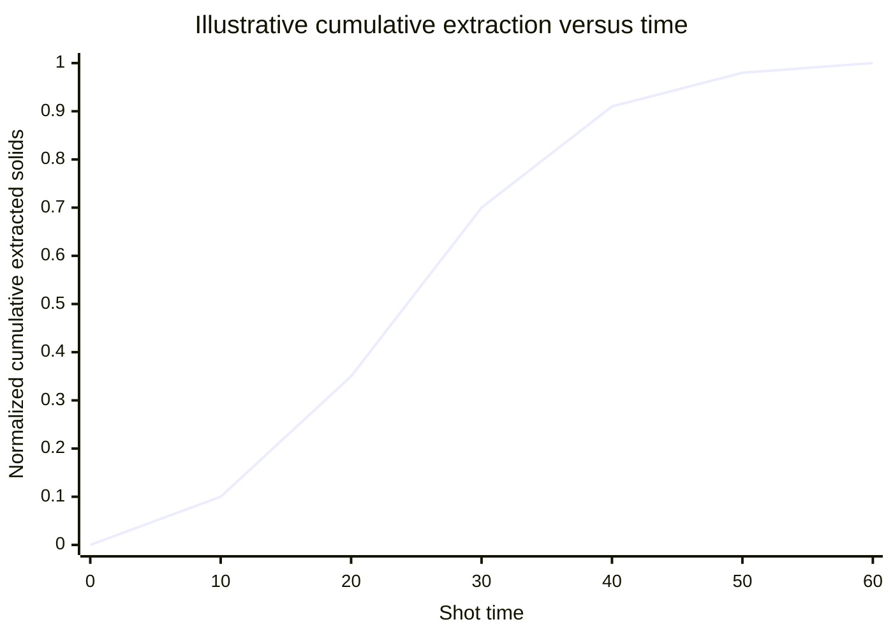
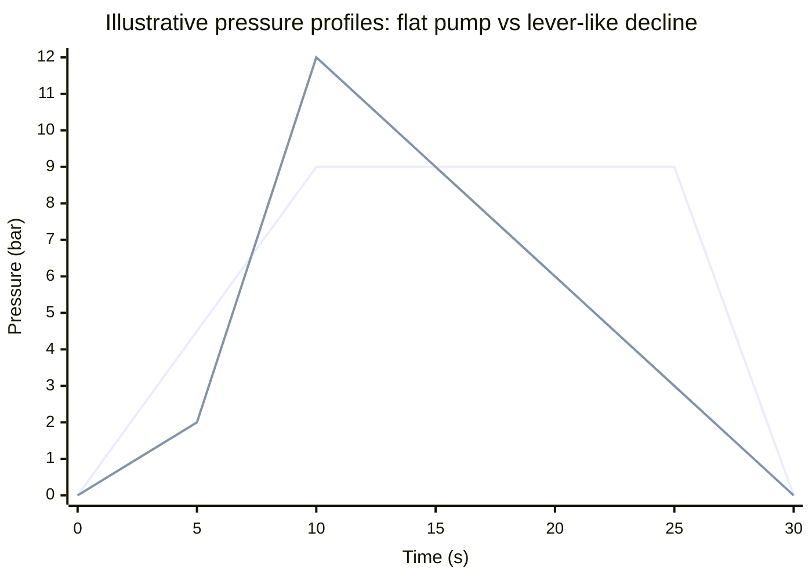
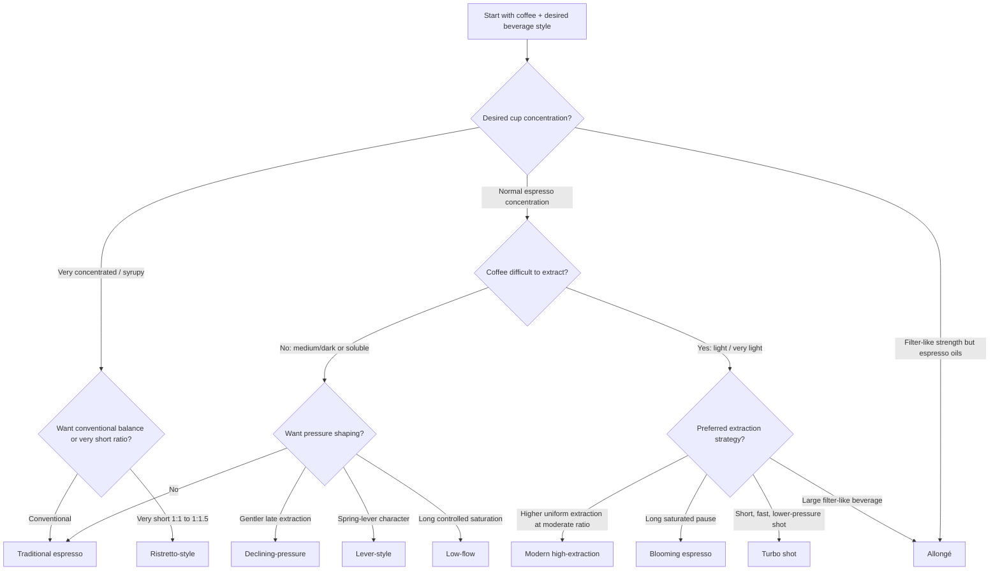
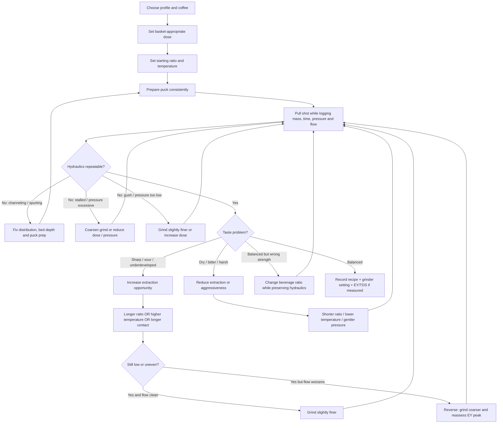

# Establishing the Causal Foundation of Espresso Extraction: A Taxonomy of Nine Shot-Profile Families

## Executive summary

Espresso profiles are best understood not as recipes with magical pressure curves, but as **different strategies for controlling transport through a dissolving, deformable porous bed**. Grind particle-size distribution, dose and bed depth establish permeability; water pressure and puck resistance jointly determine flow; flow determines how rapidly fresh solvent is delivered; temperature affects extraction kinetics; and extraction itself changes the puck by swelling it, removing soluble material, and altering porosity. Recent experimental work makes the last point especially important: espresso does not obey a simple, fixed-resistance Darcy model at normal brewing pressures. At low pressures the puck behaves approximately Darcy-like, but at espresso pressures compaction creates a nonlinear pressure–flow relationship, while dissolution progressively opens the bed. In controlled 2026 experiments, increasing pressure beyond roughly the mid-single-digit-bar range did **not** monotonically increase flow. citeturn17view0turn18view0turn19view0

That physical framework explains why the nine profile families in this report differ. **Traditional espresso** relies primarily on a fine grind and approximately constant 9-bar pressure. **Modern high-extraction espresso** seeks greater and more uniform solute removal, generally from less-soluble light roasts, by improving saturation, avoiding the ultra-fine/clogged regime, extending solvent contact or brew ratio, and often using adaptive pressure/flow control. **Turbo shots** lower dose and pressure while grinding substantially coarser, deliberately moving away from the partially clogged fine-grind regime. **Blooming espresso** increases contact time through a long, wet pause. **Allongé** takes the opposite path, moving much more fresh water rapidly through a coarse bed. **Low-flow** shots restrict water delivery to prolong controlled saturation. **Declining-pressure** and **lever-style** profiles reduce mechanical stress and/or limit late-shot acceleration as puck resistance falls. **Ristretto** primarily changes the mass balance by stopping at a short beverage ratio. citeturn23view0turn23view2turn22view0turn22view1turn22view2turn21view3

A central finding of the research is that **“finer = more extraction” is only true before the onset of flow inhomogeneity**. Cameron et al. experimentally found a peak in extraction yield as grind became finer; beyond that point, additional fines produced partial clogging and heterogeneous flow, reducing average extraction while increasing variability. Their model and café experiments showed that a lower dose, much coarser grind and lower pressure can produce fast shots with extraction yield comparable to conventional espresso. This is the causal foundation of the turbo family and, more broadly, of much modern espresso profiling. citeturn23view0turn23view1turn23view2turn23view3

Likewise, **pressure and flow are not independent flavor knobs**. La Marzocco explicitly notes that a pressure-controlled machine must change flow when grind or dose changes in order to reproduce the requested pressure curve. Decent's adaptive profiling documentation makes the inverse point: when a machine caps flow as puck resistance falls, pressure naturally declines. The 2026 poroelastic experiments supply the underlying physics: pressure itself can compact the bed and modify permeability. citeturn21view0turn21view1turn22view3turn17view0

Extraction yield and TDS should therefore be treated as **mass-balance measurements, not flavor scores**. Approximately,

\[
EY(\%)=\frac{m_{\text{beverage}}\times TDS(\%)}{m_{\text{dry coffee}}}
\]

and, using beverage ratio \(R=m_{\text{beverage}}/m_{\text{coffee}}\),

\[
TDS(\%)\approx \frac{EY(\%)}{R}.
\]

The historical SCA framework often associated roughly 17–23% extraction with desirable coffee, but contemporary SCA sensory research explicitly cautions against interpreting any single extraction range as universally “optimal”: roast, strength, extraction and individual flavor attributes interact. citeturn23view1turn20view1

The strongest equipment conclusion is equally important: **there is no scientifically established universal rule that a particular shot family requires flat rather than conical burrs**. Primary profile sources specify particle behavior, grind range and consistency much more defensibly than burr topology. The EK43 used in influential extraction work is associated by Mahlkönig with precise adjustment and a particle-size spread capable of high extraction, while contemporary espresso grinders emphasize reproducible burr spacing and temperature control; Mazzer, meanwhile, produces high-performance conical-burr espresso grinders. Accordingly, this report labels burr topology **“unspecified”** wherever the source does not prescribe it and distinguishes particle-distribution requirements from unsupported flat-versus-conical folklore. citeturn24view0turn24view1turn27search2

## Causal foundation: what a profile actually changes

### Permeability, fines and the non-monotonic grind effect

Grinding determines both available surface area and the permeability of the compacted bed. A finer grind initially gives water access to more surface, but it simultaneously increases hydraulic resistance. Cameron et al. found that espresso extraction eventually crosses from a relatively homogeneous regime into a **partially clogged regime**, in which excessive fines and heterogeneous bed density lower effective accessibility. Thus the extraction-yield curve versus grind size has a maximum rather than rising indefinitely toward finer settings. citeturn23view1turn23view3

This has a direct dial-in consequence: when an espresso is both slow and unexpectedly low in extraction, “grind finer” may be exactly the wrong intervention. Grinding **coarser** can increase both extraction uniformity and measured EY if the shot is already on the fine side of the peak. Cameron et al.'s recommended optimization method is to locate the grind setting producing maximum extraction at fixed pressure and brew ratio, then alter beverage ratio if needed to return to the desired sensory balance. citeturn23view2

Dose is part of the same hydraulic system. A lower dose creates a shallower bed; in Cameron et al.'s modeling and experiments, reducing dose while keeping beverage mass fixed raised attainable extraction and allowed a much coarser grind. Their explicit example moves from 20 g to 15 g while retaining a 40 g output, producing shots that can run in under 15 seconds. citeturn23view2turn23view3

### Pressure, flow and puck mechanics

At a conceptual level, flow through the puck depends on pressure difference divided by hydraulic resistance. But the resistance itself is changing. Wetting causes swelling; pressure compresses the bed; extraction removes solid material and increases porosity; erosion and fines migration can make these effects spatially non-uniform. The 2026 Physics of Fluids study measured espresso from roughly 1–12 bar and observed that flow increased with pressure only in the low-pressure regime; at high pressure the trend could reverse, with intermediate pressures producing the highest long-time flow. citeturn17view0turn18view0turn19view0

This provides a physical rationale for reduced-pressure, lever and declining-pressure methods. High pressure is **not automatically equivalent to more useful extraction**. Cameron et al.'s model likewise predicted higher EY as pressure was reduced under fixed modeled conditions, and their practical fine-grind experiments had to be reduced from 9 to 6 bar to avoid clogging. citeturn23view3

A machine operating in pressure mode compensates for changes in bed resistance by varying water flow. A machine operating in flow-limited mode does the reverse: as the dissolving puck loses resistance, pressure can fall rather than permitting flow to accelerate. That distinction separates a nominal “declining-pressure profile” from merely programming a lower pressure number: the causal objective is generally to prevent late-shot hydraulic acceleration and/or excessive mechanical compression. citeturn21view1turn22view3

### Time, fresh solvent and why opposite-looking profiles can both extract highly

Time and water throughput are alternative routes to mass transfer. Blooming espresso holds a saturated puck with little or no new incoming water for approximately 30 seconds, increasing contact before the main percolation phase. Allongé does nearly the opposite: it uses a coarse bed and roughly 4–4.5 mL/s water delivery so large quantities of fresh solvent continually reach the coffee. Both are principally light-roast strategies because the target coffee is comparatively difficult to dissolve. citeturn22view0turn22view1

Turbo shots use a third strategy: reduce bed depth, remove excessive fines-related resistance by grinding coarser, lower pressure, and pass a modest beverage mass through the bed quickly. The reduced resistance can make extraction **more homogeneous despite shorter contact time**. That is why shot duration cannot be treated as an independent measure of extraction quality. citeturn23view2

Recent time-resolved espresso measurements also show just how front-loaded concentration is. In one 18.5 g, light-to-medium-light espresso system, the earliest collected fractions were approximately 25% TDS; fraction strength remained high initially and then fell steeply, approaching zero around 60 seconds. The measured solute flux peaked around 30 seconds because increasing liquid flow was eventually overtaken by depletion of readily available soluble material. These numbers describe that experiment, not a universal espresso curve, but the mechanism is highly relevant to ristretto and long-ratio profiles. citeturn18view1turn18view3turn19view1

The following diagram is therefore intentionally normalized: it illustrates the **shape**, not a universal numerical extraction curve. It is consistent with the fractionation experiment above, in which cumulative removed solids approached a plateau while instantaneous beverage TDS fell dramatically with time. citeturn18view3turn19view1

The same distinction explains why ratio has such a powerful sensory effect. A 1:1 shot can have extremely high **strength** while still having relatively modest **extraction yield**; a 1:5 Allongé can have high EY but much lower TDS. Ratio, EY and TDS therefore answer three different questions: how much water ended in the cup, what fraction of the dry coffee was removed, and how concentrated the resulting liquid is. citeturn20view1turn21view0

### Pressure-profile archetypes

La Marzocco's Strada guide supplies useful historical reference shapes. Its classic espresso profile approximates a rise to roughly 9 bar followed by a plateau, while its “Golden Profile” ramps toward 12 bar before declining through the latter portion of the extraction. Historical piston-lever behavior likewise shows a pressure maximum followed by a sustained decline. Exact machine curves vary, so the chart below should be read schematically rather than as a universal prescription. citeturn21view1turn21view2

The first line represents a conventional pump-machine architecture; the second is an approximate reading of a lever/Strada-style rise-and-decline shape. A modern declining profile need not peak at 12 bar: La Marzocco's own experiments reduced the peak to roughly 9 bar for medium-solubility coffees and about 6 bar for more soluble/darker coffees. citeturn21view2

## Comparative profile matrix

“Time” below is pump-on time unless otherwise noted. Numbers labeled as **starting point** are practical synthesis values rather than standards. Where neither peer-reviewed work nor a manufacturer/profile originator gives a parameter, the table says **unspecified**.

| Profile family | Intended coffee | Typical dose and ratio | Grind / PSD objective | Pressure / flow architecture | Temperature | EY / TDS expectation | Principal sensory direction |
|---|---|---|---|---|---|---|---|
| **Traditional espresso** | Espresso-roasted blends or single origins; commonly medium through dark; origin/process: **no specific constraint** | Historically 14–18 g double; modern specialty commonly 18–20 g; ~1:2; 25–30 s | Fine espresso grind; sufficiently broad resistance to sustain ~9 bar without partial clogging; burr type **unspecified** | Short/optional PI → ~9 bar plateau | Heritage 90.5–96.1°C; modern survey ~93.5°C | Historical EY heuristic 17–23%; at 1:2 this corresponds mathematically to ~8.5–11.5% TDS | Concentrated, balanced, substantial body, prominent crema; roast-dependent sweetness/acidity/bitterness citeturn20view0turn23view1 |
| **Modern high-extraction espresso** | Primarily light/very-light, dense, relatively insoluble specialty coffee; processing **no specific constraint** | ~15–20 g; often ~1:2–1:3; exact family standard **unspecified** | Highly reproducible PSD, avoid ultra-fine side of EY peak; high-uniformity grinder advantageous; burr type **unspecified** | Full saturation/PI → pressure-managed extraction → often adaptive flow finish | Usually high end of normal espresso range; exact standard **unspecified** | Goal commonly > conventional extraction, but family-wide EY/TDS range **unspecified** | High clarity and flavor separation, reduced underdeveloped sharpness; body usually lower than classic espresso at longer ratios citeturn23view0turn23view2turn22view3 |
| **Turbo shot** | Particularly effective with light roast; origin/process **no specific constraint** | Canonical experimental/practitioner implementation ~15 g → 40 g, ~1:2.7; <15 s possible | Much coarser than conventional espresso; minimize fines-driven clogging | Approximately 6 bar, rapid unrestricted extraction | **Unspecified** in defining study as a family prescription | 22% EY is explicitly discussed for fast optimized espresso; at 15→40 g, 22% EY implies ~8.25% TDS; universal range **unspecified** | Lower concentration/body than conventional shot, high clarity and reproducibility; flavor differs from fine-ground 22% EY citeturn23view2turn23view3 |
| **Blooming espresso** | Light to very light preferred; medium workable; dark generally poor candidate | Common Decent dose ~15 g; ~1:2–1:3 practical; creator examples around 1:2.5 | Fine-to-moderate espresso grind with uniform flow; enough resistance to rebuild pressure after bloom; burr type **unspecified** | High-flow PI to ~4–5 bar → stop inflow / ~30 s bloom → ramp toward ~9 bar → flat-flow finish | Often starts ~94–98°C; may be reduced to taste | Manufacturer/originator reports include ~24% EY at 8.5% TDS and higher observational EYs; universal range **unspecified** | High extraction, clarity, softened sharp acidity, developed sweetness; dark roast can become excessively bitter citeturn22view0 |
| **Declining-pressure shot** | Profile peak can be matched to coffee solubility: ~6 bar for more soluble/darker, ~9 medium, higher peaks historically used for light/low-solubility coffee | Typically ~basket-rated dose, ~1:2 starting point; exact family ratio **unspecified** | Conventional espresso to moderately coarse depending peak/flow; stable PSD essential | PI <4 bar → pressure peak → deliberate fall through latter extraction | **Unspecified** as family standard | EY/TDS **unspecified** | Often smoother late-shot behavior and controlled body; exact acidity/sweetness/bitterness outcome is coffee-specific citeturn21view1turn21view2 |
| **Lever-style profile** | No specific roast/origin constraint; profile can be adapted broadly | Historical doubles ~12–14 g; modern basket-rated ~15–20 g; ratio usually near 1:2 as starting point, source-specific ratio **unspecified** | Enough resistance to support pressure peak while allowing declining flow/pressure; burr type **unspecified** | Fast fill → ~2–4 bar soak → ~8.5–12 bar peak → natural decline | **Unspecified** as universal family value | EY/TDS **unspecified** | Historically associated with strong crema and rounded concentrated texture; flavor balance highly coffee dependent citeturn22view2turn21view2 |
| **Low-flow / Slayer-style** | No specific roast constraint; manufacturer specifically recommends it when conventional espresso seems excessively acidic/unbalanced | Slayer: ~18–19 g; output ratio **unspecified** | Finer than the machine's standard-shot setting; enough restriction for long saturation; burr type **unspecified** | Needle-valve prebrew roughly 40–60 g water/30 s free flow → full ~9-bar brew; optional late return to restricted flow | Factory starting brew tank around 93°C | EY/TDS **unspecified** | Extended prebrew intended to increase sweetness; late reduced flow can increase body and mute harsh late-extraction character citeturn21view3 |
| **Allongé / long-ratio** | Light and ultra-light particularly suitable | ~18 g; ~1:4 beginner target, historically/profile typically ~1:5–1:6; 30–60 s | Coarse espresso grind; extremely small grind/dose changes matter; dedicated grinder useful | Very fast ~4–4.5 mL/s while retaining ~8–9 bar puck pressure | Example ~92°C; universal setting **unspecified** | Historical implementations reported ~22–23% EY; at 1:5–1:6 that corresponds to ~3.7–4.6% TDS by mass balance | Filter-like strength with espresso oils/crema, fruit/floral expression, lower perceived sharpness, long finish citeturn22view1 |
| **Ristretto-style** | No specific constraint; traditionally associated with espresso roasts | ~17–20 g; ~1:1 to 1:1.5 | Fine enough to develop useful extraction in a short beverage, but not so fine that the puck clogs; burr type **unspecified** | Usually classic ~9-bar architecture; profiling not necessary | Generally normal espresso range; exact profile value **unspecified** | Typical EY range **unspecified**; if 18% EY were achieved at 1:1, mass balance would imply 18% TDS | Very high concentration, intense body, syrupy mouthfeel, high crema fraction; risk of sour/salty underextraction when simply stopping a normal shot early citeturn21view0turn18view1 |

The table deliberately does not classify “high extraction” as synonymous with “high strength.” For example, a 22% EY 1:5 Allongé is only about 4.4% TDS by mass balance, whereas a 1:1 ristretto can theoretically be far stronger while extracting a smaller fraction of the grounds. citeturn20view1

Likewise, no row prescribes a single particle diameter. The scientifically relevant targets are **hydraulic resistance, fines fraction, distribution uniformity and shot-to-shot stability**, and those depend on coffee brittleness, burr geometry, alignment, seasoning, temperature and grinder setting. Mahlkönig explicitly markets the EK43 around precise adjustment and particle distributions capable of high extraction, and its E80S architecture uses burr-spacing measurement and active temperature control to improve repeatability. These are useful engineering traits; they do not establish a universal “98-mm flat burr = high extraction” law. citeturn24view0turn24view1

## Classical ratio families: traditional, ristretto and allongé

**Traditional espresso — intended coffee.** The historical SCA definition specifies 7–9 g for a single, 14–18 g for a double, 90.5–96.1°C water, 9–10 atmospheres and 20–30 seconds. The 2017 SCA survey showed how contemporary practice had shifted: 18–20 g was the dominant dose range, average output was about 36.5 g, the average ratio was 1:2, most shots ran 25–30 seconds, 9 bar was the modal pressure, and pre-infusion was common. La Marzocco explicitly describes its flat-pressure “classic espresso” profile as suitable for coffees roasted or blended for traditional espresso machines. Origin and processing: **no specific constraint**. citeturn20view0turn21view2

**Grinder requirements.** Burr type: **unspecified**. The useful target is a stable fine-espresso PSD producing enough resistance for roughly 25–30 seconds at the desired ratio without moving into the fines-clogging regime. A broad espresso-oriented distribution is entirely compatible with the style; there is no evidence that conical or flat geometry is categorically required. Dose should match basket capacity: La Marzocco recommends staying within approximately ±1.5 g of its nominal basket dose. For adjustment, hold dose and output constant and move grind in small increments; after each meaningful grind change, purge enough retained coffee to ensure the observed flow represents the new setting. citeturn21view0turn23view1

**Machine requirements.** A conventional rotary-vane or other pump capable of stable espresso pressure is sufficient; elaborate profiling is unnecessary. A stable brew temperature is important. Short low-pressure preinfusion is optional rather than defining. Portafilter diameter is **unspecified** by the profile definition; 58 mm is common commercial practice but not causal to the profile. citeturn20view0turn21view0

**Sensory target.** The archetype is concentrated, viscous espresso with substantial body and crema. Acidity should be integrated rather than dominant; sweetness is roast dependent; bitterness increases with darker roasting, high strength and excessive extraction; crema is typically comparatively abundant because of the concentrated, pressurized preparation. The historical 17–23% EY band implies about 8.5–11.5% TDS at a 1:2 mass ratio, but this is a mass-balance range, not a contemporary sensory standard. SCA's newer sensory work cautions that high EY does not have a universally fixed flavor consequence. citeturn20view0turn20view1turn23view1

**Failure modes.** A fast, pale, sour, thin shot usually indicates insufficient resistance, too short a ratio/time, poor distribution or an inadequately extracted coffee. A very slow shot can result from too fine a grind or too much dose. Crucially, extremely fine grinding can produce channeling and lower *average* EY rather than simply “overextracting everything.” Uneven spurting from a bottomless basket indicates heterogeneous flow, not merely a wrong total shot time. Very dark coffee at high temperature can become harsh before conventional numerical targets are reached. citeturn23view0turn23view3

**Dial-in.** Start with the basket's rated dose, for example 18 g. Target 36 g beverage, approximately 1:2, at ~93°C and nominal 9-bar extraction. Aim initially for 25–30 seconds. If output arrives rapidly and the cup is thin/sour, grind finer; if it stalls, tastes dry or shows signs of severe flow restriction, grind coarser. Once hydraulic behavior is stable, alter beverage yield: extend slightly toward 1:2.2–1:2.5 when the coffee remains sharp/underdeveloped; shorten toward ~1:1.7–1:1.8 for excess dilution or late bitterness. Temperature should be a later adjustment: higher for difficult light coffees, lower for highly soluble dark roasts. If progressively finer grinding first improves but then *reduces* extraction or consistency, move back coarser—the shot has likely crossed the EY maximum. citeturn20view0turn23view2

**Ristretto-style — intended coffee.** Roast, origin and processing: **no specific constraint** in the primary ratio definition. La Marzocco identifies 1:1 as close to the classic idea of ristretto. The family is therefore best defined by short beverage ratio rather than by an obligatory pressure profile. citeturn21view0

**Grinder requirements.** Burr type: **unspecified**. Grind is generally somewhat finer than the same coffee's 1:2 recipe when the goal is to preserve substantial extraction within a shorter yield, but blindly choking the puck is counterproductive. PSD should provide high resistance without pushing so much material into the fines-dominated regime that water finds isolated channels. Dose remains basket appropriate, typically ~17–20 g in modern double baskets. citeturn21view0turn23view0

**Machine requirements.** A conventional thermally stable 9-bar machine is sufficient. Preinfusion and profiling are optional. Portafilter diameter: **unspecified**. Because the style is defined by output ratio, a reliable scale is more important than advanced profiling. citeturn21view0

**Sensory target.** Ristretto raises concentration and compresses the extraction into early fractions. The expected direction is very high flavor intensity, thick body, syrupy mouthfeel and a high crema-to-liquid proportion. Acidity can seem concentrated even when total acids extracted are lower, and sweetness may read strongly because of the intense concentration. Bitterness from late fractions can be reduced simply because those fractions never enter the cup. But “shorter” does not mean intrinsically sweeter: a ristretto produced merely by terminating a normal 1:2 recipe early can be sharply sour, salty or vegetal because EY remains low. Time-resolved measurements show why: early espresso fractions are extremely concentrated, while readily available solute concentration falls later in the shot. citeturn18view1turn19view1

Expected EY: **unspecified**. TDS: **unspecified**. As a mathematical illustration only, achieving 18% EY at 1:1 would imply about 18% TDS; that calculation does **not** mean 18% EY or 18% TDS is typical of all ristretti. citeturn20view1

**Failure modes.** The most common is confusing concentration with adequate extraction: a 20 g → 20 g shot can taste powerfully intense while remaining underextracted. The second is compensating for the short ratio with an excessively fine grind, producing near-stall flow, local channeling and a combination of sourness plus dryness. Overdosing also makes the shallow output harder to extract evenly by increasing bed depth and resistance. citeturn23view1turn23view3

**Dial-in.** Start around 18 g → 22–27 g, rather than jumping directly to 18 → 18, at ~9 bar and a conventional espresso temperature. Find a grind producing controlled rather than stalled flow. Taste. If intensely sour/salty, first lengthen the ratio toward 1:1.4–1:1.5; only then consider slightly finer grinding or higher temperature. If heavy but dull and dry, grind coarser or shorten the contact time. Once a balanced ~1:1.4 recipe exists, shorten progressively toward 1:1 only if the coffee remains balanced. This sequence prevents the short ratio from being “rescued” by extreme puck resistance.

**Allongé / long-ratio espresso — intended coffee.** The modern Rao/Decent Allongé is principally a **light- and ultra-light-roast** strategy. Origin and processing have **no specific constraint**, though bright high-quality coffees are natural candidates. The documented Montreal antecedent used unusually large, rapidly extracted beverages and reportedly achieved ~22–23% EY even on traditional E61 machines. citeturn22view1

**Grinder requirements.** Burr type: **unspecified**. A coarse espresso setting and extremely stable adjustment are critical. A dedicated second grinder was historically used because the setting is substantially coarser than normal espresso. Particle distribution should preserve enough fine material to build espresso pressure while avoiding so many fines that 4–4.5 mL/s becomes impossible. The profile is unusually sensitive: Decent reports that microscopic grind shifts or fractions of a gram of dose can cause large pressure changes. Grind should therefore be the coarse adjustment and dose the fine adjustment. citeturn22view1

**Machine requirements.** The ideal machine can measure pressure close to the puck, sustain very high water delivery, and expose real-time pressure/flow data. Advanced flow profiling is highly advantageous. A traditional machine can approximate the style by recipe and time, but the operator loses direct information about whether high flow is occurring under true espresso pressure. Temperature stability is especially important because large water throughput otherwise magnifies thermal drift. Portafilter diameter: **unspecified**; 58 mm is common but not defining. citeturn22view1

**Sensory target.** The intended cup has filter-like concentration but retains espresso oils, crema and a longer, coating aftertaste. The profile's originator/manufacturer documentation describes prominent fruit, floral and sweet-toffee character, reduced sharp acidity and a surprisingly persistent mouthfeel. It is much less dense and syrupy than traditional espresso. Reported historical EY is ~22–23%. At 1:5 this implies approximately 4.4–4.6% TDS and at 1:6 approximately 3.7–3.8% TDS by mass balance; actual TDS should be measured rather than assumed. citeturn22view1turn20view1

**Failure modes.** Too fine a grind produces very high pressure—Decent cites 12–13 bar examples—while failing to reach target output. Too coarse a grind can allow pressure to collapse to ~3–4 bar; the resulting “gusher” is not a successful Allongé merely because it is fast. Late puck degradation can cause pressure to collapse as resistance disappears. Inconsistent puck preparation is especially costly because the profile combines high flow with a fragile coarse bed. citeturn22view1

**Dial-in.** Start with approximately 18 g in an 18 g basket. For an easier first target, aim at ~1:4 in around 30 seconds; once stable, explore 1:5–1:6 in roughly 30–60 seconds. Grind much coarser than normal espresso. Observe actual puck pressure: progressively coarsen until the shot no longer peaks at excessive pressure yet still reaches roughly 8–9 bar. On a programmable machine target about 4–4.5 mL/s while retaining espresso pressure. A documented example is ~92°C; the universal temperature is **unspecified**. If pressure collapses late, make an extremely small finer adjustment or increase dose by a fraction of a gram. If acidity remains sharp despite adequate pressure, slightly increase extraction/temperature rather than converting the shot into a low-pressure gusher. citeturn22view1

## High-extraction and high-throughput families: modern high extraction, turbo and blooming

**Modern high-extraction espresso — intended coffee.** This name is an **analytical umbrella, not an SCA-standardized profile**. It covers conventional-to-moderate-ratio espresso designed to extract difficult light or very light coffees uniformly, without requiring the defining 30-second pause of Blooming or the extreme throughput of Allongé. Light, dense coffee is the principal use case; origin and processing: **no specific constraint**. La Marzocco's pressure-profiling work explicitly notes that light roasts are denser and less soluble than dark roasts, while modern adaptive profiles use preinfusion plus pressure/flow management to increase extraction without simply grinding ever finer. citeturn21view2turn22view3

**Grinder requirements.** Burr type: **unspecified**. The principal requirement is a reproducible, relatively uniform PSD with precise adjustment and a low enough problematic-fines fraction to remain on the homogeneous side of the EY-versus-grind maximum. A high-uniformity, large-disc grinder such as the EK43 is a documented research implementation, but its geometry is an implementation rather than a causal requirement. Setting stability, burr alignment and thermal consistency matter because high extraction tends to expose shot-to-shot changes in permeability. citeturn23view0turn24view0turn24view1

**Machine requirements.** Stable temperature and controllable preinfusion are strongly advantageous. Full pressure profiling is helpful but not mandatory; the most capable implementation combines flow-controlled saturation, a pressure-limited main extraction and an adaptive flow finish so pressure cannot spike when resistance is unexpectedly high or flow cannot run away when the puck weakens. Pump type: **unspecified** as a causal requirement. Portafilter size: **unspecified**. citeturn22view3

**Sensory target.** The goal is not simply “more EY”; it is **higher uniform extraction without localized overextraction**. For suitable light coffee, that generally means less raw or piercing acidity, more clearly developed sweetness/aromatic character and high flavor separation. Body is usually moderate rather than classic-syrupy when ratios extend beyond 1:2. Crema depends strongly on coffee age, roast and gas content rather than on high EY itself. Family-wide EY and TDS: **unspecified**. A defensible operational definition is therefore “maximize even extraction while the cup continues to improve,” not “hit 25%.” Cameron et al. explicitly showed that two shots at 22% EY can taste different when one is extracted in a partially clogged regime and the other by a fast homogeneous method. citeturn23view2turn20view1

**Failure modes.** The characteristic failure is chasing EY by grinding finer until the bed becomes heterogeneous. A second is using aggressive flow control without a pressure ceiling: Decent warns that small flow changes can drive pressure above ~9.5–10.5 bar and compress the bed. A third is applying light-roast high-extraction parameters to highly soluble dark coffee, producing excess bitterness, roastiness or dryness. citeturn23view0turn22view3turn21view2

**Dial-in.** A practical starting synthesis is 18 g, approximately 1:2.5, 94–96°C for a genuinely light roast, thorough flow-controlled saturation, maximum pressure ~8–9 bar and a flat-to-slightly-rising flow finish around the 1–2 mL/s order of magnitude. The exact time is **unspecified** and should be subordinate to taste and hydraulic behavior. First find the coarsest grind region that still develops useful pressure and high extraction. If sour/underdeveloped but hydraulically even, increase ratio, temperature or contact time before going much finer. If EY or taste worsens as grinding becomes finer, reverse direction. Once extraction is high and stable, use the final beverage ratio to set concentration. citeturn23view2turn22view3

**Turbo shots — intended coffee.** Turbo is the clearest case in which conventional visual cues are intentionally abandoned. The causal basis comes from Cameron/Hendon/Foster's work on dose, pressure and grind: reduce bed depth, grind much coarser and operate near 6 bar to avoid fine-grind clogging. Light specialty coffee is the most common practical target; origin and processing: **no specific constraint**. citeturn23view2turn23view3

**Grinder requirements.** Burr type: **unspecified**, although the defining research used an EK43. The key requirement is a controllable coarse-espresso PSD with relatively low hydraulic resistance and excellent repeatability. It is particularly important not to import the traditional “shot is fast, therefore grind finer” rule: speed is intentional here. Typical dose is about 15 g, with the cited optimization contrasting it against a 20 g baseline. citeturn23view2turn24view0

**Machine requirements.** The machine must be capable of reducing brew pressure to approximately 6 bar, ideally measured at or meaningfully related to the puck. Full dynamic profiling is unnecessary; a stable lower-pressure set point is enough. Temperature profile, preinfusion requirement and portafilter size are **unspecified** in the core profile evidence. A larger basket than dose—e.g., a ~20 g basket carrying ~15 g—is commonly associated with the method because the goal is a shallow bed. citeturn23view2turn23view3

**Sensory target.** Compared with a fine, conventional shot, turbo lowers concentration and therefore usually body/intensity, while increasing reproducibility and potentially retaining equal or higher EY. Cameron et al. specifically note that a 15 g coarse-ground version can produce shots under 15 seconds, lower beverage concentration and a different flavor profile; they also compare fast and partially clogged shots at 22% EY and report sensory differences despite identical average EY. That is powerful evidence that EY alone does not determine espresso flavor. citeturn23view2

A 15 g → 40 g turbo has ratio 1:2.67. At 22% EY, the implied TDS is approximately **8.25%**. This is a derived example, not a universal turbo TDS specification. Family-wide EY/TDS ranges are **unspecified**. citeturn23view2turn20view1

**Failure modes.** Too fine means the shot ceases to be turbo: pressure rises, time increases and the bed may return to the partially clogged regime. Too coarse produces inadequate pressure, low EY and a watery, sharp cup. Excessively low dose in a wide basket can make the bed mechanically fragile. Poor distribution becomes conspicuous because a shallow, permeable bed gives localized low-resistance paths little protection. citeturn23view0turn22view0

**Dial-in.** Begin around 15 g → 40 g and set pressure near 6 bar. Grind substantially coarser than a conventional 1:2 espresso and deliberately accept a shot that may complete in roughly 10–15 seconds. If the cup is sour and thin **and** pressure never develops, move slightly finer. If the shot exceeds the intended fast window, pressure rises strongly or consistency worsens, coarsen. Once the hydraulic regime is repeatable, extend yield modestly or increase temperature for stubborn light coffees rather than immediately reverting to traditional fineness. citeturn23view2turn23view3

**Blooming espresso — intended coffee.** Blooming is optimized for **light roast**, works with medium roast, and is generally discouraged for dark roast because the long contact period can produce excessive extraction and bitterness. Origin and processing: **no specific constraint**; high-density washed coffees are frequently associated with the style in practitioner use, but processing is not a defining requirement. citeturn22view0

**Grinder requirements.** Burr type: **unspecified**. Grind must permit fast initial saturation while retaining enough post-bloom structure to rebuild pressure. Excessively fine coffee stalls after the bloom; excessively coarse coffee loses structural integrity and cannot re-establish pressure. Decent reports ~15 g as a robust common dose in a 58-mm basket and warns that very small doses such as 10 g make a 58-mm bed thin and mechanically weak; narrower baskets provide greater bed depth at low dose. citeturn22view0

**Machine requirements.** This is one of the most demanding profiles. The machine must supply high initial flow, detect/control approximately 4–5 bar, **stop adding water for about 30 seconds**, then restart with a controlled pressure ramp and flow-managed finish. Accurate programmable flow/pressure control is therefore strongly preferred. Stable, often high brew temperature matters because the bloom is partly intended to heat and equilibrate the puck. citeturn22view0

**Sensory target.** Blooming seeks high, even extraction while retaining espresso concentration. The expected direction for light coffee is reduced piercing acidity, improved sweetness/development and high clarity, with less dilution than an Allongé. Body is usually medium; crema depends on coffee age and roast. Decent describes the profile as dissolving more soluble material and improving evenness. Published manufacturer/originator examples include approximately **24% EY and 8.5% TDS**, while still higher EYs have been reported in practitioner use; these should be treated as examples rather than universal targets. citeturn22view0

**Failure modes.** A bloom that is too long can weaken the puck and permit channel formation when pressure returns; La Marzocco separately warns that excessive preinfusion/swelling can promote channeling. Dark/high-solubility coffee can become bitter or dry. Too coarse a grind causes the post-bloom pressure ramp to fail; too fine causes a post-bloom stall or pressure spike. Inadequate thermal stability can leave the puck cooler than the intended recipe. citeturn22view0turn21view1

**Dial-in.** Start around 15–18 g, with an initial target near 1:2.5. Use high-flow preinfusion until approximately 4–5 bar; stop new water for ~30 seconds; then ramp gently toward a ceiling around 9 bar and finish under approximately flat flow. For light roast, ~94–96°C is a reasonable first setting within the documented 94–98°C starting range. If the post-bloom phase immediately spikes to the pressure ceiling, grind coarser. If it never rebuilds meaningful pressure, grind slightly finer. Sour but hydraulically clean shots can take a little more yield or temperature; dry/bitter shots should first receive less temperature/yield or a shorter/less aggressive bloom, especially as roast becomes darker. citeturn22view0

## Pressure- and flow-shaped families: declining pressure, lever style and low flow

**Declining-pressure shots — intended coffee.** Unlike Blooming or Turbo, this family can cover a wide roast range because the pressure peak itself can be adapted to solubility. In La Marzocco's Strada experiments, the original “Golden Profile” climbed to roughly 12 bar and then declined, but it proved least compatible with medium and dark roasts. For higher-solubility/darker coffee La Marzocco reduced the peak to about 6 bar; medium-solubility coffee was paired with about 9 bar. Origin/process: **no specific constraint**. citeturn21view1turn21view2

**Grinder requirements.** Burr type: **unspecified**. Use a conventional-to-moderate espresso grind capable of reaching the chosen peak without immediately forcing the machine into pressure limitation. PSD and dose stability are particularly important because a pressure-programmed machine must vary flow as resistance changes. Dose should normally remain close to basket rating. citeturn21view0

**Machine requirements.** True pressure profiling is ideal: La Marzocco's Strada EP uses a dedicated gear pump for each group and measures pressure at the coffee bed. A manually controlled paddle, lever or sophisticated flow-profile system can approximate the shape, because a late flow cap naturally causes pressure to decline as puck resistance decreases. Short low-pressure preinfusion—La Marzocco defines its PI region as below 4 bar—is often part of the architecture. citeturn21view1turn22view3

**Sensory target.** Exact family-wide acidity, sweetness, bitterness, crema and mouthfeel values are **unspecified**. The most defensible causal expectation is controlled late-shot flow and reduced mechanical loading as the bed becomes more permeable. Depending on coffee, this can preserve body while reducing harshness associated with a rapidly accelerating finish. La Marzocco describes its declining profiles as productive starting points but explicitly says changing peak timing alters the balance of sweet, bitter and acidic qualities. EY/TDS: **unspecified**. citeturn21view2

**Failure modes.** Too high a peak can compact a susceptible puck and increase the chance of heterogeneous flow; the 2026 poroelastic work shows experimentally that high pressure can reduce rather than increase flow. A decline that begins too early can prevent sufficient solvent throughput. A decline that is too shallow may offer no advantage over a flat-pressure shot. If grind is too coarse, the machine may need very high flow to achieve the programmed early pressure, increasing erosion/channel risk. citeturn17view0turn19view0turn21view1

**Dial-in.** Start with the coffee's established conventional dose and ratio, e.g. 18 g → 36 g. Preinfuse below ~4 bar. For medium roast, begin with a peak around 9 bar; for dark/high-solubility coffee, test ~6 bar; for very light coffee, a higher peak can be explored but 12 bar should not be treated as intrinsically superior. Reach peak within roughly the first third of the shot, then reduce pressure smoothly toward the finish. If late flow accelerates and the cup dries out, steepen the decline or impose a flow ceiling. If the shot tastes thin/underdeveloped, hold the peak slightly longer or increase ratio before increasing maximum pressure. citeturn21view1turn21view2

**Lever-style profiles — intended coffee.** The distinguishing feature is not merely declining pressure but the **sequence** associated with a spring lever: rapid fill, low-pressure saturation/soak, pressure maximum and a mechanically natural decline. Roast, origin and processing: **no specific constraint**. Historical lever espresso used smaller doses than today's common doubles; modern digital emulations are routinely adapted to contemporary basket doses. citeturn22view2turn21view2

**Grinder requirements.** Burr type: **unspecified**. The grinder must produce sufficient resistance to let the lever reach its pressure peak without preventing meaningful liquid from appearing during the soak. Decent's Londonium emulation supplies a particularly useful diagnostic: roughly 4–8 g of beverage during the infusion stage is a practical target; almost no drips suggests too fine a grind, while excessive early output suggests too coarse. Stable small adjustments matter more than nominal burr geometry. citeturn22view2

**Machine requirements.** Either a true spring/piston lever or a programmable machine capable of emulating its hydraulic sequence. Decent's implementation uses a rapid fill, approximately 2–4 bar soak—commonly around 3 bar—followed by a peak capped around 8.5–9 bar and a maximum flow around 1.7–2.2 mL/s. A real spring lever will have its own mechanically determined pressure curve, which may peak higher; therefore those Decent values are implementation parameters, not universal lever specifications. citeturn22view2

**Sensory target.** Historical lever machines are strongly associated with crema, and the declining pressure architecture tends to produce a dense, rounded espresso texture rather than an aggressively accelerating pump-machine finish. Exact acidity, sweetness, bitterness, body, crema and EY/TDS ranges are **unspecified** across the family. The profile should not be credited with a universal “sweetness effect”; roast, ratio, temperature and hydraulic uniformity remain major determinants. citeturn21view2turn20view1

**Failure modes.** Too fine: the soak produces little or no liquid, the profile reaches its pressure ceiling without reaching its intended flow, and the shot becomes a slow conventional espresso. Too coarse: pressure cannot build and the profile becomes a low-pressure gusher. Excessively long or high-pressure soaking can over-swell the bed. An abrupt transition from soak to peak can mechanically disturb a weak puck. citeturn22view2turn21view1

**Dial-in.** Begin near 18 g and ~1:2. Fill quickly, soak around 3 bar and watch the first output rather than relying solely on time. Target roughly 4–8 g of drips before the main pressure phase. Ramp toward an ~8.5–9 bar ceiling and allow pressure to fall naturally as flow approaches roughly 1.7–2.2 mL/s. No/very few early drips: coarsen. Excessive early dripping: grind finer. If the cup is acidic, Decent recommends a finer grind or a longer infusion trigger; if bitter, coarsen or reduce infusion pressure. For extremely light roasts, its implementation can even use zero-pressure infusion. citeturn22view2

**Low-flow / Slayer-style profiles — intended coffee.** The defining use is prolonged controlled saturation using a restricted water path. Slayer explicitly presents its “Slayer Shot” as a corrective option when conventional espresso seems too acidic and lacks balance. Roast, origin and processing otherwise have **no specific constraint**. citeturn21view3

**Grinder requirements.** Burr type: **unspecified**. Slayer recommends beginning the special profile finer than its standard-shot setting—roughly “3–4 notches” on many grinders in the manual's language—and dosing 18–19 g. That number of notches is grinder dependent and should not be translated into a universal particle-size increment. The goal is enough restriction that the subsequent full-pressure phase remains controlled despite a long saturation period. citeturn21view3

**Machine requirements.** A Slayer-type system has Off, Pre-Brew and Full-Brew positions and a needle valve controlling the restricted prebrew path. The factory starting prebrew/free-flow calibration is roughly 40–60 g water per 30 seconds, or about 1.3–2.0 g/s before puck resistance. Full brew uses conventional pump pressure around 9 bar. Manual paddle control is central to the architecture; stable brew temperature is also required. Slayer's factory brew-tank starting point is around 93°C. citeturn21view3

**Sensory target.** According to the manufacturer, extended prebrew can enhance perceived sweetness, while returning to restricted flow for the final part of the shot can increase body and mute unwanted late-extraction character. Thus the intended result is moderate-to-high body, rounder acidity and developed sweetness rather than the high-flow clarity of an Allongé. Crema, EY and TDS ranges are **unspecified**. Because these are manufacturer sensory observations rather than controlled sensory trials, they should be treated as operational hypotheses and verified by tasting. citeturn21view3

**Failure modes.** Insufficient restriction produces an uncontrolled prebrew and premature output. Excessive restriction makes the saturation phase extremely long or stalls the full-brew phase. Slayer warns that a pressure “bump” lasting more than about one second can choke the puck. Uneven bottomless-basket wetting indicates poor distribution or inappropriate flow/grind. Overextending the saturation phase can also create a mechanically swollen bed prone to channeling. citeturn21view3turn21view1

**Dial-in.** Set the machine's prebrew free flow in the manufacturer's ~40–60 g/30 s region. Dose 18–19 g and start somewhat finer than the same coffee's standard espresso setting. Enter Pre-Brew and wait until the basket bottom shows broadly uniform saturation; Slayer describes roughly 15–20 seconds. Then engage Full-Brew and extract to taste. The manual leaves final beverage ratio **unspecified**; a sensible comparative starting point is ~1:2, explicitly as a synthesis rather than a Slayer specification. For additional sweetness, Slayer suggests permitting ~2–3 g of beverage to emerge during extended prebrew before engaging full pressure. For more body/less late harshness, return to the low-flow position at approximately two-thirds of the desired final volume. citeturn21view3

## Decision framework and generic dial-in workflow

The most useful way to choose a profile is to start with **coffee solubility and desired beverage concentration**, then ask whether the equipment can control pressure and/or flow. A profile should solve an observed extraction problem; it should not be selected merely because its graph looks sophisticated. The decision tree below synthesizes the primary literature and manufacturer guidance described above. citeturn23view0turn21view2turn22view0turn22view1turn22view3

A second decision is whether the shot is failing because of **average extraction** or **hydraulic uniformity**. A low EY with smooth, repeatable flow may justify more temperature, water or contact. A low/variable EY accompanied by slow flow, spurting or a fine grind can instead indicate the partially clogged regime, in which the correct move may be coarser. That distinction is one of the most consequential findings in the peer-reviewed espresso literature. citeturn23view0turn23view2

The generic workflow below therefore separates recipe, hydraulics and sensory adjustment rather than collapsing everything into shot time.

For serious comparative work, change **one controlled variable at a time until an interaction becomes the explicit subject of the test**. At minimum record dry dose, beverage mass, total pump-on time, first-drop time, temperature set point, maximum pressure, approximate flow behavior, grinder setting and tasting notes. When profiling equipment is available, save the actual pressure and flow traces rather than only the programmed targets: the puck's resistance determines whether the machine actually follows the intended control regime. citeturn21view1turn22view3turn17view0

A refractometer adds two useful observations: measured TDS and calculated EY. But they should be used diagnostically. For instance, increasing EY while flavor becomes cleaner strongly suggests improved access to previously underextracted regions; unchanged EY with worsening dryness may indicate that average extraction is hiding greater spatial heterogeneity. Cameron et al. explicitly showed that equal 22% extraction yields can arise from materially different flow regimes and taste different. citeturn23view2

The 2026 dissolution measurements provide an additional reason to stop treating seconds as a universal recipe target. Early espresso fractions can be extraordinarily concentrated, whereas later flow increasingly consists of lower-TDS liquid. Consequently, extending a shot simultaneously increases total extracted mass **and** dilutes the beverage. Ristretto emphasizes the early high-strength fraction; Allongé intentionally accepts dilution to gain total extraction; traditional espresso sits between those extremes. citeturn18view1turn19view1

The same logic should govern grinder selection. Choose a grinder for **stable dose, reproducible burr spacing, an appropriate particle distribution and sufficient resolution around the profile's hydraulic operating point**, not because one burr label is presumed to guarantee a flavor style. Large, extraction-oriented burr systems are particularly useful for Turbo, Allongé and modern high-extraction work because these profiles are sensitive to fines and small permeability shifts; conventional espresso and ristretto can be executed successfully on either high-quality flat- or conical-burr platforms. The causal requirement is PSD behavior, not burr topology itself. citeturn24view0turn24view1turn27search2

Finally, the taxonomy should be treated as **nine operating families, not nine mutually exclusive recipes**. A shot can be both lever-like and declining-pressure; a Blooming profile typically finishes with declining pressure under a flow-controlled phase; a modern high-extraction shot can borrow Turbo's lower pressure without becoming a true low-dose/short-time Turbo; and a long-ratio espresso does not become an Allongé unless it also adopts the coarse/high-flow/high-pressure hydraulic strategy. The useful taxonomy is therefore causal: **ratio families define how much beverage is collected; pressure families define mechanical loading; flow families define solvent delivery; saturation families define wet-contact history; and high-extraction families combine those controls to increase uniform soluble recovery.** This classification is more robust than treating profile names as immutable recipes because it maps directly onto the physics demonstrated by machine manuals, extraction experiments and recent poroelastic measurements. citeturn21view0turn21view1turn22view0turn22view1turn22view2turn23view0turn17view0