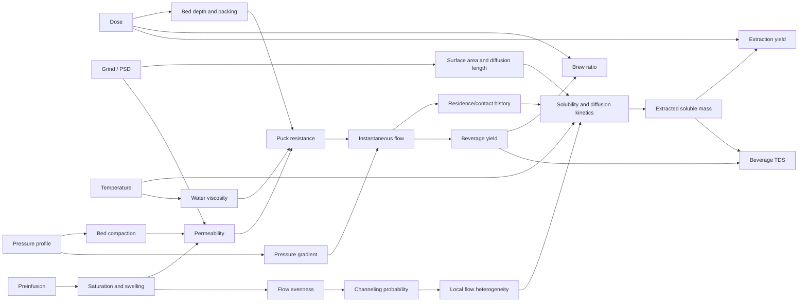
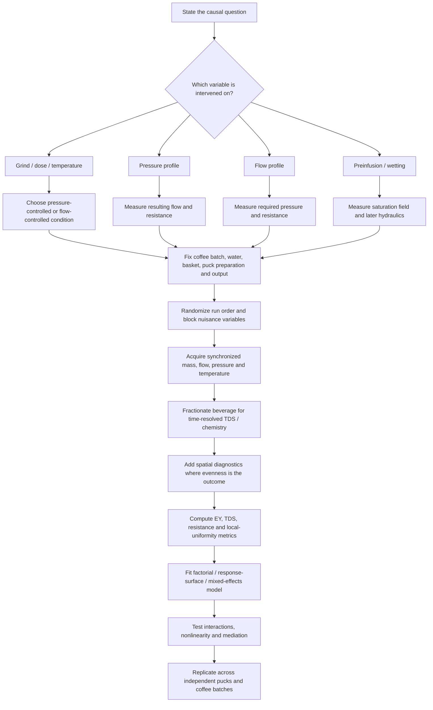

# Establishing the Causal Foundations of Espresso Extraction

## Executive summary

Espresso extraction is best understood not as a collection of independent “recipe variables,” but as a **coupled porous-media transport problem**. A small number of operator-controlled inputs—dose, beverage yield, grind particle-size distribution, water temperature, and imposed pressure/flow/preinfusion profiles—create an evolving physical state inside the coffee puck. That state is characterized by bed depth, porosity, permeability, hydraulic resistance, saturation, local fluid velocity, particle-scale diffusion distances, and spatial heterogeneity. Those intermediate states determine how much soluble material reaches the beverage, where in the puck it came from, and at what concentration. Primary experimental and modeling work over the past decade, especially Cameron et al. (2020), Moroney et al. (2019), Schmieder et al. (2023), Foster et al. (2025), and new 2026 work on espresso-puck poroelasticity and permeability, supports this causal framing. citeturn4view0turn19view0turn11search0turn18search10turn15search1

Three distinctions are fundamental.

First, **extraction yield and beverage strength are not the same outcome**. Extraction yield, \(EY\), is the fraction of the original dry coffee mass transferred into the collected beverage; beverage strength, conventionally reported as TDS, is the concentration of those extracted solids in the beverage. If \(D\) is dry dose, \(B\) is beverage mass, and TDS is expressed as a percentage,

\[
EY[\%] = TDS[\%]\frac{B}{D}.
\]

Consequently, TDS, EY, and brew ratio cannot vary independently. A beverage can become weaker in TDS while simultaneously increasing in EY as more water passes through the puck. Moroney et al. explicitly give this extraction-yield relationship, while Cameron et al. describe refractive-index-based TDS/EY measurement as the standard operational approach in espresso research. citeturn19view0turn4view0

Second, **pressure, flow, brew time, and puck resistance are causally entangled**. Under an ideal fixed porous bed, Darcy's law gives

\[
Q=\frac{kA}{\mu L}\Delta P,
\]

so pressure drop \(\Delta P\), permeability \(k\), bed depth \(L\), water viscosity \(\mu\), and flow \(Q\) determine one another. Real coffee is not a rigid fixed bed. It wets, swells, dissolves, consolidates, erodes, redistributes fines, and can form preferential flow paths. Corrochano et al. measured coffee-bed permeabilities around \(10^{-14}\)–\(10^{-13}\,\mathrm{m^2}\) under their steady-state protocol and found very strong dependence on PSD and packing. New 2026 pressure-sweep experiments show that at sufficiently high pressure the puck can compact enough that flow stops increasing proportionally with pressure and may even decrease—behavior incompatible with the simplistic idea that “more pressure simply pushes more water through.” citeturn22view3turn23view1turn8view2turn15search1

Third, **grind is simultaneously a chemical-transport variable and a hydraulic variable**. Finer particles provide more accessible surface and shorter internal diffusion distances, which favors rapid solute release. But fines also reduce permeability and raise hydraulic resistance. Cameron et al. showed the consequence experimentally: a homogeneous-flow mathematical model predicts monotonically increasing extraction as grind becomes finer, yet actual espresso shots reach a peak and then lose extraction at very fine settings. The interpretation is that very fine grinding creates increasingly heterogeneous flow and reduces the fraction of the coffee bed that is effectively contacted. This is one of the strongest pieces of evidence that **evenness and channeling are causal mediators**, not merely visual defects. citeturn4view0turn5view1turn6view2

Among readily controlled variables, **beverage yield/integrated flow has exceptionally large leverage** because it changes both accumulated solvent throughput and dilution. In Schmieder et al.'s response-surface experiment, changing total beverage mass had a substantially larger influence on extraction than the tested changes in instantaneous flow, grinder setting, or temperature. Among those latter three factors, flow was generally the strongest. Temperature altered extraction kinetics and compound profiles but its effect on gross TDS was comparatively modest and interaction-dependent across the 80–98 °C experimental range. citeturn11search0turn13search0turn14search11

**Brew time should therefore usually be treated as an outcome or mediator rather than a primitive independent cause.** At fixed collected beverage mass, time is approximately \(B/\bar Q\), so a “longer shot” produced by finer grinding is evidence of changed resistance and flow, not proof that time itself caused the extraction difference. Likewise, pressure is generally an upstream hydraulic control rather than a direct solvent-extraction force; its principal pathways are through flow, bed deformation, and spatial flow distribution. citeturn22view3turn4view0

Finally, **global EY and TDS are lossy summaries of a spatial process**. Moroney et al.'s CFD work demonstrated that two systems can have similar outlet concentration while having substantially different local extraction patterns, and represented extraction nonuniformity using the standard deviation of local extraction yield. Time-resolved micro-CT work now directly shows that wetting fronts can take several seconds to traverse an espresso bed and can propagate unevenly, particularly near walls. A complete causal analysis therefore requires three outcome layers: global mass balance, time-resolved output, and spatial evenness. citeturn21view0turn21view2turn17view2turn17view5

## Causal architecture and quantitative identities

A useful causal model separates **controls**, **puck state variables**, **transport processes**, and **measured outcomes**. This avoids a common category error: treating every number displayed on an espresso machine as though it were an independent input.

This diagram is a synthesis of the mechanisms established experimentally or modeled in the primary literature: PSD affects both diffusion and permeability; permeability and bed dimensions mediate pressure-flow relations; initial wetting establishes subsequent hydraulic conditions; and nonuniform flow produces nonuniform extraction. citeturn4view0turn22view3turn19view0turn18search10turn8view2

### Mass-balance identities

Define:

\[
D = \text{dry coffee dose [g]}
\]

\[
B(t) = \text{collected beverage mass at time }t\text{ [g]}
\]

\[
R = \frac{B}{D}
\]

where \(R\) is the output-to-dose brew ratio; in coffee notation this is often written \(1:R\).

If \(c\) is the beverage mass fraction of dissolved coffee solids,

\[
c=\frac{TDS[\%]}{100},
\]

then the collected dissolved-solids mass is

\[
M_s = cB.
\]

Extraction yield as a mass fraction is

\[
EY=\frac{M_s}{D},
\]

or, in percentage form,

\[
\boxed{EY[\%]=TDS[\%]\frac{B}{D}}
\]

and therefore

\[
\boxed{TDS[\%]=\frac{EY[\%]}{R}}.
\]

These equations are **bookkeeping identities**, not mechanistic extraction laws. They tell us how the outcomes are related once the soluble mass is known; they do not tell us what pressure, grind, temperature, or flow will cause \(M_s\) to be. The operational espresso form of the EY equation and digital-refractometer measurement of TDS are given explicitly by Moroney et al. citeturn19view0

For example, purely to illustrate the identity rather than prescribe a preparation, if \(D=20\) g, \(B=40\) g, and mixed-beverage TDS is 10%, then \(M_s=4\) g and \(EY=20\%\). Doubling beverage mass would not automatically double EY because later water encounters progressively depleted coffee; neither would TDS remain at 10%. This depletion is visible directly in time-resolved experiments, where early espresso fractions are highly concentrated and later fractions decline sharply. citeturn8view1

### Instantaneous versus integrated flow

Let \(\dot m(t)\) denote outlet beverage mass flow in g/s. Then

\[
B(t)=\int_0^t \dot m(\tau)\,d\tau.
\]

For a beverage collected to \(B_f\),

\[
\bar Q_m=\frac{B_f}{t_f}
\]

is the average mass flow. The distinction between instantaneous and integrated flow is essential: two extractions can finish at the same beverage mass while following very different flow histories.

If \(c_{\text{out}}(t)\) is instantaneous dissolved-solids mass fraction,

\[
\dot M_s(t)=c_{\text{out}}(t)\dot m(t),
\]

and

\[
M_s(t)=\int_0^t c_{\text{out}}(\tau)\dot m(\tau)\,d\tau.
\]

The final mixed-beverage concentration is therefore

\[
c_{\text{mix}}=\frac{\int c_{\text{out}}(t)\dot m(t)\,dt}
{\int \dot m(t)\,dt}.
\]

This explains why flow rate cannot be evaluated independently from the time-dependent concentration of what is flowing. The 2026 poroelastic pressure study measured both output mass flow and sequential TDS and observed roughly 25% TDS in the earliest fractions, followed by rapid decline after approximately 20 s, while total liquid flow was still rising; soluble-mass flux therefore followed a different trajectory from either flow or TDS alone. citeturn8view1

### Hydraulic relationships

For a homogeneous, saturated, rigid bed in the low-Reynolds-number Darcy regime,

\[
\boxed{Q_v=\frac{kA}{\mu L}\Delta P}
\]

where \(Q_v\) is volumetric flow, \(k\) permeability, \(A\) puck cross-sectional area, \(\mu\) dynamic viscosity, \(L\) bed thickness, and \(\Delta P\) pressure drop across the bed. citeturn22view3turn23view1

An operational hydraulic resistance can thus be written

\[
\boxed{R_h=\frac{\Delta P}{Q_v}
       =\frac{\mu L}{kA}}.
\]

That form is extremely useful experimentally because \(R_h(t)\) can be calculated continuously from pressure and flow even when an intrinsic permeability \(k(t)\) is difficult to identify.

For approximately spherical rigid particles, Kozeny-Carman scaling predicts

\[
k \propto
d_p^2\frac{\epsilon^3}{(1-\epsilon)^2},
\]

with \(\epsilon\) bed porosity and \(d_p\) an effective particle diameter. Coffee violates several assumptions underlying the simplest form: particles are polydisperse, angular and porous; the bed consolidates; the solids swell and dissolve; and the flow may become inertial or spatially heterogeneous. Corrochano et al. consequently needed porosity-dependent tortuosity corrections, while subsequent micro-CT and simulation studies have further demonstrated evolving structure and non-Darcy effects. citeturn23view1turn1search5turn18search4

At particle scale, a useful first-order estimate for diffusion time is

\[
\tau_D\sim\frac{r_p^2}{D_s},
\]

so reducing characteristic particle radius \(r_p\) sharply reduces internal diffusion time. This is the chemical-transport reason finer particles tend to extract faster in isolation. The opposing hydraulic effect of finer grinding—smaller pores and lower permeability—is why grind has a fundamentally dual causal role. Cameron et al.'s model explicitly incorporates particle-scale diffusion alongside bed-scale advection. citeturn4view0

## Variable definitions, measurement, and causal effects

The ranges below are **descriptive experimental/practice envelopes, not recommendations**. Historical specialty-coffee definitions specified approximately 7–9 g for a single espresso, 25–35 mL beverage, roughly 90.5–96.1 °C, 9–10 atmospheres, and 20–30 s. A later SCA survey of specialty cafés found much larger contemporary doses, commonly around 18–20 g with about 36.5 g beverage output, approximately 25–30 s, roughly 9 bar, and preinfusion widely used. Research papers commonly describe double-espressos using about 15–22 g coffee and 30–60 g beverage. citeturn0search10turn16search0

### Controlled and quasi-controlled variables

| Variable | Precise operational definition | Measurable metrics and instruments | Descriptive espresso range | Direct causal effect on EY and TDS | Important secondary effects / interactions |
|---|---|---|---|---|---|
| **Dose** | Dry mass of roasted ground coffee loaded into the basket before water addition, \(D\). | Gravimetric balance; typically 0.01–0.1 g resolution. Puck height can additionally be measured by caliper, displacement, or XCT. The 2026 pressure study controlled dose to \(18.50\pm0.05\) g. citeturn8view1 | Traditional single 7–9 g; contemporary double-style research/practice often ~15–22 g. citeturn0search10turn16search0 | Dose is the denominator in \(EY=M_s/D\). At fixed beverage mass, increasing dose lowers \(B/D\); experimentally/model-wise, greater dose also tends to reduce per-gram extraction because more material and bed depth must be traversed. Cameron's fixed-40-g-output simulations predicted higher EY at lower dose. citeturn5view0 | Dose changes puck depth \(L\), void/headspace geometry, hydraulic resistance, water distribution, and the ratio between solvent throughput and coffee mass. Its effect therefore cannot be interpreted independently of basket geometry, yield, PSD, or pressure/flow mode. citeturn22view3 |
| **Beverage yield** | Mass \(B\) of liquid/espresso collected downstream at the chosen endpoint; not to be confused with extraction yield. | Precision scale/load cell under cup; continuous mass logging permits \(B(t)\). | Common double-style research envelope ~30–60 g; older volumetric definition ~25–35 mL per single. citeturn16search0turn0search10 | More collected beverage normally increases cumulative extracted soluble mass and hence EY, because additional solvent continues removing material. At the same time later effluent is progressively weaker, so mixed TDS generally decreases as yield is extended. Beverage mass had a larger effect than flow, grind setting, or temperature in the 2023 response-surface study. citeturn11search0turn13search0 | Yield is the time integral of flow. Thus changing yield also changes brew duration unless flow is changed; it is mathematically tied to brew ratio and TDS. |
| **Brew ratio** | Dimensionless beverage-to-dose mass ratio \(R=B/D\), commonly expressed as \(1:R\). | Calculated from two gravimetric measurements. | Roughly 1.5–3 covers much contemporary espresso research/practice; about 1:2 was characteristic of the SCA café survey. This is descriptive rather than a quality target. citeturn0search10turn16search0 | By identity, \(EY=TDS\times R\). At fixed EY, TDS decreases inversely with \(R\). In actual brewing EY itself rises with accumulated solvent, so TDS versus ratio reflects both additional extraction and dilution. citeturn19view0 | Ratio mathematically couples dose and yield. Studies claiming a “dose effect” while holding output fixed are partly interventions on brew ratio, not dose alone. |
| **Grind / PSD** | Statistical distribution of particle sizes and shapes after grinding—not a single particle diameter. | Laser diffraction; dynamic image analysis; microscopy; sieving for larger fractions. Useful metrics include \(d_{10},d_{50},d_{90}\), Sauter diameter \(d_{3,2}\), volume-weighted diameter \(d_{4,3}\), distribution width, and fines fraction. A <100 µm fines cutoff is often used in research but is explicitly somewhat arbitrary. citeturn19view0turn22view3 | Espresso PSDs are broad and often bimodal; many papers operationally classify fines below ~100 µm rather than assigning a single “typical espresso diameter.” Cameron found finer grinder settings both shrink the coarse-particle population and increase the fines fraction. citeturn4view0turn6view0 | Finer particles shorten diffusion length and increase accessible surface, accelerating extraction. But finer PSDs, particularly more fines, reduce permeability and may cause inhomogeneous flow. Consequently global EY is often **non-monotonic** with grind: finer raises EY until hydraulic heterogeneity/channeling dominates, after which EY can fall. citeturn4view0turn5view1 | Strongly interacts with flow, pressure, dose/bed density, distribution, and prewetting. At fixed flow, finer grind requires substantially more pressure; in Schmieder et al., center-condition experiments required roughly 3.8, 7.4, and 9.3 bar as grinding became progressively finer across the tested settings. citeturn13search3 |
| **Brew time** | Time interval associated with extraction. The starting event must be defined: pump-on, water contact, pressure rise, first drop, or saturation. Endpoint likewise must be specified. | Machine clock synchronized with pressure, flow and mass DAQ; video or sensor-triggered timing where needed. | Around 20–30 s historically; modern café observations commonly around 25–30 s. Experimental studies may intentionally run much longer to study depletion or hydraulic steady state. citeturn0search10turn8view0 | Time permits dissolution and diffusion, but **elapsed time is usually not an independent causal variable**. At fixed output, \(t\approx B/\bar Q\); longer time often means lower flow and altered residence time caused by resistance. At fixed flow, increasing time also increases beverage yield, which changes EY and TDS by a different pathway. | Grind, dose, pressure, flow, preinfusion and channeling can all alter time. Time is therefore most useful as a response variable unless an experiment independently constrains flow and yield. |
| **Temperature** | Temperature of the brewing water actually reaching and traversing the puck, not merely boiler or controller setpoint. | Fast thermocouples, RTDs/PT100s or thermistors above/in the puck; multi-point arrays for gradients. Schmieder et al. measured just above the puck and achieved approximately 79.1, 88.2 and 96.5 °C for nominal 80, 89 and 98 °C conditions. citeturn14search2 | Historical machine definition ~90.5–96.1 °C; experiments deliberately extend to ~80–98 °C. citeturn0search10turn11search0 | Higher temperature generally speeds molecular diffusion/dissolution and changes saturation behavior, tending to increase extraction rate for many compounds. Yet over the tested espresso domain, Schmieder et al. found relatively modest gross TDS effects and overlapping kinetic confidence intervals at center conditions; temperature effects were smaller than beverage mass and generally smaller than flow. citeturn13search0turn14search11 | Higher temperature also lowers water viscosity, tending to raise flow at fixed pressure—potentially shortening residence time and partly offsetting faster chemical kinetics. Temperature also changes *which* molecules are extracted; individual chemical profiles can shift more than bulk TDS suggests. citeturn22view3turn14search6 |
| **Pressure** | Pressure difference driving flow through the coffee bed. Ideally measured as \(\Delta P\) immediately across the puck rather than pump or boiler pressure. | Fast pressure transducer above puck; second downstream sensor where feasible; calibration of tubing/shower-screen losses. The 2026 pressure study explicitly calibrated hydraulic losses between machine sensing and basket pressure. citeturn8view4 | Traditional nominal ~9–10 bar/atm; contemporary research has intentionally swept roughly 1–12 bar to characterize response. citeturn0search10turn8view0 | For a rigid bed at low pressure, higher \(\Delta P\) increases flow according to Darcy's law. That can reduce residence time at fixed yield. There is little reason to treat espresso-scale pressure as a major direct thermodynamic driver of solubility; its dominant effect is hydraulic/mechanical. citeturn22view3 | At higher pressures the puck compacts, decreasing permeability. The 2026 poroelastic study observed flow saturating or declining at high pressure, with fastest flow around the middle of its pressure range rather than at maximum pressure. Pressure also interacts with defect propagation/channeling. citeturn8view2turn15search1 |
| **Instantaneous flow** | Time-dependent water or beverage throughput, \(Q(t)\), reported volumetrically in mL/s or as mass flow in g/s. Inlet and outlet flow are not strictly identical during wetting because water is temporarily retained in the puck/headspace. | Coriolis mass-flow meter, positive-displacement/other calibrated flow sensor upstream, or derivative of high-frequency cup mass downstream. Moroney used a Bronkhorst CORI-FLOW system; Corrochano used an ultrasonic flow meter sampled at 10 Hz. citeturn19view0turn22view3 | Controlled espresso experiments in Schmieder et al. used approximately 0.96, 1.9 and 2.8 mL/s achieved flow rates. citeturn11search1 | At fixed final yield, higher flow reduces brew time and residence/contact duration; the 2023 controlled study found increasing flow generally reduced TDS and extracted component mass, and flow was the strongest of its flow/grind/temperature factors. citeturn11search0turn13search0 | Flow is not independent under pressure control: it is generated by the pressure/resistance combination. High measured flow can indicate either a permeable uniform bed **or a low-resistance channel**, so flow magnitude alone does not establish good contact. |
| **Integrated flow** | Cumulative water/beverage throughput, \(\int Q\,dt\); downstream it is essentially beverage yield after accounting for density and retention. | Numerical integration of calibrated flow signal; more simply, continuous gravimetric beverage mass. | Equivalent to the beverage-output ranges above once expressed as collected mass. | Controls cumulative solvent exposure and is therefore among the strongest determinants of cumulative soluble mass/EY. Its direct algebraic consequence for TDS follows from \(TDS=EY/R\). citeturn11search0turn19view0 | Separating “flow-rate effect” from “total-flow effect” requires fixing final beverage mass when changing instantaneous flow. |
| **Preinfusion** | Initial wetting phase before or during the ramp to the main extraction condition, better defined by its full \(P(t)\), \(Q(t)\), delivered-water mass and saturation state than by time alone. | Pressure and flow logging; scale; time-resolved XCT/neutron imaging for saturation; embedded moisture/electrical sensors are possible in research rigs. | No universal numerical definition. In Foster et al.'s time-resolved XCT experiments/modeling, bed-saturation times were approximately 4–10 s depending on porosity, permeability and available pressure; a fine bed in the experiment became essentially wet over roughly the first 7 s. citeturn17view2turn17view5 | Its primary causal effect is not simply “extra extraction time.” It establishes the initial spatial saturation field, permits swelling, displaces trapped gas, and changes the hydraulic state before high flow begins. These can alter effective contacted mass and therefore subsequent EY/TDS. citeturn18search10turn17view1 | Strong interactions with grind, porosity, pressure ramp, headspace, puck defects and later resistance. Direct quantitative estimates of its independent effect on final EY remain sparse because saturation, total time and delivered water are difficult to disentangle. |

### Outcome and state variables

| Variable | Precise operational definition | Measurement | Representative magnitude | Causal interpretation |
|---|---|---|---|---|
| **Extraction yield** | Fraction of initial dry coffee mass transferred into the collected beverage as soluble material: \(EY=M_s/D\). | Usually inferred from beverage mass and refractometric TDS: \(EY[\%]=TDS[\%]\times B/D\). Direct gravimetric/chemical mass balance is possible in laboratory work but substantially more involved. citeturn19view0turn4view0 | Espresso research commonly operates around the high teens through low/mid-20s percent, depending strongly on beverage yield and hydraulic regime. Cameron's experiments occupied roughly the low-20% region while deliberately exploring conditions outside traditional practice. These are measurements, not quality prescriptions. citeturn6view2turn4view0 | **Outcome, not primitive input.** It integrates how much of the dose actually reaches the cup. It discards information about *where* in the puck the solids originated and *which* chemical species comprise them. |
| **Beverage strength / TDS** | Mass concentration of dissolved coffee material in the beverage, conventionally expressed as percent by mass. | Coffee-calibrated digital refractometer; refractive index is temperature-sensitive and correlated to soluble coffee concentration. Laboratory chemical or gravimetric analyses provide alternatives. citeturn4view0turn19view0 | Roughly 8–12% is frequently reported as a conventional espresso concentration range; Foster et al. describe around 10% dissolved solids for a typical double, while Schmieder et al.'s 40 g beverages averaged 9.68%. Individual early fractions can be much higher. citeturn19view0turn16search0turn13search0 | **Outcome.** For a given extracted-solid mass, more beverage water lowers TDS. TDS therefore cannot distinguish “little extraction into little water” from “more extraction into proportionally more water” without dose and beverage mass. |
| **Evenness** | Spatial uniformity of wetting, fluid velocity, residence time, and/or local extraction across the puck. It is not a single universally standardized variable. | Time-resolved XCT wetting maps; CFD extraction maps; local outlet-flow mapping; sectional residual-solids analysis; tracer studies. Metrics can include SD or CV of local EY, variance of local flux, wetting-front variance, or spatial concentration distributions. Moroney et al. represented extraction nonuniformity with the standard deviation of local EY. citeturn21view0turn21view3 | No accepted universal “typical range.” One Moroney fine-grind model produced about a five-percentage-point spread in local extraction in the relevant region, illustrating how substantial hidden spatial variation can be. citeturn21view4 | **Mediator.** Better spatial contact increases the fraction of the dose participating effectively in extraction. Global TDS/EY can conceal severe local over- and under-extraction because they are spatial averages. citeturn21view2 |
| **Channeling** | Formation or use of preferential high-conductance pathways through which a disproportionate fraction of water bypasses the surrounding coffee matrix. | High-speed bottomless-basket visualization is qualitative; local flux sensors, tracer methods, XCT before/after brewing, and spatial pressure/flow models are more rigorous. Delaminations and void structures can be detected tomographically. citeturn8view2turn1search5 | No universal scalar range or threshold. | **Negative-evenness mechanism.** A channel raises local velocity and shortens local residence/contact while starving adjacent regions of water. Total flow can increase even as effectively contacted coffee mass and global EY fall. The 2026 pressure work observed increased flow following repeated interruption/restart without corresponding additional dissolution and linked it to puck reconfiguration/delamination and preferential flow. citeturn8view2 |
| **Puck resistance** | Dynamic hydraulic opposition of the wet coffee bed to flow. Operationally \(R_h(t)=\Delta P(t)/Q(t)\); intrinsic permeability \(k\) is a related bed property under a specified flow model. | Synchronized differential pressure and flow measurement; infer \(k\) via Darcy or more advanced poroelastic/inertial models; XCT plus computational flow can independently estimate pore-scale permeability. citeturn22view3turn18search4 | Corrochano's extracted, steady-state beds gave roughly \(10^{-14}\)–\(10^{-13}\,\mathrm{m^2}\), while other methods and newer XCT-based calculations yield substantially different values. There is therefore no universal espresso-puck permeability constant. citeturn22view3turn18search4 | **Central mediator.** It converts imposed pressure into flow and therefore governs time/residence. It evolves because of wetting, swelling, dissolution, fines movement, erosion, poroelastic compression and channel formation. citeturn1search5turn8view2 |

Several measurement cautions follow directly from these definitions. A machine's reported group pressure is not necessarily the pressure drop across the coffee, because tubing, valves, shower screens and basket hardware also consume pressure. Corrochano et al. subtracted independently measured hardware resistance, and the 2026 poroelastic study likewise calibrated the hydraulic path with additional pressure instrumentation. citeturn22view3turn8view4

Likewise, a grinder “setting” is not a physical particle-size variable. Both Cameron and Moroney show broad, often bimodal coffee PSDs. In Moroney's measurements, the fine and coarse samples differed not simply in mean size but in the proportion of particles under 100 µm—25.52% versus 15.08% by volume in that experiment. Those fines simultaneously extracted rapidly and increased bed resistance. citeturn19view0turn20view1

Finally, refractometric TDS should be treated as an **operational bulk concentration estimator**, not molecular speciation. Different compounds have distinct extraction kinetics; time-resolved mass spectrometry has resolved many espresso-derived ion signals evolving on approximately one-second timescales, while Schmieder et al. separately measured caffeine, trigonelline and chlorogenic acid alongside TDS. Thus equal TDS or EY does not imply equal chemical composition. citeturn11search2turn11search0

## Hydrodynamic coupling, evenness, and channeling

The strongest causal insight in the modern literature is that **espresso's hydraulic variables form feedback loops**.

### Why finer grind can eventually reduce extraction

At the particle level, finer grinding should raise extraction:

\[
r_p\downarrow
\quad\Rightarrow\quad
\frac{A}{V}\uparrow,\;
\tau_D\sim r_p^2/D_s\downarrow
\quad\Rightarrow\quad
\text{faster solute transfer}.
\]

At bed level, however,

\[
d_p\downarrow,\;\text{fines fraction}\uparrow
\quad\Rightarrow\quad
k\downarrow
\quad\Rightarrow\quad
R_h\uparrow.
\]

Under pressure-controlled conditions, this lowers or redistributes flow. Under flow-controlled conditions, it forces pressure higher. Either way, tiny packing differences can become amplified: water selects lower-resistance routes, those routes receive more flow, and the rest of the bed becomes relatively bypassed. citeturn23view1turn19view0

Cameron et al. provide a particularly clean model falsification. Their homogeneous-flow model predicts EY should continue rising as grind becomes finer because surface accessibility and diffusion improve. The experiments instead show a maximum: below a certain grind setting, shot time continues increasing but EY drops. The authors interpret the discrepancy as the onset of increasingly inhomogeneous flow/particulate clogging, which reduces effective extraction despite apparently favorable particle-scale kinetics. citeturn4view0turn5view1turn6view2

This resolves the apparent contradiction between “finer extracts faster” and “too fine can extract less.” Both are causally correct, but they operate through different pathways.

\[
\text{Finer grind}
\rightarrow
\begin{cases}
\text{shorter diffusion path} & (+EY)\\
\text{higher surface area} & (+EY)\\
\text{lower permeability} & (\pm EY)\\
\text{more hydraulic heterogeneity} & (-EY\text{ when severe})
\end{cases}
\]

Schmieder et al. independently observed a parabolic grind response in their factorial espresso study: moving through the tested grinder range initially increased TDS/component extraction and then reversed for several responses. Because their system controlled flow, the pressure required to maintain that flow rose dramatically as grind became finer, directly revealing the hydraulic cost of the PSD change. citeturn13search0turn13search3

### Pressure does not have a monotonic relationship with flow

The rigid-bed Darcy intuition predicts

\[
Q\propto\Delta P.
\]

Coffee, however, is compressible and structurally evolving. The 2026 *Physics of Fluids* pressure study used an 18.50 g puck, calibrated pressure sensing, continuous cup-mass measurement, sequential refractometry, and micro-CT. Across approximately 1–12 bar, flow initially increased as expected but subsequently saturated or declined as puck compression increased resistance. In that apparatus, maximum mass-flow growth occurred around the middle of the pressure range rather than at the highest applied pressure. citeturn8view0turn8view2turn15search1

That result is consistent with much older reports summarized by Corrochano et al., in which flow decreased above roughly 5–7 bar, historically attributed to bed consolidation. The modern work provides a more explicit poroelastic framework for the phenomenon. citeturn23view1

A better causal statement is therefore

\[
P\uparrow
\rightarrow
\begin{cases}
\Delta P\uparrow\rightarrow Q\uparrow\\
\text{compaction}\uparrow\rightarrow k\downarrow\rightarrow Q\downarrow
\end{cases}
\]

with the observed flow being the net result of those competing pathways.

This makes a pressure number meaningless without knowing the puck's resistance state.

### Puck resistance is dynamic rather than fixed

Several processes alter \(R_h\) during one extraction.

Initial hydration fills pore space and displaces gas. Coffee particles swell. Pressure mechanically compresses the matrix. Soluble material leaving particles can open void volume. Fine particles can migrate. Local erosion can enlarge paths. Structural rearrangement can cause delamination. A preferential path can then carry a growing proportion of the total flow. Micro-CT studies before and after extraction have observed systematic changes in coffee-bed porosity, and simulations suggest normal espresso pressure gradients can be sufficiently strong for inertial corrections to matter in some pore networks. citeturn1search5

The 2026 poroelastic work explicitly frames the temporal behavior as a competition between **dissolution opening the pore structure** and **pressure-driven compression closing it**. After initial wetting/swelling, flow and concentration evolve together rather than independently. citeturn8view2

This also explains why steady-state permeability measurements are scientifically useful but cannot simply be substituted into an entire espresso shot. Corrochano et al.'s protocol circulated water for 600 s so that the bed was fully extracted before measuring steady-state pressure-flow curves. That isolates permeability as an engineering property, but deliberately removes the transient dissolution/wetting processes that dominate ordinary espresso timescales. citeturn22view3

### Preinfusion is fundamentally a saturation intervention

Time-resolved micro-computed tomography has made the early phase much less speculative. Foster et al. modified an espresso system for rotating X-ray imaging, collecting projections fast enough to reconstruct approximately one-second snapshots of liquid infiltration. Their fine and coarse beds displayed different wetting dynamics. In the fine bed there was relatively little penetration initially, followed by progression of a comparatively uniform front, with near-complete saturation around the first several seconds; the model predicted roughly 4–10 s saturation times as porosity, permeability and pressure were varied. citeturn17view2turn17view3turn17view5

Thus the most precise causal definition of preinfusion is not “a low-pressure pause of \(n\) seconds.” It is an intervention on

\[
S(\mathbf{x},t),
\]

the spatial saturation field. Its downstream influence is

\[
\text{preinfusion profile}
\rightarrow
\text{wetting front}
\rightarrow
\text{swelling/air displacement}
\rightarrow
k(\mathbf{x},t)
\rightarrow
Q(\mathbf{x},t)
\rightarrow
\text{local extraction}.
\]

The direct independent contribution of preinfusion to final global EY remains less well quantified than these mechanisms because altering preinfusion usually changes several quantities simultaneously: delivered water, effective contact time, saturation state, pressure history, and subsequent permeability. Foster et al. themselves note that the relationship between initial wetting and the spatial origin of rapidly extracted solubles remains incompletely resolved. citeturn17view1

### Evenness is a hidden dimension of extraction yield

Global extraction yield is

\[
EY_{\mathrm{global}}
=
\frac{1}{D}
\int_{\text{puck}}
m_0(\mathbf{x})\,e(\mathbf{x})\,dV,
\]

conceptually, where \(e(\mathbf{x})\) is the local fraction extracted. Two pucks can have the same integral while possessing very different spatial distributions of \(e\).

Moroney et al.'s CFD study makes this explicit. A cylindrical geometry with relatively uniform flow and a truncated/conical geometry with nonuniform flow could produce similar outlet concentration trajectories even though the internal extraction maps differed substantially. They proposed expressing the spatial spread by the standard deviation of local extraction yield and showed that the fine-grind model could have a local EY range on the order of five percentage points in the relevant region. citeturn21view0turn21view2turn21view4

Consequently:

\[
\boxed{\text{Global EY and TDS do not identify extraction evenness.}}
\]

Channeling is the extreme case of this hidden variable. A channel has low local resistance, so

\[
q_{\text{channel}}\gg q_{\text{surrounding bed}}.
\]

That increases total measured flow while reducing how much coffee mass receives useful solvent contact. A sudden increase in flow is therefore ambiguous: it may represent a uniformly more permeable puck, or a structural failure that bypasses most of the puck. The 2026 pressure study's restart experiments and XCT-observed delaminations provide unusually direct evidence for this distinction. citeturn8view2

## Experimental designs for causal identification

Espresso experiments are unusually vulnerable to confounding because altering one nominal control automatically changes several mediator variables. The appropriate experimental design therefore depends on the **causal estimand**: what precisely is meant by “the effect of grind,” “the effect of pressure,” or “the effect of time?”

For example, the effect of grind at constant pressure is not the same estimand as the effect of grind at constant flow. In the former, grind is allowed to alter flow and time; in the latter, the controller compensates with pressure and reveals the extraction effect after holding flow constant. Neither experiment is wrong, but they answer different causal questions.

### Programmable espresso-machine intervention studies

A programmable machine with closed-loop flow and pressure control allows several important causal contrasts.

For a **grind-at-fixed-flow** experiment, fix dose, beverage mass, temperature, flow profile, puck geometry and preparation while randomizing PSD/grinder setting. Required pressure becomes an outcome. This design largely removes brew-time and average-flow confounding and reveals the combined effect of particle accessibility plus whatever spatial-flow changes persist. Schmieder et al. effectively exploited this approach: at a nominal 2 mL/s, finer grinding demanded much higher pressure. citeturn13search3

For a **flow-at-fixed-yield** experiment, fix dose, PSD, temperature and beverage mass, randomize flow setpoint, and allow time to change. The contrast estimates the consequence of residence/contact history without confounding it with total solvent throughput. Schmieder et al.'s 1, 2 and 3 mL/s conditions are an important example; achieved flows were approximately 0.96, 1.9 and 2.8 mL/s. Higher flow generally reduced TDS and extracted-component mass at a given beverage amount. citeturn11search1turn13search0

For a **temperature intervention**, flow control is especially important because temperature changes water viscosity. Under pressure control, part of an apparent “temperature effect” could actually be flow-mediated. Measuring actual temperature immediately upstream of the puck rather than relying on a heater setpoint is also necessary. citeturn22view3turn14search2

### Factorial and response-surface designs

When interactions are central, one-factor-at-a-time experiments are inefficient and potentially misleading. Schmieder et al. used a **central composite experimental design** spanning flow, grind level, and temperature and measured multiple response variables across sequential beverage fractions and fixed beverage masses corresponding to several brew ratios. This permits estimation of linear effects, curvature and interactions rather than assuming monotonic independent responses. citeturn11search0turn13search0

A rigorous modern experiment could extend that design with pressure or preinfusion factors. A mixed-effects model would ideally treat shot/puck as the unit of replication while blocking coffee batch, roast age, grinder session, basket, machine/group, and experimental day as nuisance variables where applicable.

The most useful response vector is not merely final TDS:

\[
Y=
\{
EY,\,
TDS_{\mathrm{mix}},\,
TDS(t),\,
Q(t),\,
P(t),\,
R_h(t),\,
T(\mathbf{x},t),\,
U_{\mathrm{spatial}}
\}.
\]

Including \(R_h(t)\) and spatial uniformity allows mediation analysis: whether a treatment changed EY because it changed particle-scale extraction kinetics, because it changed hydraulics, or both.

### Pressure sweeps and hydraulic system identification

To isolate the puck's pressure-flow behavior, maintain tightly standardized dose, PSD and puck preparation while sweeping applied pressure across independent pucks or long equilibrated runs. Measure actual basket pressure and outlet flow, then fit competing models:

\[
Q=a\Delta P
\]

for simple Darcy behavior versus poroelastic forms allowing \(k=k(P)\).

The 2026 pressure study performed approximately this kind of wide pressure sweep and combined it with gravimetric flow, sequential TDS, pressure calibration and micro-CT, allowing mechanical deformation to be connected with flow anomalies. citeturn8view0turn8view2turn8view4

Corrochano et al.'s earlier dedicated permeability rig illustrates another clean design. Their brewing cell separated the coffee-bed pressure drop from hardware losses, measured flow ultrasonically at 10 Hz, measured particle PSD by laser diffraction, quantified particle shape by image analysis, controlled packed-bed density, and fitted steady-state pressure-flow data to Darcy's law. This design isolates **material permeability** more effectively than an ordinary espresso machine can. citeturn22view3

### Time-resolved fractionation

Final mixed-beverage TDS hides extraction kinetics. Sequential fractionation can identify the time-dependent concentration:

\[
c_{\mathrm{out}}(t),
\]

from which solute flux can be calculated.

The 2026 pressure work collected approximately five-second fractions for refractometry. The resulting concentration curve showed the extreme front-loading of soluble concentration in espresso and, when multiplied by simultaneous liquid flow, allowed calculation of soluble-mass flux. citeturn8view1

For more chemical resolution, the fractions can be analyzed with HPLC/UPLC, LC-MS, ion chromatography or spectrometry. Schmieder et al. followed TDS alongside caffeine, trigonelline and 5-caffeoylquinic acid, demonstrating why TDS alone cannot establish chemical equivalence between conditions. citeturn11search0

### Tomographic and spatial experiments

For preinfusion, evenness and channeling, bulk measurement is insufficient. Time-resolved micro-CT can directly estimate the wetting-front position

\[
z_f(\mathbf{x},t),
\]

saturation time \(t_s\), spatial saturation variance, and structural changes. Foster et al.'s rotating X-ray apparatus acquired thousands of projections during an extraction and reconstructed evolving infiltration in fine and coarse beds, providing direct evidence that saturation itself consumes a material portion of espresso timescale. citeturn17view3turn18search10

Pre/post-extraction XCT can quantify porosity, fractures, delaminations and packing rearrangements. Modern XCT combined with lattice-Boltzmann or smoothed-particle-hydrodynamics simulation can also derive permeability and tortuosity from the real three-dimensional pore network rather than assuming spherical particles. Mo et al. used this approach in 2023, and Wadsworth et al. in 2026 developed a permeability model validated against XCT-derived coffee structures and computational flow. citeturn1search5turn18search4

### Model-experiment falsification

Mathematical models are especially valuable when they make a clear prediction that can be falsified. Cameron et al.'s homogeneous extraction model is exemplary: it predicted continued increases in EY as grinding became finer. The empirical reversal at fine settings thereby identifies missing physics—spatially heterogeneous flow—as necessary to explain the observations. citeturn4view0turn5view1

This is stronger evidence than simply observing a correlation between grind setting and taste or shot time because the model explicitly separates expected particle-scale mass-transfer effects from the hydraulic behavior that violated those expectations.

## Comparative causal leverage and variability

The table below rates **causal leverage on global EY/TDS**, not sensory quality. The effect ratings are a synthesis of the cited mechanistic and experimental evidence rather than standardized meta-analytic effect sizes; the espresso literature does not yet contain enough harmonized multi-laboratory experiments to calculate universal standardized coefficients. “Controllability” refers to the ability to set the variable directly in a laboratory system. “Variability” refers to likely shot-to-shot variability if not actively constrained.

| Variable | Causal role | Estimated leverage on global EY | Leverage on TDS | Direct controllability | Measurability | Typical uncontrolled variability | Empirical basis |
|---|---|---:|---:|---:|---:|---:|---|
| **Dose** | Input + bed-geometry determinant | High | High through ratio | Very high | Very high | Low with gravimetric dosing | Lower dose produced higher modeled EY at fixed beverage output; dose also sets bed depth/resistance. citeturn5view0turn22view3 |
| **Beverage yield** | Integrated solvent/output | **Very high** | **Very high** | Very high | Very high | Low with gravimetric stop | Largest factor relative to flow, grind and temperature in Schmieder's experiment; directly enters EY/TDS identity. citeturn11search0turn19view0 |
| **Brew ratio** | Mathematical state derived from dose/yield | **Very high** | **Very high** | High through D and B | Very high | Low | \(EY=TDS\times B/D\); not an independent physical treatment when dose/yield already specified. citeturn19view0 |
| **Grind / PSD** | Mass-transfer input + hydraulic input | **High to very high** | High | High at grinder-setting level; moderate for exact PSD | High with laser/image methods | Medium–high | Strong effect on permeability, kinetics and nonuniformity; non-monotonic EY at fine grind. citeturn4view0turn19view0 |
| **Time** | Mostly mediator/outcome | Medium when independently manipulated; otherwise not identifiable | Medium | Medium | Very high | Medium | Usually follows from \(B/Q\); confounded with flow/yield unless constrained experimentally. |
| **Temperature** | Mass-transfer/viscosity input | Low–moderate over normal espresso range | Low–moderate for gross TDS; potentially larger for specific compounds | High | High near puck | Low–medium | 80–98 °C study found relatively modest gross effects compared with output and flow, with significant context/interactions. citeturn13search0turn14search11 |
| **Pressure** | Hydraulic/mechanical input | Moderate; potentially high via nonlinear puck changes | Moderate | High on suitable machine | High if measured at puck | Low–medium setpoint; higher effective | Low-pressure Darcy effect competes with high-pressure compaction; 2026 flow-pressure curve non-monotonic. citeturn8view2turn15search1 |
| **Instantaneous flow** | Transport-rate mediator/control | **High** | **High** | Very high with flow control | High | Medium under pressure control | Strongest of flow/grind/temp factors in Schmieder et al.; higher flow generally decreased extraction at fixed beverage mass. citeturn11search0turn13search0 |
| **Integrated flow** | Accumulated solvent throughput | **Very high** | **Very high** | Very high | Very high | Low when stopped by mass | Essentially beverage yield; dominates accumulated solute extraction. citeturn11search0 |
| **Preinfusion** | Initial-condition/saturation input | Moderate, probably condition-dependent | Moderate, indirect | Very high on programmable system | High for P/Q; low–medium for saturation without imaging | Medium | XCT shows saturation occurs over multi-second timescales and is sensitive to permeability, porosity and pressure; independent EY effect remains incompletely quantified. citeturn17view5turn17view1 |
| **Extraction yield** | Outcome | N/A | Algebraically linked | Indirect only | High operationally | Medium | Mass-balance outcome, not independent cause. citeturn19view0 |
| **TDS** | Outcome | N/A | N/A | Indirect only | Very high | Medium | Final concentration integrates soluble mass and beverage mass. citeturn4view0turn19view0 |
| **Evenness** | Spatial mediator | **High** when substantially nonuniform | Moderate–high | Low directly | Low–medium without imaging | **High** | Local extraction may vary materially while outlet TDS looks similar; spatial SD of EY provides one metric. citeturn21view0turn21view2 |
| **Channeling** | Preferential-flow failure mode | **High negative leverage** when present | Variable; can produce deceptively normal TDS | Low directly; causes can be manipulated | Low–medium | **High** | Can increase total flow while reducing contacted mass; XCT/restart evidence links structural rearrangement to preferential flow. citeturn8view2 |
| **Puck resistance** | Central hydraulic mediator | **High indirect** | High indirect | Low directly | **High** with pressure + flow sensors | **High and dynamic** | Controls pressure-flow conversion; can change by large factors with PSD, packing and compression. Corrochano found roughly a 17-fold permeability span across tested beds. citeturn22view3 |

The most important interpretive point in this table is that **effect size and causal proximity are different concepts**. Puck resistance can have enormous leverage on the shot even though the operator does not directly set “resistance.” Beverage yield can have enormous statistical effect even though part of that effect is mathematically constrained by the EY/TDS definitions. Time can correlate strongly with EY even when the actual upstream causes are grind, resistance and flow.

Laboratory repeatability can be much tighter than routine shot-to-shot variability. For example, the 2026 pressure experiment maintained dose at \(18.50\pm0.05\) g, while Schmieder et al. reported achieved flow conditions near \(0.96\pm0.1\), \(1.9\pm0.0\) and \(2.8\pm0.1\) mL/s and actual temperature conditions around 79.1, 88.2 and 96.5 °C with approximately 0.5 °C standard deviation. Such control is sufficient to make hydraulic and interaction effects experimentally distinguishable rather than burying them in preparation noise. citeturn8view1turn11search1turn14search2

## Evidence synthesis, uncertainties, and conclusions

The current evidence supports a hierarchy of causal claims with different confidence levels.

**The mass-balance relationships are essentially certain.** Dose, beverage mass, TDS and EY are constrained by conservation of soluble mass. Any interpretation that treats all four as independent is mathematically inconsistent. Final mixed TDS is concentration; EY is extracted mass normalized by dose. citeturn19view0

**The dual role of grind is also very strongly supported.** Particle-size reduction accelerates particle-scale mass transfer while simultaneously lowering bed permeability. The resulting net effect is context-dependent and can become non-monotonic. This conclusion is supported by theory, PSD measurements, pressure-flow experiments, CFD, and Cameron et al.'s experimentally observed decline in EY at very fine grind settings. citeturn4view0turn19view0turn22view3

**Pressure should be treated primarily as a driver of hydraulics and mechanics, not as a direct extraction intensity scale.** Simple Darcy behavior is useful at low pressure in sufficiently stable beds, but coffee compaction, evolving pore geometry and preferential paths make \(Q(P)\) nonlinear under realistic conditions. The 2026 poroelastic work substantially strengthens this conclusion with calibrated pressure sweeps and structural observations. citeturn8view2turn15search1

**Flow is causally closer to extraction kinetics than nominal pressure.** Flow controls how rapidly fresh water is delivered, how long a given beverage mass takes to collect, how rapidly solutes are carried away, and how concentrated the local liquid phase becomes. Controlled 2023 experiments found flow stronger than grind setting or temperature within the particular factorial domain tested. That ranking should not be universalized beyond the tested ranges, but the underlying mechanism is well established. citeturn11search0turn13search0

**Beverage yield/integrated flow has particularly strong leverage because it simultaneously determines solvent throughput and dilution.** This is why an experiment seeking the causal effect of some other variable should normally hold final beverage mass fixed, unless beverage mass itself is the treatment. Otherwise apparent changes in extraction can be dominated by different amounts of water passing through the puck. citeturn11search0

**Temperature has a clear mechanistic effect but a less universal gross-EY effect than simplified espresso heuristics imply.** Increasing temperature should increase many molecular transport rates and alters compound selectivity, but it simultaneously alters viscosity and hence hydraulics. Over an experimentally studied 80–98 °C range, gross TDS differences could be comparatively small or interaction-dependent even where the chemistry of the extracted beverage changed. citeturn13search0turn14search11turn14search6

**Preinfusion is physically important but causally under-quantified as an independent treatment.** Time-resolved XCT has now established that complete bed saturation is not instantaneous; it can consume several seconds and depends strongly on porosity, permeability and pressure. What remains less certain is how much of a final-EY difference can be assigned uniquely to preinfusion after total water, total contact time, pressure history and subsequent resistance have all been controlled. citeturn17view5turn17view1

**Evenness and channeling remain the largest measurement gap.** The literature can model local extraction fields, visualize wetting, identify post-extraction structural defects and infer preferential flow, but espresso lacks a universally standardized in-shot scalar equivalent to TDS for extraction uniformity. Moroney's local-EY standard deviation, spatial flux variance, XCT saturation metrics, and tomographic permeability maps are scientifically plausible measures, but no single one has become a universal experimental standard. citeturn21view0turn18search4turn1search5

This gap matters because a global measurement can be causally misleading. Suppose two shots have identical \(D\), \(B\), mixed TDS and therefore EY. One could have nearly uniform local extraction,

\[
e(\mathbf{x})\approx\bar e,
\]

while the other contains a fast channel surrounded by poorly contacted regions, with

\[
\operatorname{Var}[e(\mathbf{x})]\gg0.
\]

The standard mass-balance observables cannot distinguish them. Moroney et al.'s CFD results explicitly demonstrate this possibility: similar outlet concentrations can coexist with materially different internal extraction maps. citeturn21view2

The causal foundation of espresso can therefore be summarized in one chain:

\[
\boxed{
\text{controls}
\rightarrow
\text{puck structure and saturation}
\rightarrow
\text{resistance and spatial flow}
\rightarrow
\text{contact + molecular transport}
\rightarrow
\text{soluble mass flux}
\rightarrow
EY,\;TDS
}
\]

with the crucial feedback that extraction itself alters the puck through dissolution and structural evolution. citeturn8view2turn1search5

Or, expressed more operationally:

\[
\boxed{
\begin{aligned}
&\text{Dose + grind + puck geometry}
   &&\rightarrow\text{initial resistance}\\
&\text{Preinfusion}
   &&\rightarrow\text{saturation + swelling}\\
&\text{Pressure + resistance}
   &&\rightarrow\text{flow field}\\
&\text{Flow + PSD + temperature}
   &&\rightarrow\text{mass-transfer history}\\
&\text{Flow heterogeneity}
   &&\rightarrow\text{evenness/channeling}\\
&\int \text{solute flux}\,dt
   &&\rightarrow M_s\\
&M_s/D
   &&\rightarrow EY\\
&M_s/B
   &&\rightarrow TDS.
\end{aligned}
}
\]

The implication for causal research is decisive: **dose, grind, temperature, pressure, flow, time and preinfusion should not be analyzed as seven parallel independent knobs.** Dose and grind construct the porous medium; preinfusion establishes its initial wet state; pressure acts on that state to generate flow; flow and PSD determine contact and mass-transfer rates; time largely records the integrated consequence; evenness determines how much of the puck participates; and beverage yield integrates the resulting flow. EY and TDS are then downstream mass-balance observables. This hierarchy reconciles most of the apparently contradictory findings in espresso research and provides the appropriate causal basis for subsequent experimental work. citeturn4view0turn22view3turn18search10turn8view2

The strongest primary-source foundation for that framework is Cameron et al.'s model-experiment demonstration of non-monotonic grind behavior; Corrochano et al.'s controlled permeability measurements; Moroney et al.'s spatial extraction CFD and experimental validation; Schmieder et al.'s factorial separation of flow, grind and temperature; Foster et al.'s direct time-resolved imaging of puck saturation; Mo et al.'s XCT-based structural/permeability work; and the 2026 *Physics of Fluids* poroelastic pressure study and *Royal Society Open Science* XCT/permeability study. Together, these studies shift espresso extraction from a recipe-variable model toward a quantitatively testable theory of **evolving porous-media flow coupled to multiscale mass transfer**. citeturn4view0turn22view3turn19view0turn11search0turn18search10turn1search5turn15search1turn18search4