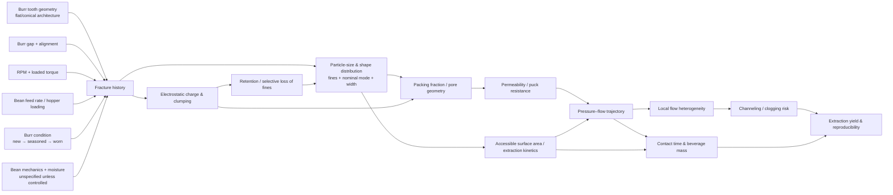

# The Causal Foundation of Espresso Extraction: Grinder and Burr Interactions

## Executive summary

Espresso grinder behavior is best understood as a **causal chain from mechanical fracture to porous-bed flow**, not as a collection of isolated specifications such as “flat,” “conical,” “64 mm,” or “800 rpm.” Burr tooth geometry, burr gap, feed trajectory, rotational speed, alignment, burr condition, bean mechanics, and electrostatics jointly determine a particle-size-and-shape distribution. That distribution then determines how densely the puck can pack, its connected pore network and specific surface area, its permeability, the rate at which solubles become accessible, and ultimately the pressure–flow–extraction trajectory of the shot. Recent X-ray microtomography work gives unusually strong support to this framework: permeability can be predicted from pore connectivity and particle-associated specific surface, and those properties vary systematically with grind size and packing. citeturn17search1turn18search15

The most important conclusions are these:

**Flat versus conical is a statistical tendency, not a physical law.** Jonathan Gagné's analysis of roughly 300 particle-size distributions from 24 grinders, measured on the same coffee with the same Camsizer X2 system, found conicals to be, on average, higher-fines and less uniform than flats, but with substantial overlap. Some flat grinders behaved more like nominally “conical-style” distributions than other flats, and vice versa. Burr tooth geometry and grinder-specific implementation appear more predictive than the flat/conical label alone. The dataset was observational across different grinders, so it cannot isolate geometry causally from alignment, feed rate, RPM, and tooth design. citeturn20view0

**The fraction of fines is more hydraulically important than the coarse-mode median alone.** Coffee PSDs are often bimodal, with a fines population around approximately 30–40 µm associated with cellular-scale fragments and a much coarser nominal population whose location depends on grinding conditions. In one laser-diffraction study, an espresso powder contained 29.21% of its measured volume below 100 µm while a filter powder contained 9.7%; their volume-weighted means were 308 and 673 µm, respectively. These numbers are not universal coffee constants, but they demonstrate why one statistic such as \(D_{50}\) cannot describe espresso behavior. citeturn17search7

**A wider PSD can produce *more* puck resistance even when its mean particle size is larger.** Vaca Guerra and colleagues experimentally compressed beds with different PSDs and found that less-uniform distributions packed to lower porosity under the same axial compression. Their espresso experiments showed that low permeability is therefore not exclusive to small mean particles: mean size, distribution width and compression interact. citeturn18search10turn18search5 This provides a mechanistic basis for the familiar observation that a high-fines/traditional burr can be dialed substantially coarser than a low-fines burr while producing similar shot flow.

**Low-fines/high-uniformity burrs do not simply make espresso “flow faster.”** At a fixed nominal median, they generally do; but espresso is normally redialed to a target hydraulic behavior. The low-fines grinder must consequently be set much finer overall. Gagné found exactly this across the 24-grinder dataset and in a more controlled Niche Zero versus EG-1/SSP ULF comparison. At the same 2 mL/s flow-controlled extraction, the ULF grinder had to operate much finer, and its puck resistance declined faster during the shot. Its measured extraction yield was also higher: 26.8 ± 0.2% versus 24.8 ± 0.1% using raw refractometer samples, or 24.1 ± 0.3% versus 22.7 ± 0.2% after VST filtration. The filtered difference was 1.3 ± 0.3 percentage points. This was a small, non-peer-reviewed experiment and cannot establish a universal quantitative advantage, but its direction agrees with the underlying surface-area mechanism. citeturn21view1turn22view4

**There is nevertheless a fine-grind limit.** Cameron et al.'s model predicts increasing extraction as particles become finer if flow remains homogeneous. Their actual espresso experiments instead showed a maximum: below a critical grind setting, further grinding reduced average extraction and increased variability. Their interpretation was the onset of nonuniform flow or local clogging/channeling. At 9 bar their finest settings could clog, and experimental work was therefore also performed at 6 bar. citeturn19search14turn19search11 A grinder that enables unusually fine nominal particles does not eliminate this hydraulic instability; it merely changes where it occurs.

**Burr diameter has no demonstrated independent “more uniform = bigger” law.** Gagné's dataset, containing most flat burrs between 50 and 70 mm plus one 83 mm flat, showed no systematic increase in uniformity or reduction of fines with diameter. Geometry was apparently more important. citeturn20view0 Diameter affects available cutting-path geometry and peripheral velocity, but RPM must be considered simultaneously: \(v=\pi DN/60\). An 80 mm E80S at its published 1,400–1,700 rpm has an unloaded circumference speed of roughly 5.9–7.1 m/s, whereas an 80 mm variable-speed Kafatek running 550 rpm is roughly 2.3 m/s. Identical diameter therefore does not imply remotely identical fracture dynamics. citeturn21view8turn21view9

**RPM has no universal sign.** Across Gagné's 24-grinder comparison there was no clear overall relationship between RPM and fines or uniformity; he observed that RPM effects are strongly burr- and grinder-specific and that feed rate can be equally or more important. citeturn20view0 Motor *type* is still further removed from extraction. There is no convincing controlled literature showing that BLDC versus a fixed-speed commercial motor directly causes a particular PSD. Motor architecture matters indirectly through loaded RPM, torque reserve, speed control, heat generation and the ability to feed beans reproducibly at difficult grind settings. Current grinders illustrate the engineering range: Kafatek specifies a BLDC drive adjustable from 22–800 rpm, while Mahlkönig's E80S specifies idle speeds of 1,400 rpm at 50 Hz and 1,700 rpm at 60 Hz. citeturn21view8turn21view9

**Alignment is a true first-order grinder variable; retention is a related but distinct problem.** Uman et al. explicitly noted the EK43's replaceable burrs and susceptibility to misalignment and provided a PSD example associated with alignment state. Gagné likewise identified unknown alignment as an important confounder in cross-grinder PSD comparisons. citeturn17search15turn20view0 Mechanically, tilt or eccentricity creates a circumferential distribution of local burr gaps instead of one gap, allowing different particles to experience different terminal fracture conditions. By contrast, direct experimental evidence that burr misalignment itself causes substantial retention is weak; retention is more directly driven by internal dead volume, chute geometry, electrostatic adhesion and clumping.

**Seasoning is real in at least some burr systems, but there is no universal kilogram count.** Gagné followed an EG-1/SSP ULF set over 24 lb of grinding, repeatedly testing a reference coffee. His image-derived Q-factor increased from 1.59 ± 0.02 before seasoning to 1.76 ± 0.02 afterward; the distribution initially shifted coarser and later narrowed. citeturn22view0turn21view2 Manufacturer guidance itself varies greatly: Kafatek currently says its pre-seasoned/coated Shuriken flats may need only 1–3 lb to smooth the coating, whereas Mazzer conicals in its grinders may require 5–10 lb and occasionally as much as 25 lb. Those are product-specific manufacturer observations, not transferable scientific constants. citeturn24search5

**Grind-by-weight and single dosing optimize different variables.** Grind-by-weight directly controls *delivered mass*; for example, Mahlkönig's E80S GbW continuously weighs the portafilter with a load cell and the manufacturer specifies dosing accuracy up to 0.1 g. citeturn24search0turn24search12 Single dosing directly controls *input identity and quantity* and can minimize exchange with older retained coffee if the grinder is designed for low retention, but input mass does not guarantee equal output mass. Gagné's 10 g full-hopper versus single-dose experiment found a detectable coarse-shifting “popcorning” effect in the last beans but a negligible effect on the composite PSD in that Baratza Forté/filter-grind experiment; he explicitly cautioned that the test was not conclusive for espresso. citeturn22view2turn22view3turn21view5

The resulting espresso principle is therefore:

> **Do not dial grinders to the same burr gap, median particle size, shot time, or nominal recipe and expect a valid comparison. Dial them to an explicitly chosen hydraulic condition, then examine what particle distribution was required to produce it.**

The central causal architecture can be summarized as follows:

This synthesis is supported mechanistically by compressed-bed experiments, laser-diffraction and imaging PSD work, espresso extraction experiments, electrostatic measurements, and recent X-ray microtomography/permeability modeling. citeturn18search10turn17search7turn19search14turn25search6turn17search1

## Evidence base, definitions, and measurement

The strongest evidence does **not** come from direct A/B tests of commercial grinders. Such experiments are surprisingly rare. The literature is much stronger on the intermediate links—particle size, porosity, permeability, extraction kinetics—than on whether one named burr architecture generates those intermediate states.

For this report, **“fines” means an operationally defined small-particle fraction, not a unique material class.** A cutoff of <100 µm is common in recent coffee PSD work and is the cutoff Gagné used for cross-grinder analysis, while the fines population itself often peaks much lower, around 30–40 µm. Mo et al. interpreted this scale as consistent with fragments related to the roasted bean's cellular microstructure. citeturn17search7turn20view0 Changing the cutoff changes the reported “fines percentage,” so a claim such as “10% fines” is incomplete without the measurement basis and cutoff.

Likewise, **“high-uniformity,” “unimodal,” “low-fines,” and “traditional espresso” are not standardized burr classifications.** Gagné uses *unimodality* principally to describe low fines at a matched median size, and *uniformity* to describe the width/large-particle tail of the nominal mode; he found the two properties positively associated in the 24-grinder dataset. citeturn20view0 In this report, *traditional/high-fines* means a burr system producing a substantial secondary fines population at espresso sizes, while *high-uniformity/low-fines* means a system deliberately minimizing that population and/or narrowing the coarse mode. Those labels describe the output distribution, not a guaranteed property of a burr's marketing name.

### What the measurement instrument actually measures

| Method | What is measured | Strengths | Important espresso limitations | Evidence |
|---|---|---|---|---|
| **Laser diffraction** | Optical scattering is inverted into an equivalent-size distribution, commonly reported on a volume basis. | Very large particle counts, fast acquisition, excellent for comparing repeatable samples on the *same* instrument. | Coffee spans an unusually broad size range; optical/model assumptions matter. Instrument, dispersion protocol and binning can alter the apparent PSD. Number-, surface- and volume-weighted results look radically different. | Uman et al. used a Beckman Coulter LS13 320 and emphasized the difficulty created by coffee spanning roughly three orders of magnitude. ISO 13320:2020 remains the current international laser-diffraction standard after review in 2025. citeturn17search15turn24search1 |
| **Dynamic image analysis** | Individual falling/dispersed particles are imaged and geometrical dimensions inferred directly. | Retains information about individual particles and potentially shape; avoids some optical inversion assumptions. | Detection limits, orientation, segmentation, dispersion and software corrections matter; results are not directly interchangeable with laser diffraction. | The 2026 permeability study used high-speed stereoscopic particle imaging; the ZHAW/Kaffeemacher dataset analyzed by Gagné used a Camsizer X2. citeturn18search15turn20view0 |
| **Sieving** | Mass retained/passed through calibrated aperture classes. | Direct, inexpensive, intuitive mass fractions; useful for process monitoring. | Poor resolution of the tens-of-microns fines peak unless very fine meshes and careful protocols are used; irregular particles pass according to orientation as well as size. | Griffiths et al. directly compared precision sieving and laser diffraction in a burr-wear study and found both useful for detecting changes in grinder PSD. citeturn21view7 |
| **Microscopy/image sampling** | 2-D projected particle area/diameter from photographs or microscopy. | Accessible and useful for controlled longitudinal studies. | Small sampling mass; agglomeration and particle overlap can bias segmentation; projected area is not equivalent to laser-diffraction diameter. | Gagné used repeated photographic samples for his seasoning and hopper/popcorning experiments. citeturn22view0turn22view2 |
| **X-ray micro-CT** | 3-D solid/pore architecture of a packed bed. | Directly interrogates the quantity that matters hydraulically: connected pore space and tortuous flow geometry. | Expensive, small imaged domains and substantial image-processing/modeling requirements; it is not a routine grinder PSD method. | Mo et al. and Wadsworth et al. coupled micro-CT to computational flow simulations. citeturn17search7turn17search1 |

A particularly instructive numerical example comes from Mo et al. Their laser-diffraction measurements gave an espresso powder a Sauter mean \(D[3,2]\) of **81.0 µm**, a volume-weighted \(D[4,3]\) of **308 µm**, and **29.21 vol% below 100 µm**. A drip-filter powder had corresponding values of **214 µm**, **673 µm**, and **9.7 vol% below 100 µm**. citeturn17search7 The huge difference between \(D[3,2]\) and \(D[4,3]\) in the same sample is not a contradiction: smaller particles dominate surface-area-weighted metrics while large particles dominate volume.

That distinction is fundamental to espresso. **Extraction kinetics scale more closely with accessible surface and diffusion length, whereas flow resistance depends on how all particle classes build the pore network.** A single “average grind size” therefore throws away both pieces of information.

Gagné's 24-grinder analysis also illustrates why comparisons made from manufacturer PSD plots can be misleading. His data used one 82-point natural Brazilian coffee, one Camsizer X2 system and many settings per grinder. He explicitly warns that different beans, different measurement machines, different binning and a single unmatched grind setting can create differences as large as—or larger than—the grinder effect one is trying to measure. citeturn20view0

The published espresso-kinetics experiment of Schmieder et al. reinforces the same point. Using a Mahlkönig E65S and laser diffraction, their three practical grind-level settings produced comparatively modest changes in measured mean particle size; their experimental design instead found **flow rate** to be the strongest of the manipulated process factors. They ran 20.00 ± 0.01 g doses, beverage ratios of approximately 1:1, 1:2 and 1:3, and controlled flows around 1, 2 and 3 mL/s. citeturn23search0turn23search5 This is a warning against assuming that a numerical move on a grinder's adjustment collar necessarily represents a large change in the physically relevant PSD.

**Evidence hierarchy used below.** Peer-reviewed mechanistic experiments and models are given greatest weight; Gagné's work is treated as unusually careful but non-peer-reviewed technical experimentation; manufacturer specifications are used primarily for engineering dimensions such as speed, tolerances and dosing technology, not as evidence of superior extraction.

**Unspecified variables.** Unless a cited experiment explicitly fixed them, coffee origin, species/cultivar, processing, roast degree/profile, post-roast age, bean temperature, internal moisture, ambient relative humidity, water chemistry, basket geometry, puck headspace, distribution technique, tamp force, group temperature and pressure/flow-control algorithm should be considered **unspecified**. They must not be inferred from grinder type. Uman et al. demonstrated that bean temperature alone can measurably change PSD, while Méndez Harper et al. showed that internal moisture and ambient/electrostatic conditions affect charge, aggregation and the apparent delivered PSD. citeturn17search15turn21view6turn25search6

## Burr geometry, particle formation, fines, and burr diameter

The phrase “flat burrs cut and conicals crush” is too crude to serve as a causal model. In both architectures, roasted coffee undergoes repeated compression, fracture, shear and collision. What differs is the **trajectory and sequence of fracture events** imposed by the teeth and the grinder's feeding system.

A flat burr generally receives beans toward the center and moves material outward across successive tooth zones before discharge. In a conical system the material follows a more axial/angled trajectory through the cone/ring interface. This difference also makes nominal diameter comparisons deceptive: as Gagné notes, a particle traversing a flat burr travels across a substantial radial distance, while material in a conical pair does not traverse half the stated diameter in the same way. citeturn20view0

At the microscopic level, roasted coffee's cell structure supplies a natural fracture scale. Mo et al. observed fines peaks around 30–40 µm and internal pore/cell dimensions on the order of 30–60 µm. citeturn17search7 It is therefore plausible that one source of the fines mode is fragmentation of cell-wall-scale structures rather than simply scaled-down versions of the large particles. This helps explain why the fines peak can move relatively little while the nominal peak moves substantially as grind setting changes.

Uman et al. directly showed that changing grinding conditions can alter not only the central tendency but the shape of the distribution. Their EK43 experiments used controlled burr configurations and laser diffraction, with the authors explicitly emphasizing that grind profiles depend on the grinding interface rather than a single nominal gap variable. citeturn17search15

### Flat versus conical: what the best comparative dataset actually says

Gagné's reanalysis of the ZHAW/Kaffeemacher dataset is currently one of the most useful large comparative datasets because it avoids the worst cross-study confounders. At a reference median particle size of **340 µm**, he fitted the fraction below 100 µm as a measure of fines tendency and separately quantified the large-particle side of the nominal peak. In that sample:

- conicals were **on average** higher-fines and less uniform;
- the categories overlapped substantially;
- unknown burr alignment could plausibly move individual grinders within the plot;
- RPM did not show a clear cross-grinder trend;
- burr diameter did not show a clear flat-burr trend;
- tooth geometry appeared more important than the simple flat/conical or diameter labels. citeturn20view0

Those findings should be treated as **observational evidence**, not a randomized geometry experiment. The conical grinders were not created by replacing a flat set in the same chassis while keeping motor speed, feed, alignment, diameter and cutting profile constant. A causal statement stronger than “the sampled conicals tended toward…” is not supported.

### Traditional high-fines versus high-uniformity/low-fines designs

This distinction has much greater causal relevance to espresso than flat versus conical.

At a matched nominal/coarse median:

**A high-fines grinder** creates many small particles capable of occupying voids among larger ones. The increased polydispersity can make the bed pack more densely, and the small particles dramatically increase specific surface. Both effects reduce permeability. Vaca Guerra et al. experimentally found lower bed porosity for less-uniform PSDs under equivalent axial compression, even when mean particle size was not smaller. citeturn18search10

**A low-fines grinder** has fewer such void-filling particles at the same median and therefore usually produces a more permeable puck. To reach the same espresso flow, the grinder must be moved to a smaller average particle size. Gagné found this relationship very clearly across the 24-grinder data: dialed-in espresso from low-fines grinders had much finer nominal/median particles than dialed-in espresso from high-fines grinders. Intriguingly, the final dialed-in low-fines pucks could even contain a slightly *higher* <100 µm fraction because they had been moved so far finer; Gagné calls this an “overshoot” and hypothesizes that compression/reconfiguration contributes. That explanation remains unproven. citeturn20view0

This resolves an apparent paradox:

\[
\text{“low-fines burr”} \not\Rightarrow \text{“few fines in the final dialed-in puck”}.
\]

It means **low fines at a matched median grind size**. Espresso changes the operating point.

The controlled-ish EG-1/SSP ULF versus Niche experiment then demonstrates the extraction consequence. Gagné used the same coffee and DE1 machine, a 30 s bloom, a 1:4 beverage ratio and 2 mL/s flow control. Both grinders peaked at roughly 5 bar after the bloom, but pressure for the ULF shots fell substantially faster as extraction progressed. citeturn21view0turn22view4 His interpretation was that the ULF burr's much finer average particle population released solubles more rapidly, changing both solid depletion and the viscosity of the liquid phase. That interpretation is plausible but was not independently instrumented at the pore scale.

The extraction-yield difference in that experiment was substantial, but it should not be converted into “ULF adds 1.3% EY” as a product specification. Only 11 dialed-in shots were involved, burr geometry, grinder chassis and motor system all differed, and Gagné himself reported several assumptions about slurry viscosity and resistance. citeturn21view1turn22view4

### Burr diameter: why size is not a causal variable by itself

For a flat burr with outside diameter \(D\) operating at \(N\) rpm, the no-load circumferential speed at the outer radius is

\[
v_{\mathrm{tip}}=\frac{\pi D N}{60}.
\]

Diameter therefore enters the fracture problem jointly with RPM.

As an engineering illustration, Mahlkönig publishes an 80 mm burr diameter and 1,400/1,700 rpm idle speeds for the E80S, corresponding to approximately **5.9/7.1 m/s** outer-edge speeds. Kafatek's current 80 mm flat platform is adjustable from 22–800 rpm; at 550 rpm the corresponding value is only about **2.3 m/s**. citeturn21view8turn21view9 These numbers do not measure actual particle impact speed, but they demonstrate why “80 mm” contains very little causal information by itself.

Gagné's empirical diameter analysis is correspondingly negative: among the available 50–70 mm flats and one 83 mm flat, bigger burrs did not systematically become more uniform or lower-fines. citeturn20view0 Larger diameter can give a designer more circumference, tooth area, throughput capability and freedom to stage fracture zones, but **whether that potential is used to increase uniformity, reduce fines or merely increase throughput depends on tooth design and operating speed**.

| Burr attribute | Most defensible causal interpretation | Expected PSD consequence | Evidence strength |
|---|---|---|---|
| Flat architecture | Changes radial feed path and available staged tooth geometry. | No universal PSD; sampled flats averaged lower-fines/more uniform than sampled conicals. | Moderate observational evidence. citeturn20view0 |
| Conical architecture | Changes axial/angled material path and interaction with gravity/feed loading. | Sampled conicals averaged higher-fines/broader, with large overlap. | Moderate observational evidence. citeturn20view0 |
| Traditional espresso teeth | Designed/operated such that substantial fines population is generated. | More pronounced secondary fines population; higher resistance at matched coarse median. | Strong mechanism; product-specific magnitude. citeturn17search7turn18search10 |
| Low-fines / HU / ULF teeth | Reduce fines generation and/or narrow nominal mode at matched median. | Lower initial resistance at matched median, forcing finer overall dial-in. | Strong comparative pattern; limited controlled burr-only trials. citeturn20view0turn21view1 |
| Larger diameter | Increases geometric design envelope and, at fixed RPM, peripheral speed. | No demonstrated monotonic relationship with fines or uniformity. | Negative observational evidence. citeturn20view0 |
| Finer burr gap | Increases required fracture before exit. | Generally shifts nominal population finer and often changes fines fraction, but not by a simple rigid translation. | Strong. citeturn20view0turn17search15 |

## RPM, motor behavior, alignment, tolerances, and retention

RPM is often discussed as though it were an independent coffee variable. Mechanically it is not. It acts through several intermediate quantities: contact velocity, collision energy, time available for particles to exit a cutting zone, bean feed behavior, centrifugal transport, thermal power and—if the motor is marginal—speed droop under load.

The cross-grinder evidence does **not** support “lower RPM always means fewer fines.” In Gagné's dataset, RPM showed no obvious overall relationship with his low-fines or uniformity metrics. He reports that changing RPM can have a strong effect on some grinder/burr combinations and nearly none beyond a shift in effective grind size on others. He also emphasizes that **feed rate** can materially alter PSD and should be controlled whenever RPM experiments are performed. citeturn20view0

This follows mechanically. A change from 800 to 400 rpm can simultaneously:

1. halve nominal cutting velocity;
2. alter how quickly particles are swept away from the interface;
3. change bean accumulation above the burr;
4. change motor load and possible speed droop;
5. change heat generation;
6. alter popcorning or feed intermittency.

An RPM experiment that does not measure actual **loaded RPM and mass feed per second** is therefore incompletely specified.

### Motor type

The available evidence supports a narrow conclusion: **motor type matters because it determines how the commanded mechanical state is achieved, not because a BLDC magnetic field somehow produces better coffee particles.**

Kafatek's current 80 mm platform, for example, specifies a brushless DC motor with real-time speed display and an adjustable 22–800 rpm range. Mahlkönig's E80S publishes fixed idle speeds of 1,400 rpm at 50 Hz and 1,700 rpm at 60 Hz together with active temperature management and 6–8 g/s nominal grinding capacity at a stated 250 µm condition. citeturn21view8turn21view9 These are different control philosophies, but there is no peer-reviewed experiment holding burrs, feed and loaded RPM constant while changing only BLDC versus another motor topology.

The causal variables worth recording are therefore **actual RPM under load, torque reserve, transient speed regulation, throughput and grinding temperature**, not the motor label by itself.

### Alignment and manufacturing tolerances

Alignment changes the physical meaning of “burr gap.”

For perfectly parallel flat burrs, an idealized terminal gap can be written

\[
g(\theta)\approx g_0.
\]

With angular tilt or carrier runout,

\[
g(\theta)=g_0+\delta g(\theta),
\]

so particles approaching different azimuthal regions encounter different minimum openings. The grinder then behaves as though multiple grind settings exist simultaneously. The expected causal outcomes are a broader nominal distribution, increased tails and potentially changed fines production.

Uman et al. specifically noted that the EK43's replaceable burrs were susceptible to misalignment and included a supplementary PSD example illustrating the issue. citeturn17search15 Gagné likewise warns that unknown alignment may partly explain the grinder-to-grinder spread in his 24-grinder data. citeturn20view0

Modern manufacturer tolerances illustrate the scale involved. Kafatek states that relevant grinder components are CMM-inspected to **10 µm or less, ±0.005 mm**, and explicitly links its bearing/carrier construction to alignment. citeturn21view9 That is a manufacturer specification, not evidence that 10 µm is a universal required tolerance. It does, however, show that mechanical errors are of a scale comparable to meaningful changes in an espresso grinding interface.

A critical distinction is necessary: **alignment → PSD has direct evidence; alignment → retention does not have equivalently good isolated evidence.** Poor concentricity or rubbing can certainly create abnormal mechanical conditions, but normal retention is much more directly attributable to chamber voids, chute surfaces, electrostatic adhesion and clump formation.

### Static turns retention into a particle-selection mechanism

Retention is not merely missing mass. It can be **compositionally selective**.

Méndez Harper and colleagues showed experimentally that grinding generates charge through both fracture and contact electrification. Charge magnitude depends on grind conditions and coffee moisture, and fines can adhere to other particles or grinder surfaces. citeturn25search6turn25search4 Consequently, the PSD measured in the catch cup can differ from the PSD physically created at the burrs.

Their follow-on charge-mitigation work is particularly revealing. Adding small amounts of water before grinding reduced charging, released fines that would otherwise remain in the grinder or aggregates, and shifted the *delivered* PSD toward smaller sizes. With all other conditions fixed, the changed delivered distribution produced at least a 15% increase in beverage concentration in the darker-roast espresso condition studied. citeturn25search15turn25search19 The exact magnitude should not be generalized to other coffees or grinders, but the mechanism matters greatly:

\[
\text{burr-generated PSD}
\neq
\text{delivered PSD}
\]

whenever retention is particle-size selective.

This also means that a “low-retention” grinder potentially improves more than dose recovery: it can reduce unpredictable sample-to-sample changes in PSD caused by selective carryover. Manufacturer claims should nevertheless be treated cautiously. Kafatek, for example, specifies less than 0.5 g internal retention without water treatment and approximately zero under its stated RDT conditions, explicitly noting dependence on bean and environmental moisture. citeturn21view9 That is useful engineering information but not an independent comparative experiment.

### Practical implications of mechanics

| Observation | Causal implication | What to do with espresso parameters |
|---|---|---|
| Changing RPM changes flow at the same dial position | The PSD and/or effective median has shifted. | **Redial grind first.** Do not preserve shot time by changing dose or pressure until the new grind's hydraulic behavior is characterized. Gagné's cross-grinder data shows no universal RPM correction factor. citeturn20view0 |
| Grinder slows audibly at very fine settings | Loaded RPM/feed regime is no longer the intended regime. | Treat the setting as mechanically unstable rather than merely “very fine.” Coarsening or reducing feed load is preferable to compensating with increased pressure. |
| Shot-to-shot flow oscillates despite constant dose | Alignment, feed, retained/exchanged grounds, clumping or puck prep may be changing the effective PSD/packing. | Recipe adjustment cannot repair a mechanical distribution problem; establish alignment, output mass and retention stability first. citeturn17search15turn25search15 |
| Grinder warms substantially in sustained use | Burr/bean interface temperature and possibly material mechanics have changed. | Recheck grind needed for target flow rather than assuming the original dial number remains physically equivalent. Uman et al. observed PSD sensitivity to grinding temperature conditions. citeturn17search15 |

## Seasoning, wear, grind-by-weight, and single dosing

“Seasoning” is often discussed as though burrs improve monotonically until they become “broken in.” The evidence supports a more nuanced life cycle:

The early and late phases should not be conflated. Seasoning can remove or modify microscopic edge asperities and coating irregularities; prolonged wear can later degrade the intended geometry.

### Gagné's seasoning experiment

Gagné's 2019 EG-1/SSP ULF experiment is the most quantitative publicly documented longitudinal seasoning study relevant to enthusiast espresso burrs. He ground a total of **24 lb** through the burrs, taking approximately 10 g samples of the same washed Burundi reference coffee every two pounds while the seasoning coffee itself consisted of mixed roast batches. His initial seasoning conditions were 700 rpm, later changed as needed because of motor loading; this is an important confounder he documents rather than hides. citeturn22view0

He observed two stages. The PSD first moved toward larger particles at the unchanged reference setting; later it became narrower. His image-analysis Q-factor—the mean projected particle area divided by its standard deviation—increased from **1.59 ± 0.02 before seasoning to 1.76 ± 0.02 after seasoning**. citeturn21view2

The experiment also demonstrates why longitudinal grinder studies are difficult. Twenty-three days later the reference coffee itself produced a finer, broader distribution; Gagné suspected aging/drying of the coffee rather than reversal of burr seasoning. citeturn22view1 Whether that particular mechanistic explanation was correct or not, the confounding observation is decisive: a “before/after” seasoning trial that uses coffee of different age is not necessarily measuring the burrs alone.

The correct generalization is therefore **not** “all burrs need 24 lb.” Kafatek's current product-specific guidance illustrates the range: its pre-seasoned Shuriken burrs are said to need only about **1–3 lb** if additional coating smoothing is desired, while Mazzer conical sets in its grinders are described as needing **5–10 lb**, sometimes as much as **25 lb** for particular coated sets. citeturn24search5

Longer-term wear is also experimentally observable. Griffiths et al. used both precision sieving and laser diffraction to monitor grind-on-demand burr condition and concluded that burr damage/wear altered the precision of the PSD sufficiently to support condition monitoring and replacement decisions. citeturn21view7 Thus:

\[
\text{fresh} \rightarrow \text{seasoned/stable} \rightarrow \text{worn}
\]

is a more plausible model than “more kilograms always makes a burr better.”

**Practical implication:** during early break-in, hold dose, basket, pressure/flow program and reference coffee as constant as possible and monitor the grind position needed to hit a fixed hydraulic endpoint. A drifting grind requirement is expected for some burrs. Do not change three espresso variables simultaneously and then attribute the result to seasoning.

### Single dosing versus a loaded hopper

A hopper supplies **bean head pressure/feed continuity**. Near the end of a single dose, the last beans no longer have other beans pressing them into the burrs and can intermittently bounce or “popcorn.” Mechanistically that can change residence time and allow those last beans to leave through a larger effective opening.

Gagné directly tested this with three 10 g samples on a Baratza Forté BG: one with a full hopper, one as a normal single dose, and one fed bean-by-bean. He collected 12 image samples per condition. citeturn22view2 The last-bean effect was detectable, but the composite difference between full-hopper and single-dose PSD was tiny relative to differences between grinders. His conclusion was that the affected fraction of a realistic dose was small. citeturn22view3

There are two major limitations. It was a **single grinder** and a **filter-grind experiment**; Gagné explicitly stated that static makes the espresso case harder and that the experiment was not conclusive for espresso. citeturn21view5 A grinder with a different auger, prebreaker, conical feed path or intentionally slowed feeding could behave differently.

Thus, there is no strong basis for saying that hopper grinding inherently produces a superior espresso PSD. Feed mechanism matters more than whether the consumer calls the workflow “single dosing.”

### Grind-by-weight versus single dosing

These workflows control different sources of variance:

| Property | Grind-by-weight from hopper | Single dose |
|---|---|---|
| **Delivered dose mass** | Directly controlled when the scale measures output during grinding. Mahlkönig specifies real-time load-cell control and up to 0.1 g dosing accuracy on the E80S GbW. citeturn24search0turn24search12 | Controlled indirectly through input mass; output can differ by retained/exchanged mass. |
| **Feed loading** | Generally steady while hopper contains substantial beans. | Can change near the final beans; magnitude is grinder-dependent. Gagné found a negligible composite effect in his Forté experiment. citeturn22view2turn22view3 |
| **Exchange with prior grounds** | Possible wherever the grinder retains material internally. GBW corrects total delivered *weight*, not necessarily the age/composition of that weight. | Potentially minimized in a genuinely low-exchange design. |
| **PSD consistency** | No inherent advantage merely from weighing output. | No inherent advantage merely from preweighing input. Burrs and feeding determine PSD. |
| **Coffee switching** | Hopper inventory makes rapid switching intrinsically difficult. | Well suited to complete dose-to-dose coffee changes. |
| **Retention sensitivity** | A load cell can mask net mass loss by grinding additional coffee, but cannot tell whether 0.2 g of the delivered dose is exchanged retained grounds. | Input-output weighing can expose net retention, although it still cannot quantify exchange without tracer methods. |
| **Reason to expect different brew ratio** | None from dosing mode alone. | None from dosing mode alone. Any ratio change should follow a demonstrated PSD/hydraulic change, not the workflow label. |

The important distinction is between **total retention**—how much material remains in the grinder—and **exchange retention**—how much prior material exits while an approximately equal amount of the new dose remains behind. A grinder can show nearly equal input and output while still exchanging old and new grounds. The electrostatic work demonstrates why such exchange may also be particle-size selective. citeturn25search15turn25search19

## From grinder PSD to puck resistance, channeling, and extraction

The most rigorous way to connect burrs to espresso is through porous-media physics.

For a simplified saturated porous bed, Darcy-like behavior gives the conceptual relationship

\[
Q \propto \frac{kA\Delta P}{\mu L},
\]

where \(Q\) is flow, \(k\) permeability, \(A\) basket cross-sectional area, \(\Delta P\) pressure drop, \(\mu\) liquid viscosity, and \(L\) puck depth.

The important grinder variable is not directly \(Q\); it is **\(k\)**.

Wadsworth et al.'s 2026 study—coauthored by Gagné—provides the strongest recent microscopic validation. The researchers examined two roasted coffees over **11 grind settings**, used X-ray computed microtomography to reconstruct packed beds, and calculated flow with lattice-Boltzmann simulations. Their permeability model depends principally on connected porosity and specific surface area, and showed excellent agreement with the reconstructed beds. citeturn17search1turn18search15

This puts several grinder phenomena on one causal footing.

### Why fines create disproportionate resistance

For a given mass, smaller particles create far more surface area. They also fit into larger interparticle voids. Thus fines simultaneously increase solid–fluid surface and reduce effective pore dimensions. Vaca Guerra et al.'s compression work confirms experimentally that a wider particle distribution can reach lower porosity than a narrower one under the same compression. citeturn18search10

Consequently, two pucks can have the same \(D_{50}\) and very different permeability.

Conversely, two grinders can produce similar permeability while having wildly different \(D_{50}\), because the high-fines grinder is operated coarser and the low-fines grinder finer. That is precisely what Gagné saw at espresso dial-in. citeturn20view0

### Why grinding finer eventually becomes counterproductive

If water remained spatially uniform, increasing surface area by grinding finer should monotonically increase extraction. Cameron et al. built a model with essentially this prediction. Their experimental data did **not** behave monotonically: extraction yield rose as grind became finer, reached a maximum, and then declined at the finest settings while variability increased. citeturn19search14

The causal interpretation is a feedback instability.

Suppose one small region begins slightly more permeable than another. It receives more flow. The lower-flow region is more susceptible to local obstruction, while extraction, swelling, fines movement and changing viscosity can further alter the resistance contrast. Eventually most water bypasses part of the bed. The measured whole-puck extraction can therefore fall even though every individual coffee particle *would* have extracted faster under uniform flow.

This is why “finer = more extraction” is conditionally true only above the grinder–puck system's **critical instability threshold**.

Cameron et al. found that very fine conditions could clog at 9 bar and used 6 bar to access parts of the experimental space. In their cafe demonstration, they also showed that a 20 g recipe could be replaced, within that particular setup and extraction objective, by **15 g ground much coarser**, with highly reproducible shots that could run in under 15 s. citeturn19search5turn19search8 The scientific lesson is not “15 g/15 s is the best recipe”; it is that **shot time is an outcome of dose, permeability and pressure, not an independent quality variable**.

### Dose and puck depth

At fixed basket diameter and approximately comparable packing fraction, increasing dose increases puck depth \(L\). The 2026 permeability analysis specifically identifies dose as a major determinant of puck thickness and therefore of hydraulic response. citeturn17search1

This produces a powerful grinder–dose interaction:

\[
\text{higher dose}
\rightarrow
\text{deeper puck}
\rightarrow
\text{higher hydraulic resistance}
\]

so a higher dose can be paired with a somewhat coarser grind to preserve flow, while a lower dose can be ground finer before reaching the same resistance.

This means comparisons of burrs made at fixed shot time but **different doses** confound burr PSD with bed depth.

### Brew ratio and extraction kinetics

Brew ratio is downstream of both permeability and particle accessibility.

Schmieder et al. directly studied approximately **1:1, 1:2 and 1:3** ratios with 20 g pucks while manipulating flow from approximately **1–3 mL/s**. Flow rate was the strongest of their process factors for the masses of several extracted compounds, and the time-dependent concentration of the exiting liquid fell over the course of extraction. citeturn23search0turn23search5

A low-fines burr that must be ground to a much smaller nominal size for equal resistance exposes more coffee area and shortens characteristic diffusion distances. It can therefore reach a given average extraction with less beverage water than a high-fines grinder whose nominal particles are much larger.

Gagné's ULF/Niche experiment supports this direction: despite using a long 1:4 comparison ratio that should reduce differences, ULF extraction remained materially higher. He further reported that approximately 1:2.3 ULF shots in his observations could exceed the extraction of approximately 1:3 Niche shots. citeturn21view1turn22view5 The latter comparison was observational rather than a randomized ratio experiment, so it establishes a plausible **direction**, not a universal ratio conversion.

Thus the defensible statement is:

> **A grinder producing lower fines at matched median often makes shorter brew ratios *feasible at a given extraction target* because espresso dial-in forces its overall particle population finer.**

It is not defensible to say “HU burrs require 1:2” or “conicals require 1:3.”

### Pressure and flow

Pressure should likewise be understood as a control input to the porous bed, not a cure for inadequate grind quality.

Wadsworth et al. frame espresso as a pressure-driven packed-bed system extending to roughly 9–10 bar pressure gradients, with permeability and bed thickness determining the resulting flow. citeturn18search15 Cameron's model predicts that, under homogeneous conditions, reducing pressure can lengthen contact and increase extraction, while their experiments also showed that sufficiently fine coffee could clog at 9 bar. citeturn19search11

Gagné's flow-controlled ULF/Niche comparison gives another useful perspective. Rather than fixing pressure, he fixed shower-head flow at 2 mL/s; pressure rose to roughly 5 bar and then declined as puck resistance changed. The ULF pressure declined faster. citeturn22view4 In that experimental design, the **pressure curve became a measurement of evolving puck resistance** rather than a prescribed target.

This is analytically preferable when comparing burrs: a fixed-flow shot reveals how much pressure each puck requires over time.

### Channeling risk is not simply “more fines” or “fewer fines”

There are at least two competing mechanisms.

A high-fines distribution creates low permeability and greater potential for local fines accumulation or clogging. A low-fines distribution has fewer pore-blocking particles at a matched coarse median, which can make flow easier and perhaps less sensitive to isolated fines—but espresso dial-in then pushes the entire distribution finer, which again reduces pore size and can place the puck close to the critical instability regime identified by Cameron et al. citeturn19search14turn20view0

Therefore neither “high fines always channels more” nor “uniform burrs cannot channel” is supported.

The more defensible risk criterion is:

\[
\boxed{
\text{Channeling risk rises when the required operating permeability becomes
spatially unstable}
}
\]

and grinder PSD determines how close the puck is to that regime.

## Espresso implications and comparative synthesis

The table below translates the evidence into parameter consequences without assuming coffee origin, elevation, processing or tasting notes. All such variables remain unspecified unless separately measured.

| Grinder / burr condition | Causal PSD and hydraulic consequence | Grind setting | Dose | Brew ratio | Time / flow | Pressure | Principal limitation |
|---|---|---|---|---|---|---|---|
| **Traditional / higher-fines burr** | More fines create resistance at a relatively coarse nominal particle size. Broader PSD can pack densely. citeturn18search10turn20view0 | Typically **coarser** than low-fines burr for the same basket/dose/flow. | No inherent requirement; increasing dose further raises resistance. | May require **more beverage water for the same average EY** because nominal particles remain larger; magnitude is grinder-specific. | Same target flow can occur at a coarser median. Time is therefore not directly comparable across burr classes. | Increasing pressure is not an appropriate substitute for coarsening if puck is near clogging. | Fines amount, not “traditional” label, is causal. |
| **Low-fines / HU / ULF burr** | Lower resistance at matched median forces much finer overall grind at espresso dial-in; accessible surface increases. citeturn20view0turn21view1 | **Finer**, often substantially, for equal flow. | Lowering dose can provide hydraulic margin if an extremely fine setting becomes unstable. | A **shorter ratio may achieve the same EY** because extraction kinetics are faster; Gagné's result supports direction, not a fixed conversion. citeturn21view1turn22view5 | Can show faster decline in puck resistance during flow-controlled shots. | Flow control or reduced pressure can be diagnostically useful if a very fine puck chokes at conventional pressure. | Ultra-fine operation can still cross the inhomogeneous-flow threshold. citeturn19search14 |
| **Larger burr diameter, otherwise unknown** | No predictable PSD change from diameter alone. | No generic correction. | None. | None. | Evaluate actual PSD/flow; diameter and RPM jointly set mechanical velocity. | None from diameter alone. | Gagné found no monotonic size–uniformity relationship in his sample. citeturn20view0 |
| **RPM changed on same grinder** | May shift median, fines, feed dynamics or only effective grind size depending on burr design. | **Redial empirically.** | Keep fixed during characterization. | Keep fixed until hydraulic effect is known. | Compare at fixed output flow or pressure, not merely identical dial position. | Keep fixed during initial comparison. | Cross-grinder data show no universal RPM sign. citeturn20view0 |
| **Misaligned burrs** | Circumferentially varying gap broadens the effective fracture conditions. citeturn17search15 | Recipe compensation is secondary; fix mechanical condition. | Do not use dose to mask alignment problems. | No principled compensation. | Often poorer reproducibility is the diagnostic concern. | Higher pressure may amplify consequences of heterogeneous permeability rather than repair them. | Quantitative alignment-to-EY literature remains thin. |
| **Fresh/unseasoned burr** | Effective PSD and grind position may drift as surfaces break in. Gagné observed a coarser shift followed by narrowing in one ULF set. citeturn22view0turn21view2 | Expect **redialing over time**. | Hold constant for monitoring. | Hold constant for monitoring. | Track flow/shot mass as a process-control metric. | Hold constant for monitoring. | Break-in amount is burr/coating-specific, not universal. citeturn24search5 |
| **Worn burr** | PSD precision can change with wear. citeturn21view7 | Increasingly frequent redialing may mask underlying wear. | Not a genuine fix. | Not a genuine fix. | Trend analysis is more useful than one shot. | Not a genuine fix. | Wear state and coffee aging are easily confounded. |
| **GBW hopper grinder** | Directly stabilizes output dose; does not inherently stabilize PSD or eliminate exchange retention. citeturn24search0 | Independent issue. | **Strong control of delivered mass** is the major benefit. | No intrinsic change. | Lower dose variation should reduce a source of hydraulic variance. | No intrinsic change. | Manufacturer accuracy claims do not quantify exchange retention. |
| **Single-dose grinder** | Reduces inventory/exchange potential if internal retention is low; last-bean feed effects are possible but may be small. citeturn22view3 | Independent issue unless feed changes PSD appreciably. | Input mass precisely controlled; output should still be checked. | No intrinsic change. | Flow consistency depends on retention/static/feed design. | No intrinsic change. | Gagné's direct popcorning test was filter-focused, not conclusive for espresso. citeturn21view5 |

The quantitative parameter ranges that actually appear in the cited experiments provide a more defensible envelope than traditional recipe folklore:

| Variable | Experimentally represented range or point | Interpretation |
|---|---:|---|
| **Dose** | 15–20 g in Cameron's optimization comparison; 20.00 ± 0.01 g in Schmieder et al.; 18 g nominal basket in Gagné's comparison. citeturn19search8turn23search0turn21view0 | There is no grinder-independent ideal dose. Dose alters puck depth and hence resistance. |
| **Brew ratio** | 1:1, 1:2, 1:3 in Schmieder; 1:4 deliberately used by Gagné for ULF/Niche comparison. citeturn23search0turn21view0 | Ratios across this broad range have been useful experimentally; burr PSD changes the extraction reached at each ratio. |
| **Flow** | Approximately 1, 2 and 3 mL/s in Schmieder; 2 mL/s in Gagné's flow-controlled comparison. citeturn23search5turn22view4 | Flow is often a cleaner comparative control variable than shot time. |
| **Pressure** | 9 bar caused clogging at Cameron's finest conditions, motivating 6 bar operation; Gagné's 2 mL/s shots peaked near ~5 bar rather than imposing 9 bar. citeturn19search11turn22view4 | Required pressure is a property of the puck at the specified flow; 9 bar should not be treated as an invariant grinder benchmark. |
| **Shot time** | Cameron's lower-dose/coarser protocol could produce shots under 15 s; conventional-looking longer times were not a prerequisite for reproducibility in their system. citeturn19search5turn19search8 | Time is primarily a dependent variable once dose, ratio, permeability and pressure/flow are chosen. |
| **Fines definition** | <100 µm operational cutoff in Gagné and Mo et al.; fines mode approximately 30–40 µm in Mo et al. citeturn20view0turn17search7 | Always state both cutoff and measurement method. |

The most defensible experimental procedure for comparing grinders therefore reverses the usual workflow.

Rather than setting **18 g → 36 g → 9 bar → 30 s** on both grinders and asking which one “extracts better,” hold the basket geometry, dry dose, water, temperature and puck preparation constant; choose either a fixed pressure profile and measure flow, or preferably a fixed flow profile and measure required pressure; generate PSDs across several grind settings; and locate the finest reproducible operating region before the extraction-yield downturn or flow instability appears. Cameron et al.'s maximum-EY phenomenon shows why locating this boundary is more informative than forcing both grinders into an arbitrary time window. citeturn19search14

Extraction yield can then be treated through the ordinary mass balance

\[
EY \approx
\frac{m_{\mathrm{beverage}}\times TDS}{m_{\mathrm{dry\ coffee}}},
\]

with the important caveat demonstrated by Gagné: refractometer readings can be affected by suspended particles and oils, which is why his filtered and unfiltered measurements produced different absolute EY differences. citeturn21view1

The deepest conclusion from the literature is that **a grinder does not possess a single “espresso extraction quality.”** It establishes a family of PSDs as burr gap, RPM, feed and burr state change. The espresso machine then converts one member of that family into a compressed porous medium. The correct causal object is therefore:

\[
\boxed{
\text{grinder state}
\rightarrow
\text{PSD + shape + charge}
\rightarrow
\text{packing}
\rightarrow
\text{permeability}
\rightarrow
\text{pressure/flow field}
\rightarrow
\text{mass-transfer field}
}
\]

Within that framework, several popular heuristics become much more precise.

“**Conicals make more fines**” becomes: *in Gagné's controlled-measurement multi-grinder sample, conicals averaged higher-fines and broader distributions, but geometry classes overlapped and alignment/feed/RPM were not isolated.* citeturn20view0

“**Big burrs are more uniform**” becomes: *there is no demonstrated monotonic relationship in the available multi-grinder dataset; diameter is an engineering opportunity, while tooth geometry and speed determine how it is used.* citeturn20view0

“**Slow RPM reduces fines**” becomes: *sometimes, for particular burr/feed systems; no cross-grinder universal relationship has been demonstrated.* citeturn20view0

“**Low-fines burrs flow faster**” becomes: *at matched nominal particle size, generally yes because the bed is more permeable; at espresso dial-in, however, they are moved much finer until comparable resistance is restored.* citeturn18search10turn20view0

“**Uniform burrs allow higher extraction**” becomes: *they can permit a finer nominal particle population at usable permeability and therefore faster extraction, as Gagné's experiment suggests, but excessively fine operation still encounters the same instability/channeling boundary demonstrated by Cameron et al.* citeturn21view1turn19search14

“**Seasoning takes X pounds**” becomes: *early PSD drift has been measured, but the required mass depends strongly on burr machining, coating and prior manufacturer treatment; documented guidance spans approximately 1–25 lb depending on the specific product.* citeturn22view0turn24search5

And “**GBW is more consistent than single dosing**” becomes: *GBW more directly stabilizes delivered dose mass; single dosing more directly isolates individual input doses and can reduce exchange in a low-retention architecture. Neither workflow inherently determines PSD quality, and neither eliminates retention physics.* citeturn24search0turn22view3turn25search15

The strongest research gap is now clear. Coffee science has increasingly good models of **PSD → pore structure → permeability → extraction**, culminating in the 2026 X-ray micro-CT work, but still lacks systematic factorial experiments in which **burr geometry, diameter, alignment, RPM and feed rate are independently varied while everything else remains fixed**. citeturn17search1 Until such data exist, burr labels and grinder specifications should be treated as causes only insofar as they demonstrably alter the intermediate physical quantities—particle distribution, packing, permeability and extraction kinetics—that the primary literature shows actually govern espresso.